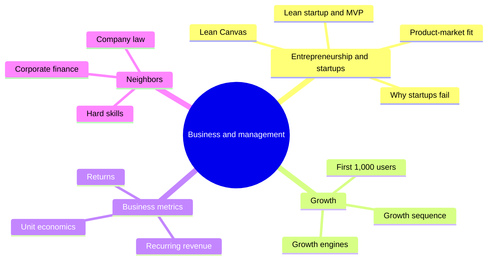

# Business and management

Creating, running and growing organizations. This field belongs to [Applied sciences](../README.md). It starts with how new businesses are founded and tested (entrepreneurship and startups), how consumer products find their first users and then grow (growth), and how a business measures its health (business metrics). Investment decisions and valuation (DCF, WACC, NPV, IRR, EBITDA, free cash flow) live in [corporate finance](../finance-and-investing/corporate-finance/README.md), and the legal form of a Polish company in [company law](../../social-sciences/law/company-law/README.md).

Skills used in business, such as copywriting, sales and e-commerce, have their home in [hard skills](../../personal-development/skills/hard-skills/README.md), because they are learned and practiced as skills. The notes here link to them instead of repeating them.

## Map of the field

The map shows the three written subfields and the neighboring fields they rely on.

## Reading order

1. [Entrepreneurship and startups](entrepreneurship-and-startups/README.md): the lean startup method, the MVP, the Lean Canvas, pirate metrics, product-market fit, why startups fail, the founding team, building a first product and practical lessons.
2. [Growth](growth/README.md): how consumer products move from an insight to a niche, a hook, the first 1,000 users, retention and a growth engine.
3. [Business metrics](business-metrics/README.md): MRR, ARR, ARPU, ARPA, churn, net revenue retention, CAC, LTV, payback, ROI, ROAS and SROI.

## Planned topics

- Strategy
- Operations
- Leadership and management
- Marketing and copywriting (see [copywriting](../../personal-development/skills/hard-skills/copywriting/README.md) and [content marketing](../../personal-development/skills/hard-skills/content-marketing/README.md))
- Sales and client acquisition (see [client acquisition](../../personal-development/skills/hard-skills/client-acquisition/README.md))
- E-commerce (see [e-commerce](../../personal-development/skills/hard-skills/e-commerce/README.md))

## Navigation

- Back to [Applied sciences](../README.md).
