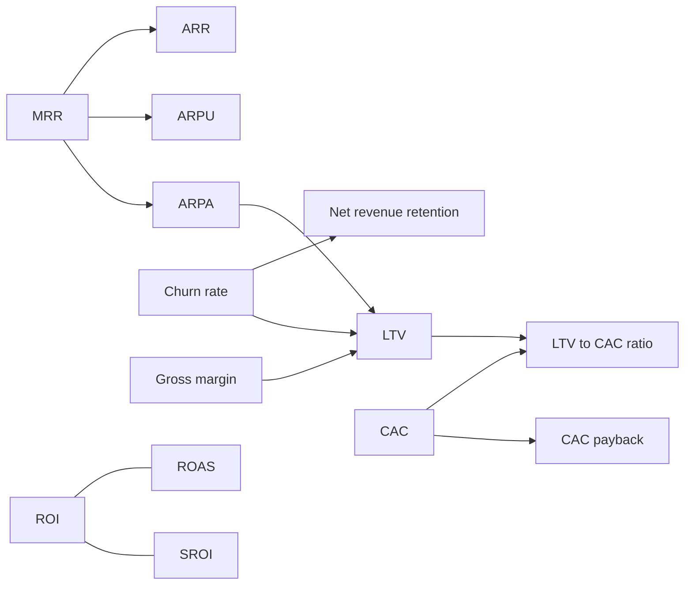

# Business metrics

The numbers that show whether a business, especially a subscription business, is healthy and growing efficiently. This subfield belongs to [Business and management](../README.md). The notes cover three groups: recurring revenue (MRR, ARR), unit economics per customer (ARPU, ARPA, churn, net revenue retention, CAC, payback, LTV and the LTV to CAC ratio) and returns on spending (ROI, ROAS, SROI). Company-level financial measures such as EBITDA, OpEx, CapEx and free cash flow are in [corporate finance](../../finance-and-investing/corporate-finance/README.md), and metrics specific to online shops in [E-commerce metrics](../../../personal-development/skills/hard-skills/e-commerce/e-commerce-metrics.md).

## Map of the subfield

The diagram shows how the metrics feed each other. Lifetime value depends on revenue per account, margin and churn, and the LTV to CAC ratio compares it with the cost of winning the customer.

## Notes in reading order

**Recurring revenue**

1. [Monthly recurring revenue (MRR)](monthly-recurring-revenue.md): definition, two ways to calculate, the five components and net MRR growth.
2. [Annual recurring revenue (ARR)](annual-recurring-revenue.md): normalization of contracts, the ARR bridge and valuation multiples.

**Unit economics**

3. [Average revenue per user (ARPU)](arpu.md): revenue per paying customer and what it says about pricing power.
4. [Average revenue per account (ARPA)](arpa.md): revenue per company or household, land and expand.
5. [Churn rate](churn-rate.md): customer and revenue churn, types of churn and why churn drives lifetime value.
6. [Net revenue retention](net-revenue-retention.md): expansion versus losses and negative net churn.
7. [Customer acquisition cost (CAC)](customer-acquisition-cost.md): fully loaded cost of winning a customer, blended, paid and organic.
8. [CAC payback period](cac-payback-period.md): months until a customer pays back its acquisition cost.
9. [Customer lifetime value (LTV)](customer-lifetime-value.md): revenue and margin versions and the three levers.
10. [LTV to CAC ratio](ltv-to-cac-ratio.md): the 3:1 benchmark and how to read it.

**Returns**

11. [Return on investment (ROI)](return-on-investment.md): profit per unit of cost, annualized ROI and opportunity cost.
12. [Return on ad spend (ROAS)](return-on-ad-spend.md): revenue per unit of ad spend and break-even ROAS.
13. [Social return on investment (SROI)](social-return-on-investment.md): valuing social and environmental outcomes, the principles and the risk of over-claiming.

## How to use this subfield

Read notes 1 and 3 to 5 first: they define the inputs of almost everything else. Then calculate CAC, payback and LTV for your own business (notes 7 to 10) from real data, segmented by plan or channel. Use ROI and ROAS (notes 11 and 12) for decisions on individual projects and campaigns. Growth strategy built on these numbers is in [growth](../growth/README.md).

## Navigation

- Back to [Business and management](../README.md).
