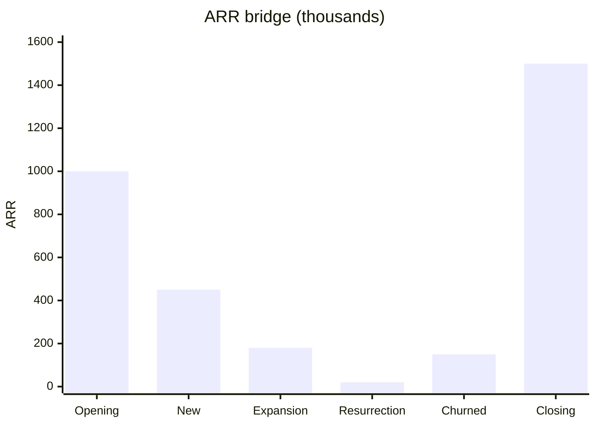

# Annual recurring revenue (ARR)

## Summary

Annual recurring revenue (ARR) is the value of a company's recurring subscription revenue normalized to one year. While MRR tracks the business month to month, ARR is the long-term measure of scale and the basis on which software companies are often valued, as a multiple of ARR. It is calculated by multiplying MRR by 12 or by summing the annualized value of every active contract. An ARR bridge explains its change through new, expansion, resurrected and churned ARR.

## Prerequisites

- [Monthly recurring revenue (MRR)](monthly-recurring-revenue.md)

## Core concepts

### Definition

*Annual recurring revenue* (ARR) is the annualized value of the recurring components of active term subscriptions. It is a run rate: what the current customer base would pay over the next twelve months if nothing changed. It excludes one-time items and counts a contract only once the service is live and billing has started. A signed contract that has not started is a *booking*, not ARR.

### Analogy

ARR is like a landlord's annual rent roll: the total yearly rent from all current tenants. It describes the size of the business today, not what was collected last year. The analogy breaks because tenants usually sign longer leases than many software customers, so a software rent roll changes faster.

### Mechanism

**Two ways to calculate.**

```text
Method A (MRR multiplication):   ARR = MRR x 12
Method B (annual contract sum):  ARR = sum of the annualized value of every active contract
```

**Normalization.** A three-year contract for 30,000 adds 10,000 to ARR. Multi-year deals are always broken down to their twelve-month value.

**The ARR bridge.** To explain why ARR moved, for example from 1.0 to 1.5 million over a year, split the change into four categories:

| Component | Definition | Business signal |
| --- | --- | --- |
| New ARR | Revenue from customers who joined this year | Sales and marketing efficiency |
| Expansion ARR | Increased spending by existing customers | Product value and account management |
| Resurrection ARR | Revenue from former customers who returned | Brand strength and win-back success |
| Churned ARR | Revenue lost from customers who canceled (and from downgrades) | Customer satisfaction and product gaps |

**ARR and MRR.** Use MRR for operations: product and marketing teams track monthly experiments, seasonal dips and burn. Use ARR for strategy and valuation: it smooths out the difference between 28-day and 31-day months and shows the scale of the company.

**Valuation multiples.** Investors and buyers often value software companies at a multiple of ARR. If the relevant multiple is 6x and ARR is 2 million, the indicative value is about 12 million, and every extra unit of ARR adds about six units of value. Multiples vary widely with growth rate, net revenue retention, margins and interest rates: they were far higher in 2021 than in 2023, for example. Treat any multiple as a market observation of a given time, not a constant.

An ARR bridge from 1.0 to 1.5 million over one year:



The churned bar is a reduction: 1,000 + 450 + 180 + 20 - 150 = 1,500. The numbers are invented for the example.

## Worked example

A company has three active contracts and a monthly self-service base:

| Customer | Contract | Annualized |
| --- | --- | --- |
| A | 36 months for 90,000 | 30,000 |
| B | 12 months for 24,000 | 24,000 |
| C | 24 months for 40,000, starts next month | 0 (booking, not live) |
| Self-service | MRR 5,000 | 60,000 |

ARR = 30,000 + 24,000 + 60,000 = 114,000. Customer C adds 20,000 to ARR when the service goes live.

## Trade offs and when to use it

ARR is the standard language of software investors and shows scale clearly. It is a run rate, not a guarantee: it ignores how many contracts renew, costs and cash. Companies with monthly plans and high churn can show an ARR that will not materialize.

## Common mistakes

- **Including professional services, implementation fees or hardware.** They are non-recurring. Including them inflates valuation and is caught in due diligence.
- **Counting bookings as ARR.** A contract becomes ARR when the service is live and billing has started.
- **Using list prices.** Use net ARR after discounts. A 20% loyalty discount means ARR is 80% of list.
- **Annualizing a one-off spike.** Use stable recurring revenue, not a single month boosted by one-time items.

## Practice

1. A customer signs a 3-year contract for 30,000. What is its ARR?
2. What is the difference between a booking and ARR?
3. Why should ARR multiples be treated with caution?

### Answers

1. 10,000.
2. A booking is a signed contract. It becomes ARR when the service is live and billing starts.
3. They change with growth, retention, margins and interest rates, so they describe a market moment.

## Further reading

- Skok, D. (2013). SaaS Metrics 2.0: A guide to measuring and improving what matters. For Entrepreneurs. [Link](https://www.forentrepreneurs.com/saas-metrics-2/). Recurring revenue metrics.
- Bessemer Venture Partners. State of the Cloud and cloud benchmarks. Bessemer Venture Partners. [Link](https://www.bvp.com/atlas). Cloud company benchmarks and multiples.
