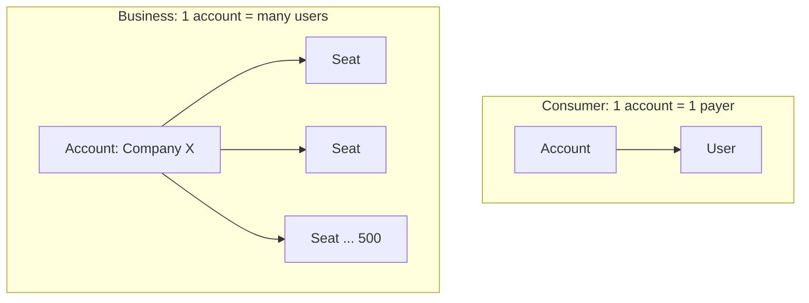

# Average revenue per account (ARPA)

## Summary

Average revenue per account (ARPA) is recurring revenue divided by the number of distinct paying accounts, where an account is a company or household that may have many users. It is the main unit measure for business software sold by seat or by team: Slack's account can have 500 users, while a consumer streaming account usually has one payer. Comparing ARPA for new and existing accounts shows whether sales land bigger deals and whether account managers expand them. A healthy business-to-business software company sees ARPA rise over time.

## Prerequisites

- [Average revenue per user (ARPU)](arpu.md)

## Core concepts

### Definition

*Average revenue per account* (ARPA, sometimes ARPAC) is:

```text
ARPA = recurring revenue / number of unique paying accounts
```

Using MRR gives monthly ARPA; using ARR gives annual ARPA. ARPU focuses on the individual payer, ARPA on the organization. When one company pays for many seats, ARPA is the measure that reflects the commercial relationship.

### Analogy

If ARPU is the average bill per diner, ARPA is the average bill per party: a company dinner for twenty people is one account. A restaurant serving corporate events cares more about the party bill than about any one diner.

### Mechanism

**Data filters.**

- **Consistent time frame:** MRR in the numerator gives monthly ARPA, ARR gives annual ARPA.
- **Unique accounts:** if Company X has three subscriptions under one parent, count it once to see the real *wallet share* you have with that client.

**Land and expand.** Compare new and existing ARPA:

| Segment | Calculation | Insight |
| --- | --- | --- |
| New ARPA | Revenue from accounts won this month / new accounts | Whether sales are landing bigger deals |
| Existing ARPA | Revenue from older accounts / number of older accounts | Whether account managers are expanding accounts |

If new ARPA is clearly higher than existing ARPA, the product is moving upmarket, toward larger and wealthier customers.

**Three strategic uses.**

1. **Support burden.** If ARPA is 50 and keeping the account costs 100 in support time, each account loses money. Raising ARPA allows better service at a healthy margin.
2. **Price sensitivity.** If prices rise 10% and the number of accounts stays the same, ARPA rises 10% at no extra cost, which flows directly to EBITDA (see [EBITDA](../../finance-and-investing/corporate-finance/ebitda.md)). In practice some accounts usually leave, which must be measured.
3. **Resource allocation.** High-ARPA (enterprise) accounts justify dedicated account managers. Low-ARPA (self-service) accounts should be served through automation and help center articles.

**Why it matters.** ARPA reflects pricing power. In a healthy business software company, ARPA grows as features and seats are added to existing accounts. When expansion exceeds the revenue lost from churned accounts, the company has negative net churn (see [Net revenue retention](net-revenue-retention.md)).

ARPU and ARPA differ in the unit counted:



## Worked example

A team chat product has 400 accounts and MRR of 200,000, so ARPA is 500. Accounts won this month: 20 with MRR of 16,000, so new ARPA is 800. Existing accounts: 380 with MRR of 184,000, existing ARPA about 484. New accounts are landing at 800, well above the base, which signals a move upmarket. The team plans dedicated onboarding for accounts above 1,000 per month and automated onboarding below.

## Trade offs and when to use it

ARPA describes commercial relationships better than ARPU in business software. Like any average, it is distorted by a few large accounts, and it ignores how much each account costs to serve.

## Common mistakes

- **The outlier effect.** One huge enterprise account can make ARPA look strong while most accounts are small and unprofitable. Report median ARPA alongside the average.
- **Not tracking ARPA over time.** Accounts can shrink usage before they cancel. Watch ARPA per cohort.
- **Mixing tiers.** Do not blend starter and enterprise plans in one ARPA. Segment them.

## Practice

1. When is ARPA a better measure than ARPU?
2. New ARPA is 1,200 and existing ARPA 700. What does this suggest?
3. Why count a company with three subscriptions as one account?

### Answers

1. When one paying account has many users, as in team or enterprise plans.
2. The company is moving upmarket, landing larger customers than its base.
3. To see the real share of that client's spending and avoid double counting.

## Further reading

- Skok, D. (2013). SaaS Metrics 2.0: A guide to measuring and improving what matters. For Entrepreneurs. [Link](https://www.forentrepreneurs.com/saas-metrics-2/). Account-level unit economics.
