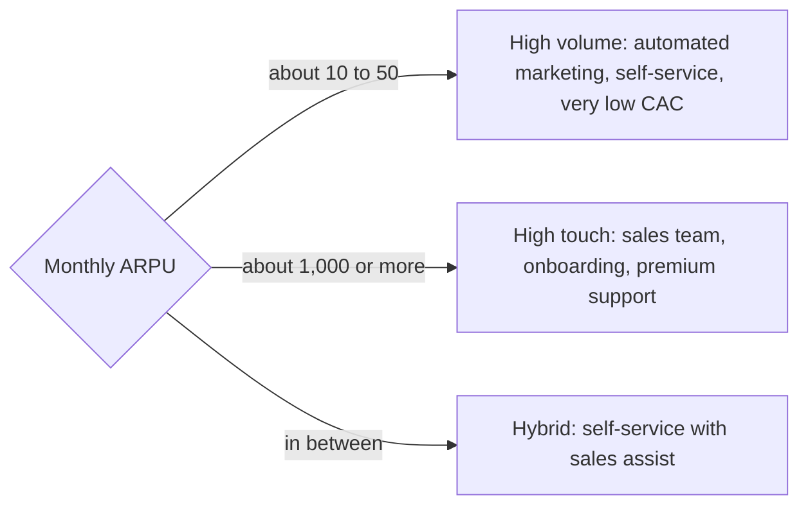

# Average revenue per user (ARPU)

## Summary

Average revenue per user (ARPU) is the recurring revenue a business earns per paying customer in a period, usually a month. It is a unit economics measure: it shows what one customer is worth and how much can be spent to acquire and serve one. Rising MRR with falling ARPU means the business works harder for less money per customer. Because averages hide skew, ARPU should be read together with the median and split by customer segment.

## Prerequisites

- [Monthly recurring revenue (MRR)](monthly-recurring-revenue.md)

## Core concepts

### Definition

*Average revenue per user* (ARPU) is total recurring revenue in a period divided by the number of paying customers in that period:

```text
ARPU = total MRR / number of paying customers
```

In telecoms and consumer apps, "user" can mean a subscriber or an active user, and some companies include free users. In subscription business analysis, including free users mixes two questions, so this note uses paying customers. For businesses where one account has many users, ARPA is the better measure (see [Average revenue per account (ARPA)](arpa.md)).

### Analogy

ARPU is like the average bill per table in a restaurant. It tells the owner whether to invest in faster turnover (low bills) or in service and wine lists (high bills). The analogy breaks because one large banquet can raise the average a lot, which is exactly the trap described below.

### Mechanism

**Data filters.**

- **Numerator:** only recurring revenue. No setup fees, no one-off consulting.
- **Denominator:** only paying customers. Free trial and freemium users who have not paid make ARPU look artificially low.
- **Time frame:** monthly ARPU uses MRR. For annual views, use annual figures consistently.

**Two segments.**

| Segment | Why it matters |
| --- | --- |
| New customer ARPU | The value of customers landed now. If it is higher than overall ARPU, pricing power is increasing. |
| Existing customer ARPU | The value of the installed base. If it is growing, upselling and expansion work. |

**Three strategic uses.**

1. **Volume or touch.** Low ARPU (roughly 10 to 50 per month) needs a high-volume model: automated marketing, self-service and very low acquisition cost. High ARPU (roughly 1,000 to 10,000 or more) can pay for sales teams, personalized onboarding and premium support. The thresholds are rules of thumb.
2. **Pricing and features.** Does a new feature raise ARPU? If prices rise, how many customers leave (churn) and how much does ARPU rise? The balance decides profitability.
3. **Room for acquisition.** You cannot spend 100 to acquire a customer whose ARPU is 5 and who stays 10 months. ARPU sets the ceiling for CAC (see [Customer acquisition cost (CAC)](customer-acquisition-cost.md)).

ARPU positions a business between two models:



## Worked example

```python
# Python 3.12. ARPU, median and the average trap.
from statistics import mean, median

fees = [10] * 99 + [10_000]          # 99 small customers and one large one
print("ARPU (mean):", round(mean(fees), 2))
print("median:", median(fees))

small = [10] * 99
print("ARPU small-business tier:", mean(small))
```

Output:

```text
ARPU (mean): 109.9
median: 10.0
ARPU small-business tier: 10
```

The mean of 109.90 describes no real customer. Reporting ARPU per tier (small business and enterprise) or the median gives a truer picture.

## Trade offs and when to use it

ARPU is easy to compute and to explain. It hides distribution, mixes plans and changes when the customer mix changes, even if no price changed. Doubling ARPU without doubling operating costs raises margins sharply, and raising the ARPU of 1,000 existing customers by 20% is often easier than finding 200 new ones, but price increases must be weighed against churn.

## Common mistakes

- **Using only the average.** Report the median and ARPU by tier or segment.
- **Including free users.** Divide by paying customers to see what payers are worth.
- **Mixing time frames.** Use monthly revenue for monthly ARPU, annual for annual.

## Practice

1. MRR is 60,000 from 1,500 paying customers and 4,000 free users. What is ARPU?
2. New customer ARPU is 55 and overall ARPU is 40. What does it suggest?
3. Why does ARPU limit acquisition spending?

### Answers

1. 60,000 / 1,500 = 40 per month.
2. Pricing power is increasing: new customers pay more than the base.
3. Because the revenue per customer over its lifetime must exceed the cost of acquiring it.

## Further reading

- Skok, D. (2013). SaaS Metrics 2.0: A guide to measuring and improving what matters. For Entrepreneurs. [Link](https://www.forentrepreneurs.com/saas-metrics-2/). Unit economics of subscription businesses.
