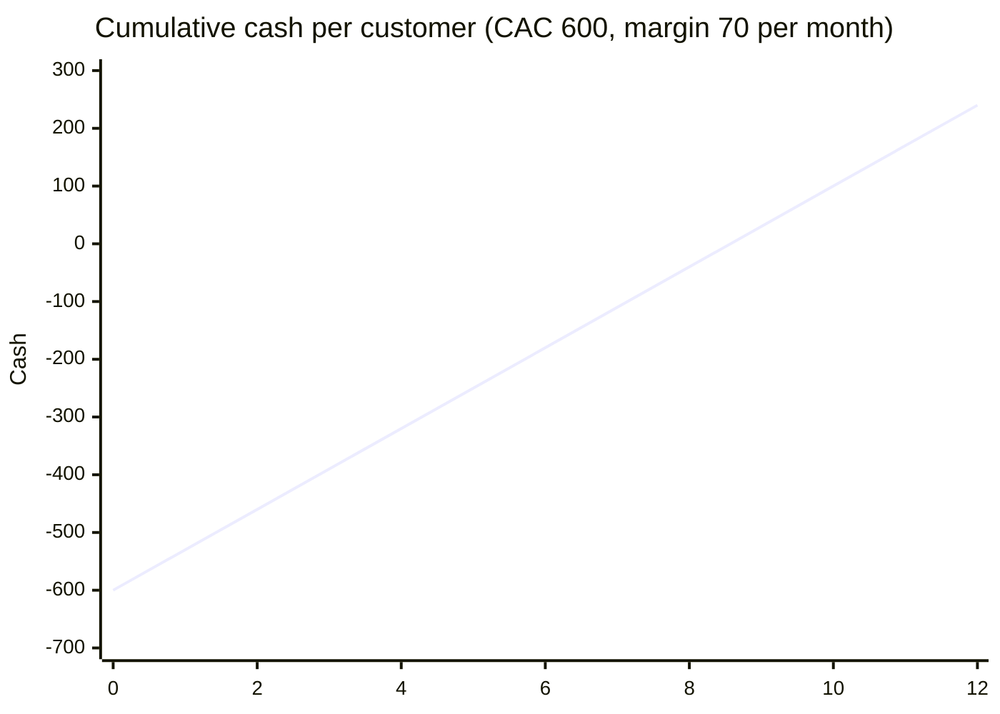

# CAC payback period

## Summary

The CAC payback period is the number of months it takes for a new customer's gross margin to repay the cost of acquiring them. It is the cash-flow view of unit economics: a business with a long payback needs a lot of capital to grow, even if each customer is profitable over its lifetime. Subscription businesses commonly aim for a payback under 12 months, and consumer companies running paid acquisition often aim for 6 to 12 months.

## Prerequisites

- [Customer acquisition cost (CAC)](customer-acquisition-cost.md)

## Core concepts

### Definition

The *CAC payback period* is:

```text
CAC payback (months) = CAC / (monthly ARPA x gross margin %)
```

Using gross margin rather than revenue measures the cash the customer actually returns after the cost of serving them. It is a specific use of the general *payback period* method for investments (see [Payback period](../../finance-and-investing/corporate-finance/payback-period.md)).

### Analogy

CAC payback is like the time it takes a new taxi to earn back its purchase price from fares after fuel. A taxi that pays for itself in eight months lets the owner buy the next one quickly; one that takes three years ties up the owner's money even if it is profitable in the end.

### Mechanism

Payback links growth and cash. Every new customer is a cash outflow now and inflows later. The faster the payback, the more of the growth can be funded from the business's own cash; a long payback means borrowing or raising equity to grow. Shortening payback works on three levers: lower CAC, higher ARPA, higher gross margin. Annual upfront billing shortens cash payback dramatically, because the customer pays the year at the start.

Cumulative margin from one customer against its CAC: payback is where the line crosses zero.



## Worked example

CAC is 600, ARPA 100 per month, gross margin 70%. Payback = 600 / (100 × 0.70) ≈ 8.6 months. If the company offers annual plans paid upfront at 1,000 (a 17% discount), cash from that customer is positive from day one, although margin-based payback on the discounted price is slightly longer.

## Trade offs and when to use it

Payback is simple and speaks directly to cash needs. It ignores what happens after payback, so a short payback with high churn can still be a poor business. Read it with LTV.

## Common mistakes

- **Using revenue instead of gross margin.** Use margin; revenue overstates how quickly cash comes back.
- **Ignoring churn before payback.** If many customers leave before month 9, a 9-month average payback is optimistic. Check payback per cohort.

## Practice

1. CAC 900, ARPA 150, gross margin 80%. What is payback?
2. Name three levers that shorten payback.

### Answers

1. 900 / 120 = 7.5 months.
2. Lower CAC, higher ARPA, higher gross margin (and upfront annual billing for cash).

## Further reading

- Skok, D. (2013). SaaS Metrics 2.0: A guide to measuring and improving what matters. For Entrepreneurs. [Link](https://www.forentrepreneurs.com/saas-metrics-2/). Months to recover CAC.
- Rachitsky, L. (2022). Step 6: Growth engines. Lenny's Newsletter. [Link](https://www.lennysnewsletter.com/p/growth-engines). Payback targets for paid acquisition.
