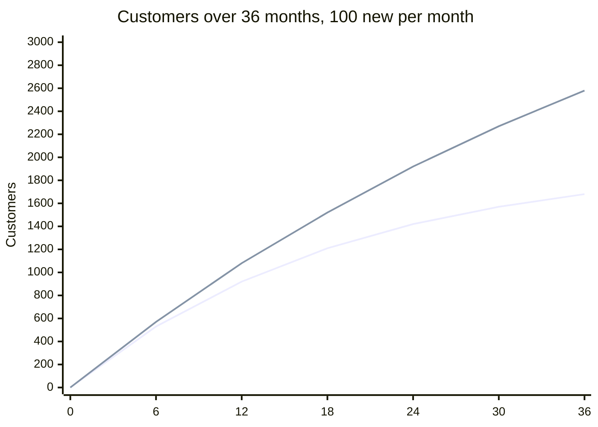

# Churn rate

## Summary

Churn rate is the share of customers or recurring revenue lost in a period. It is the opposite of retention and one of the clearest signals of product-market fit: when people stop paying, the value they get is lower than the price. Customer (logo) churn counts lost customers, revenue churn counts lost money. Because average customer lifetime is roughly one divided by churn, a small change in churn has a large effect on lifetime value: cutting monthly churn from 5% to 2% raises the average lifetime from 20 to 50 months.

## Prerequisites

- [Monthly recurring revenue (MRR)](monthly-recurring-revenue.md)

## Core concepts

### Definition

*Churn rate* is the proportion of customers (customer churn, also *logo churn*) or of recurring revenue (revenue churn, also *MRR churn*) lost during a period, relative to the start of the period:

```text
Customer churn = customers lost during period / customers at start of period
Revenue churn  = (churned MRR + contraction MRR) / MRR at start of period
```

Customers acquired during the period are excluded from the denominator. Some companies report *gross revenue churn* (losses only) and *net revenue churn* (losses minus expansion); the latter is the complement of net revenue retention (see [Net revenue retention](net-revenue-retention.md)).

### Analogy

Churn is the hole in the bucket from the retention note: acquisition pours customers in, churn lets them out. Small holes matter more than they look, because they drain the bucket every single month.

### Mechanism

**Why churn drives lifetime value.** If a constant share of customers leaves each month, the average lifetime is about one divided by the churn rate:

| Monthly churn | Average lifetime |
| --- | --- |
| 5% | 20 months |
| 2% | 50 months |
| 1% | 100 months |

Since lifetime value is roughly ARPA divided by churn (see [Customer lifetime value (LTV)](customer-lifetime-value.md)), reducing churn from 5% to 2% multiplies the value of every customer by 2.5 without any extra marketing spend.

**Types of churn.**

| Type | Cause | Action |
| --- | --- | --- |
| Voluntary | The customer chooses to cancel | Improve product, service or pricing |
| Involuntary | Payment failure, for example an expired card | Better *dunning* (automated billing recovery and reminders) |
| Early | Customers leave within 30 to 90 days | Fix onboarding: they did not see value fast enough |
| Late-stage | Long-term customers finally leave | Check for new competitors or product fatigue |

**The growth ceiling.** Every subscription business eventually reaches a point where new customers per month equal customers lost per month. With churn rate c and N new customers per month, the customer base levels off at about N / c. The only ways through the ceiling are more acquisition or lower churn.

The chart shows the growth ceiling: with 100 new customers a month, the base levels off near 100 / churn.



The first line is 5% monthly churn (ceiling 2,000), the second 2% (ceiling 5,000). Values come from the calculation in the worked example.

## Worked example

```python
# Python 3.12. Customer base with constant acquisition and churn.
def base(new_per_month, churn, months):
    n = 0.0
    out = []
    for m in range(months + 1):
        if m % 6 == 0:
            out.append(round(n, -1))
        n = n * (1 - churn) + new_per_month
    return out

print("5% churn:", base(100, 0.05, 36))
print("2% churn:", base(100, 0.02, 36))
print("lifetime at 5%:", 1 / 0.05, "months; at 2%:", 1 / 0.02, "months")
```

Output:

```text
5% churn: [0.0, 530.0, 920.0, 1210.0, 1420.0, 1570.0, 1680.0]
2% churn: [0.0, 570.0, 1080.0, 1520.0, 1920.0, 2270.0, 2580.0]
lifetime at 5%: 20.0 months; at 2%: 50.0 months
```

At 5% churn the business is already approaching its ceiling of 2,000 customers after three years; at 2% it is still far from its ceiling of 5,000.

## Trade offs and when to use it

Churn is simple and directly tied to value. Monthly churn can mislead for annual contracts, and averages hide the differences between plans and cohorts. For businesses without subscriptions (shops, marketplaces), repeat purchase rate and cohort retention replace churn.

## Common mistakes

- **The churn cliff hidden in an average.** If overall churn is 5% but 20% on the basic plan and 1% on enterprise, the basic product is failing. Segment churn by plan.
- **The annual contract mirage.** With 12-month contracts, monthly churn looks like zero for 11 months and spikes in month 12. Use cohort analysis of renewals.
- **Counting trial cancellations as churn.** Churn is for paying customers only.
- **Including new customers in the denominator.** Divide by customers at the start of the period.

## Practice

1. 500 customers at the start, 25 cancel. What is customer churn?
2. What is the average lifetime at 4% monthly churn?
3. What is involuntary churn and how is it reduced?
4. With 200 new customers a month and 4% churn, where does the base level off?

### Answers

1. 25 / 500 = 5%.
2. 1 / 0.04 = 25 months.
3. Loss caused by failed payments; reduced by dunning, automated reminders and card updates.
4. Around 200 / 0.04 = 5,000 customers.

## Further reading

- Skok, D. (2013). SaaS Metrics 2.0: A guide to measuring and improving what matters. For Entrepreneurs. [Link](https://www.forentrepreneurs.com/saas-metrics-2/). Churn and its effect on growth.
- Fader, P. S., Hardie, B. G. S. (2009). Probability models for customer-base analysis. Journal of Interactive Marketing, 23(1), 61-69. [DOI](https://doi.org/10.1016/j.intmar.2008.11.003). Probability models of customer bases.
- Rachitsky, L., Winters, C. (2021). What is good retention?. Lenny's Newsletter. [Link](https://www.lennysnewsletter.com/p/what-is-good-retention-issue-29). Retention benchmarks.
