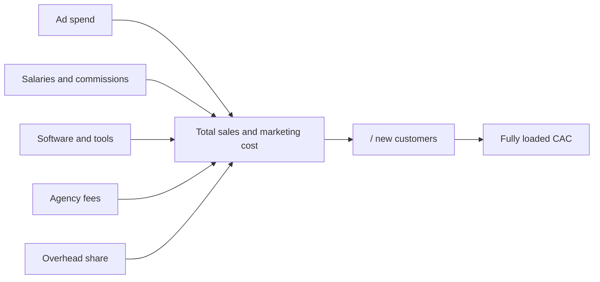

# Customer acquisition cost (CAC)

## Summary

Customer acquisition cost (CAC) is the total cost of winning one new customer: sales and marketing spending in a period divided by the new customers won. A fully loaded CAC includes ad spend, salaries and commissions, tools, agencies and a share of overhead, not just the advertising bill. CAC means little alone: it must be compared with what a customer is worth over time. If CAC is higher than the profit a customer brings, the business model is broken, however fast it grows.

## Prerequisites

- [Average revenue per user (ARPU)](arpu.md)

## Core concepts

### Definition

*Customer acquisition cost* is:

```text
CAC = total sales and marketing cost in a period / number of new customers acquired in that period
```

A *fully loaded* CAC includes:

- **Ad spend:** Facebook, Google, LinkedIn and other platforms.
- **Salaries:** gross pay of the marketing team and the sales representatives, including commissions.
- **Software and tools:** CRM (for example Salesforce or HubSpot), email automation, design tools.
- **Agency fees:** outside consultants and creative agencies.
- **Overhead:** a share of rent and equipment used by sales and marketing.

Costs of keeping existing customers (customer success) are usually kept out of CAC and reported separately or in cost of goods sold; practice varies, so state your choice.

### Analogy

CAC is like the cost of recruiting one new member to a gym: posters, the salesperson's pay, the free trial week and a share of the reception desk. A gym that only counts the posters thinks members are cheap. The analogy holds well; it breaks only in that software products can recruit some members with almost no human effort.

### Mechanism

**Three views of CAC.**

| View | Covers | Use |
| --- | --- | --- |
| Blended CAC | All channels together | The big picture of acquisition health |
| Paid CAC | Only customers from paid channels | Whether paid marketing is profitable on its own |
| Organic CAC | Search, content, referrals | Usually lower but slower to build; strong organic growth lowers blended CAC |

**Context: the LTV to CAC ratio.** A CAC of 500 is excellent for a 50,000 software contract and terrible for a 10 per month subscription. Compare CAC with lifetime value (see [LTV to CAC ratio](ltv-to-cac-ratio.md)): about 1:1 means losing money after operating costs, about 3:1 is the common benchmark for healthy growth, and 5:1 or more may mean under-investment in growth.

**Payback.** For cash flow, the number of months until a customer's margin repays its CAC is often more useful than the ratio (see [CAC payback period](cac-payback-period.md)). Subscription businesses usually aim for under 12 months.

**Why it matters.** CAC is the limit on scalability. If spending 1,000 reliably brings five customers worth more than 200 each, the business has a predictable growth machine and can confidently add capital.

The components of a fully loaded CAC:



## Worked example

```python
# Python 3.12. Ads-only versus fully loaded CAC, with a sales cycle lag.
ads = 30_000
salaries = 45_000          # marketing team and two sales reps, incl. commissions
tools = 4_000
agency = 6_000
overhead = 5_000
new_customers = 120

ads_only = ads / new_customers
fully_loaded = (ads + salaries + tools + agency + overhead) / new_customers
print("ads-only CAC:", ads_only)
print("fully loaded CAC:", fully_loaded)

# with a three-month sales cycle, compare spend with customers won three months later
spend_q1 = 90_000
customers_won_q2 = 140
print("lag-adjusted CAC:", round(spend_q1 / customers_won_q2, 2))
```

Output:

```text
ads-only CAC: 250.0
fully loaded CAC: 750.0
lag-adjusted CAC: 642.86
```

The ads-only view understates the true cost threefold.

## Trade offs and when to use it

CAC is essential for deciding how much to spend on growth. It is sensitive to attribution (which channel gets credit), to time lags and to how overhead is allocated, so the same company can report very different CACs. Agree on a definition and keep it stable over time.

## Common mistakes

- **Ignoring the sales cycle lag.** If the cycle is three months, this month's customers result from spending three months ago. Match spend and customers with the lag.
- **Excluding salaries.** With several sales representatives on commission, the true CAC is far above the ad bill.
- **Mixing retention costs into CAC.** Keep customer success costs separate, in cost of goods sold or a retention budget.
- **Looking only at blended CAC.** Split by channel; a cheap organic channel can hide an unprofitable paid one.

## Practice

1. Sales and marketing cost 60,000 and brought 80 customers. What is CAC?
2. Why is blended CAC not enough to judge paid ads?
3. Where should customer success costs go?

### Answers

1. 750.
2. Cheap organic customers lower the average and can hide an unprofitable paid channel.
3. Outside CAC, in cost of goods sold or a separate retention budget.

## Further reading

- Skok, D. (2013). SaaS Metrics 2.0: A guide to measuring and improving what matters. For Entrepreneurs. [Link](https://www.forentrepreneurs.com/saas-metrics-2/). CAC, LTV and payback.
