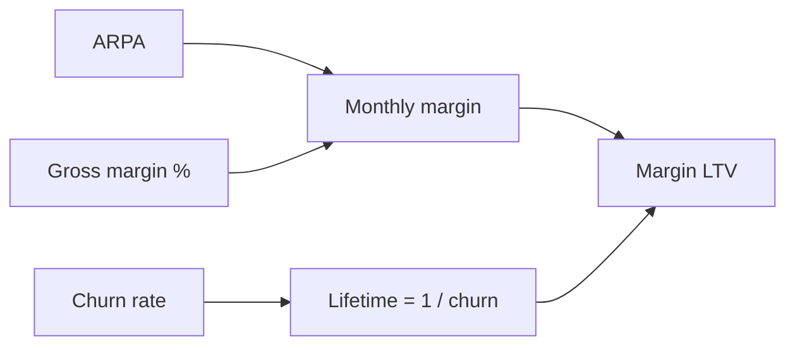

# Customer lifetime value (LTV)

## Summary

Customer lifetime value (LTV, also CLV) is the total revenue or profit a business expects from a customer over the whole relationship. In subscription businesses it is commonly estimated as monthly revenue per account divided by monthly churn, and in its more honest form multiplied by gross margin. It tells whether a customer is worth what it costs to win. It has three levers: monetization, retention and efficiency. Because it is a forecast, it is easy to overestimate, especially for young companies.

## Prerequisites

- [Churn rate](churn-rate.md)
- [Average revenue per account (ARPA)](arpa.md)

## Core concepts

### Definition

*Customer lifetime value* is the projected value of all future revenue (revenue LTV) or contribution margin (margin LTV) from a customer. The simple subscription formulas assume constant revenue and constant churn:

```text
Revenue LTV = ARPA / churn rate
Margin LTV  = (ARPA x gross margin %) / churn rate
```

Academic models (Gupta et al., 2006; Fader and Hardie, 2009) also discount future cash and model churn and purchase behavior statistically, especially when customers can leave silently, as in retail.

### Analogy

LTV is like estimating what a fruit tree will yield over its life before planting it: the yearly harvest times the expected number of years, minus the cost of water and care. The estimate is only as good as the assumption about how long the tree lives.

### Mechanism

If you spend 100 to get a customer who pays only 50 before leaving, you have built an expensive hobby, not a business. LTV makes this visible.

**Three levers.**

| Lever | Action | Effect |
| --- | --- | --- |
| Monetization (ARPA) | Raise prices or sell more features | Higher revenue per month |
| Retention (churn) | Improve product quality and support | Customers stay more months |
| Efficiency (margin) | Automate and lower the cost of serving customers | More of each unit of revenue is kept |

**Comparison with CAC.** LTV must always be compared with CAC (see [LTV to CAC ratio](ltv-to-cac-ratio.md)). A known LTV gives confidence to spend on acquisition and to outbid competitors for advertising and talent.

**Discounting.** For long lifetimes, future margin is worth less today. A discounted LTV divides each month's margin by (1 + monthly discount rate) raised to the month number, as in a DCF (see [Discounted cash flow (DCF)](../../finance-and-investing/corporate-finance/discounted-cash-flow.md)).

LTV as a product of its levers:



## Worked example

```python
# Python 3.12. Revenue LTV, margin LTV and a discounted version.
arpa, churn, margin = 100, 0.05, 0.70

revenue_ltv = arpa / churn
margin_ltv = arpa * margin / churn
print("revenue LTV:", revenue_ltv)
print("margin LTV:", margin_ltv)

# discounted: survival probability falls by churn each month, 1% monthly discount rate
r = 0.01
discounted = sum(arpa * margin * (1 - churn) ** m / (1 + r) ** m for m in range(600))
print("discounted margin LTV:", round(discounted))
```

Output:

```text
revenue LTV: 2000.0
margin LTV: 1400.0
discounted margin LTV: 1178
```

With ARPA 100, churn 5% and margin 70%, revenue LTV is 2,000, but a customer is actually worth about 1,400 in margin, and about 1,180 after discounting future months.

## Trade offs and when to use it

LTV turns customer behavior into a single number for budget decisions. Its weakness is false precision: churn measured in a young company is unstable, and constant-churn formulas overstate lifetime when early churn is high and later churn low, or understate it in the reverse case. Use cohort data and conservative assumptions.

## Common mistakes

- **The forever assumption.** Assuming customers stay five years when the company is six months old. Cap the lifetime (for example at 3 to 5 years) until data exists.
- **Using revenue LTV for marketing budgets.** Use margin LTV; revenue LTV ignores the cost of serving customers and can lead to overspending.
- **Ignoring cohorts.** LTV of customers acquired in one year can differ greatly from another year. Track LTV by cohort.

## Practice

1. ARPA 80, churn 4%, margin 75%. What are revenue and margin LTV?
2. Name the three levers of LTV.
3. Why can a constant-churn LTV be misleading for a six-month-old company?

### Answers

1. Revenue LTV = 2,000. Margin LTV = 1,500.
2. Monetization (ARPA), retention (churn), efficiency (margin).
3. Churn measured over a short period is unstable, and real churn usually changes with customer age.

## Further reading

- Gupta, S., Hanssens, D., Hardie, B. et al. (2006). Modeling customer lifetime value. Journal of Service Research, 9(2), 139-155. [DOI](https://doi.org/10.1177/1094670506293810). Review of customer lifetime value models.
- Fader, P. S., Hardie, B. G. S. (2009). Probability models for customer-base analysis. Journal of Interactive Marketing, 23(1), 61-69. [DOI](https://doi.org/10.1016/j.intmar.2008.11.003). Probability models for customer-base analysis.
- Skok, D. (2013). SaaS Metrics 2.0: A guide to measuring and improving what matters. For Entrepreneurs. [Link](https://www.forentrepreneurs.com/saas-metrics-2/). Simple LTV formulas for SaaS.
