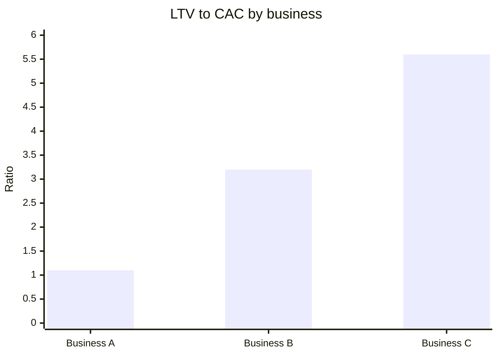

# LTV to CAC ratio

## Summary

The LTV to CAC ratio compares what a customer is worth over its lifetime with what it cost to acquire. It is often called the most important ratio in a subscription business. A ratio around 1:1 means a business is losing money once overheads are paid; about 3:1 is the widely used benchmark for healthy, scalable growth; 5:1 or higher usually means the company could grow faster by spending more on acquisition. The ratio is only as good as the LTV estimate behind it.

## Prerequisites

- [Customer lifetime value (LTV)](customer-lifetime-value.md)
- [Customer acquisition cost (CAC)](customer-acquisition-cost.md)

## Core concepts

### Definition

The *LTV to CAC ratio* is margin-based lifetime value divided by fully loaded customer acquisition cost:

```text
LTV:CAC = margin LTV / CAC
```

The 3:1 benchmark comes from practitioners and venture investors (popularized by David Skok's SaaS metrics guides) rather than from research; it leaves room for overhead, research and development and profit.

### Analogy

The ratio is like a farmer's yield ratio: how many sacks of grain are harvested for each sack planted. Below a certain ratio, the farm cannot feed its workers; far above it, the farmer is planting too little land.

### Mechanism

| Ratio | Meaning |
| --- | --- |
| 1:1 or less | The customer pays back acquisition but nothing covers overhead. The business is dying. |
| About 3:1 | Common benchmark for healthy, scalable growth. |
| 5:1 or more | Very efficient; probably under-investing in growth. Spending more on acquisition could grow the business faster. |

Read the ratio together with payback (see [CAC payback period](cac-payback-period.md)): a ratio of 3:1 with a 40-month payback needs much more capital than 3:1 with a 10-month payback.

Three businesses on the ratio scale:



The values are invented for the example.

## Worked example

Business A: margin LTV 550, CAC 500, ratio 1.1, losing money after overhead; fix retention or pricing before spending. Business B: LTV 1,600, CAC 500, ratio 3.2; scale carefully. Business C: LTV 2,800, CAC 500, ratio 5.6; test larger budgets, accepting that CAC will rise as cheaper audiences are used up.

## Trade offs and when to use it

The ratio summarizes unit economics in one number, which is also its risk: an inflated LTV (revenue instead of margin, an assumed long lifetime) produces a flattering ratio. Use margin LTV, cohort data and channel-level CAC.

## Common mistakes

- **Computing the ratio with revenue LTV.** Use margin LTV.
- **Using blended CAC for a paid channel decision.** Use the CAC of the channel in question.
- **Treating 3:1 as a law.** It is a rule of thumb; capital costs, payback and growth goals matter too.

## Practice

1. Margin LTV 1,200, CAC 300. What is the ratio and what does it suggest?
2. Why should payback be read alongside the ratio?

### Answers

1. 4:1, healthy and possibly room to spend more on growth.
2. Because the same ratio can need very different amounts of capital depending on how fast cash returns.

## Further reading

- Skok, D. (2013). SaaS Metrics 2.0: A guide to measuring and improving what matters. For Entrepreneurs. [Link](https://www.forentrepreneurs.com/saas-metrics-2/). Origin of the 3:1 rule of thumb.
