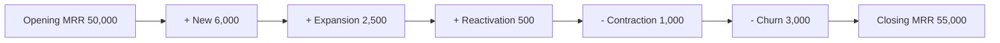

# Monthly recurring revenue (MRR)

## Summary

Monthly recurring revenue (MRR) is the predictable revenue a subscription business expects to receive every month from its active paying customers. It excludes one-off payments such as setup fees, consulting and hardware, and it normalizes quarterly and annual plans to a monthly amount. Breaking the change in MRR into new, expansion, reactivation, contraction and churn shows why the business grew or shrank. MRR is the operating heartbeat of a subscription business and the base for ARR and most valuation discussions.

## Prerequisites

No prior notes are needed.

## Core concepts

### Definition

*Monthly recurring revenue* (MRR) is the sum of the normalized monthly subscription fees of all active paying customers at a point in time. Two words carry the meaning: *recurring* (only charges that repeat under a subscription) and *normalized* (an annual payment of 1,200 counts as 100 per month). MRR is not cash received and not revenue recognized in accounts. A customer who pays 1,200 for a year upfront adds 100 to MRR every month; the 1,200 belongs in bookings and cash flow.

### Analogy

MRR is like the number of regular weekly customers in a bakery multiplied by what each usually spends. A wedding cake order is welcome, but it is not part of that number, because it will not repeat next week. The analogy breaks because subscription customers are contractually committed for a period, while bakery regulars can stop any day without notice.

### Mechanism

**Two ways to calculate.**

```text
Method A (customer by customer):  MRR = sum of the monthly fee of every paying customer
Method B (ARPU method):           MRR = number of paying customers x ARPU
```

Method A is exact. Method B is a quick estimate that depends on an accurate ARPU (see [Average revenue per user (ARPU)](arpu.md)).

**The five components of MRR change.**

| Component | Description | Effect |
| --- | --- | --- |
| New MRR | Revenue from customers acquired during the month | Positive |
| Expansion MRR | Extra revenue from existing customers: upsells, cross-sells, more seats | Positive |
| Reactivation MRR | Revenue from former customers who returned to a paid plan | Positive |
| Contraction MRR | Revenue lost because customers moved to a cheaper plan | Negative |
| Churn MRR | Revenue lost because customers canceled completely | Negative |

**Net MRR growth.**

```text
Net new MRR = New + Expansion + Reactivation - Contraction - Churn
```

A positive result means the business is growing. A negative result is a leaky bucket: even with new customers, revenue is lost faster than it is replaced.

The waterfall below shows how one month's MRR moves from the opening to the closing value.



## Worked example

A project-management tool closes a month with these movements:

```python
# Python 3.12. MRR movements for one month.
opening = 50_000
new, expansion, reactivation = 6_000, 2_500, 500
contraction, churn = 1_000, 3_000

net_new = new + expansion + reactivation - contraction - churn
closing = opening + net_new
print("net new MRR:", net_new)
print("closing MRR:", closing)
print("growth rate: {:.1%}".format(net_new / opening))
# an annual plan of 1,200 paid upfront adds 1,200 / 12 to MRR
print("annual plan contribution:", 1_200 / 12)
```

Output:

```text
net new MRR: 5000
closing MRR: 55000
growth rate: 10.0%
annual plan contribution: 100.0
```

Expansion (2,500) nearly covers churn (3,000). Improving expansion is often cheaper than finding more new customers.

## Trade offs and when to use it

MRR is simple and comparable across months. It ignores costs and cash timing, so it must be read together with margins, churn and cash flow. For businesses with usage-based pricing, MRR is less stable and is often reported as a trailing average.

## Common mistakes

- **Including non-recurring fees.** Setup, consulting and training fees inflate MRR and suggest false predictability. Leave them out.
- **Counting trials or signed but unpaid customers.** Only customers who have actually paid count. A committed customer who has not paid is a lead.
- **Ignoring discounts and credits.** A customer paying 100 with a 20 discount for six months adds 80. Use the net amount.
- **Counting a full annual payment in one month.** Divide by 12. The upfront amount belongs in bookings or cash flow.

## Practice

1. A customer pays 2,400 for a year upfront. What does it add to MRR?
2. Opening MRR is 80,000; new 4,000; expansion 1,000; contraction 500; churn 6,000. What is net new MRR?
3. Why are setup fees excluded from MRR?

### Answers

1. 200 per month.
2. 4,000 + 1,000 - 500 - 6,000 = -1,500, a leaky bucket.
3. They do not recur, so including them overstates predictable revenue.

## Further reading

- Skok, D. (2013). SaaS Metrics 2.0: A guide to measuring and improving what matters. For Entrepreneurs. [Link](https://www.forentrepreneurs.com/saas-metrics-2/). Definitions and use of SaaS metrics.
- Bessemer Venture Partners. State of the Cloud and cloud benchmarks. Bessemer Venture Partners. [Link](https://www.bvp.com/atlas). Benchmarks for cloud businesses.
