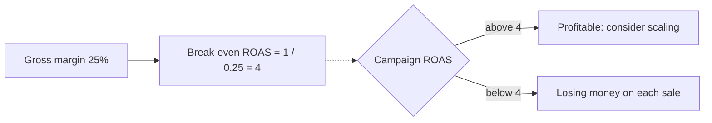

# Return on ad spend (ROAS)

## Summary

Return on ad spend (ROAS) measures the revenue earned for each unit of money spent on advertising. If ROI is about profit, ROAS is about revenue efficiency of a campaign. It is usually written as a multiple: 4x means four euros of revenue for each euro of ads. A ROAS that sounds good can still lose money if margins are thin, so every business needs its break-even ROAS, which equals one divided by the gross margin.

## Prerequisites

No prior notes are needed.

## Core concepts

### Definition

*Return on ad spend* is:

```text
ROAS = revenue attributed to ads / ad spend
```

It does not count labor, software or overhead, only the advertising spend and the revenue attributed to it. The *break-even ROAS* is the ROAS at which ad-driven gross profit exactly covers ad spend:

```text
Break-even ROAS = 1 / gross margin %
```

Using contribution margin (after shipping, payment fees and returns) instead of gross margin gives a stricter and more realistic threshold, as shown in [Product selection](../../../personal-development/skills/hard-skills/e-commerce/product-selection.md).

### Analogy

ROAS is like counting the sales a market stall makes on days it pays for a loudspeaker announcement. It tells you whether the announcement brings buyers, but not whether the stall makes money after paying for the goods.

### Mechanism

**Reading the multiple.** A 4:1 or "4x" ROAS means 4 units of revenue for every unit of ad spend.

**Break-even.** With a 25% margin, break-even ROAS is 1 / 0.25 = 4. Above 4 the ads make a profit; below 4 every sale loses money, even as revenue grows.

**ROAS and ROI.**

| Metric | Focus | Example |
| --- | --- | --- |
| ROAS | Efficiency of a specific ad | "I spent 1,000 on Facebook and got 5,000 in sales. ROAS is 5x." |
| ROI | Profitability of the whole effort | "After paying the agency, the designer and for the product, I made 200. ROI is 20%." |

**Scaling trigger.** If a channel's ROAS is well above break-even, keep increasing spend until ROAS falls toward break-even, the point of diminishing returns (see [Performance marketing engine](../growth/performance-marketing-engine.md)).

The decision around break-even ROAS:



## Worked example

A shop sells a product at 80 with a gross margin of 30%. Break-even ROAS = 1 / 0.30 ≈ 3.33. Campaign X spends 2,000 and brings 9,000 in revenue: ROAS 4.5, gross profit 2,700, profit after ads 700. Campaign Y spends 2,000 and brings 6,000: ROAS 3.0, gross profit 1,800, a loss of 200 despite a ROAS of 3 that sounds healthy.

## Trade offs and when to use it

ROAS is fast, campaign-level and supported by every ad platform. It depends heavily on attribution and ignores everything except ad cost, so it guides tactics, not strategy.

## Common mistakes

- **The attribution trap.** A customer may have seen a Facebook ad first and a Google ad last. Platforms each claim the sale, so ROAS double counts. Compare platform data with your own analytics and total revenue.
- **Ignoring the halo effect.** Ads also drive store visits and later organic searches that ROAS tools do not capture, which can make ads look worse than they are.
- **The margin blind spot.** High-revenue, low-margin products can have high ROAS and negative ROI. Always check break-even ROAS.

## Practice

1. Margin is 40%. What is break-even ROAS?
2. A campaign has ROAS 3 and margin 20%. Is it profitable?

### Answers

1. 2.5.
2. No: break-even is 5, so it loses money.

## Further reading

- Kohavi, R., Tang, D., Xu, Y. (2020). *Trustworthy Online Controlled Experiments*. Cambridge University Press. [DOI](https://doi.org/10.1017/9781108653985). Measuring the effect of changes, including incrementality.
