# Return on investment (ROI)

## Summary

Return on investment (ROI) measures how much net profit an investment produced for each unit of money put in: net profit divided by cost. It answers a plain question: for every euro invested, how much came back as profit? ROI helps allocate limited capital, hold projects accountable and see the opportunity cost of choices. Because a percentage says nothing about time, investments of different length are compared with annualized ROI, and long projects with NPV and IRR.

## Prerequisites

No prior notes are needed.

## Core concepts

### Definition

*Return on investment* is:

```text
ROI = (final value or gain from the investment - cost of the investment) / cost of the investment
```

usually expressed as a percentage. The *cost* should include all costs, including staff time, software and overhead, not only the visible purchase. ROI is a simple ratio and ignores the time value of money; for multi-year projects, use [Net present value (NPV)](../../finance-and-investing/corporate-finance/net-present-value.md) and [Internal rate of return (IRR)](../../finance-and-investing/corporate-finance/internal-rate-of-return.md).

### Analogy

ROI is like comparing what you paid for a bag of seeds with the profit from the harvest. It tells you which seeds paid best, but not how long each took to grow, which matters if one grows in a month and another in five years.

### Mechanism

**ROI and ROAS.** ROI is often confused with return on ad spend (see [Return on ad spend (ROAS)](return-on-ad-spend.md)):

| Feature | ROAS | ROI |
| --- | --- | --- |
| Focus | Gross revenue from ads | Net profit from the whole project |
| Formula | Revenue / ad spend | (Profit - cost) / cost |
| Includes | Only the ad cost | Salaries, software, overhead and ads |
| Purpose | Campaign tactics | Business strategy |

**Annualized ROI.** A 20% return in one month is much better than in five years. To compare investments of different durations:

```text
Annualized ROI = (1 + ROI) ^ (1 / n) - 1,   where n is the number of years held
```

**Three uses.**

1. **Capital allocation.** Limited cash goes where ROI is highest: two more sales representatives or a server upgrade?
2. **Accountability.** An expected ROI for each project makes it possible to judge it later and to pivot or stop it.
3. **Opportunity cost.** If project A returns 5% and project B 15%, doing A costs the 10 points you gave up.

The chart compares total and annualized ROI for two investments.

```mermaid
xychart-beta
  title "Total versus annualized ROI (%)"
  x-axis ["A: 60% over 5 years", "B: 25% over 1 year"]
  y-axis "Percent" 0 --> 70
  bar [60, 25]
  bar [9.9, 25]
```



The first bar of each pair is total ROI, the second annualized ROI.

## Worked example

```python
# Python 3.12. Simple ROI, full-cost ROI and annualized ROI.
campaign_cost = 10_000
gross_profit = 15_000
roi = (gross_profit - campaign_cost) / campaign_cost
print("ROI: {:.0%}".format(roi))

# add 100 hours of team time at 60 per hour
full_cost = campaign_cost + 100 * 60
print("ROI with time cost: {:.1%}".format((gross_profit - full_cost) / full_cost))

def annualized(total_roi, years):
    return (1 + total_roi) ** (1 / years) - 1

print("A: {:.1%} per year".format(annualized(0.60, 5)))
print("B: {:.1%} per year".format(annualized(0.25, 1)))
```

Output:

```text
ROI: 50%
ROI with time cost: -6.2%
A: 9.9% per year
B: 25.0% per year
```

The campaign looks like a 50% return until the team's time is counted, which turns it into a small loss. Investment A has the higher total return but a much lower annual return than B.

## Trade offs and when to use it

ROI is simple and makes discussions objective. It strips away enthusiasm for impressive but unprofitable projects. Its limits: no time dimension, no risk, and easy to manipulate through what counts as cost and gain.

## Common mistakes

- **Ignoring soft costs.** Include the cost of people's time; 100 hours of executive meetings is a real cost.
- **Vanity ROI.** Savings of employee time count only if the time is turned into revenue-generating work or lower costs.
- **Cherry-picking time frames.** Measuring too early (before the project matures) or too late (ignoring maintenance) distorts ROI.
- **Comparing ROI of projects of different length.** Annualize, or use NPV and IRR.

## Practice

1. An investment of 20,000 returns 26,000. What is ROI?
2. Annualize a 44% return over two years.
3. Why can ROI and ROAS give opposite verdicts on the same campaign?

### Answers

1. 30%.
2. (1.44)^(1/2) - 1 = 20% per year.
3. ROAS counts revenue against ad spend only; ROI counts profit against all costs, so a high-ROAS campaign with thin margins can have negative ROI.

## Further reading

- Brealey, R. A., Myers, S. C., Allen, F. et al. (2023). *Principles of Corporate Finance (14th ed.)*. McGraw Hill. Investment decisions and their measures.
