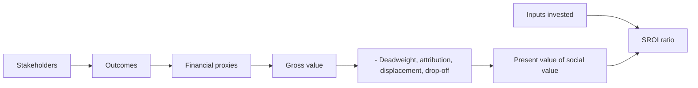

# Social return on investment (SROI)

## Summary

Social return on investment (SROI) is a principles-based method for measuring social, environmental and economic value that does not appear in conventional financial accounts. It expresses that value in money, using financial proxies, and compares it with the investment, giving a ratio such as 2:1: two units of social value for each unit spent. It is used by charities, social enterprises, public bodies and companies reporting on impact. Its strength is that it makes outcomes visible; its weakness is subjectivity, which seven principles are meant to control.

## Prerequisites

- [Return on investment (ROI)](return-on-investment.md)

## Core concepts

### Definition

*Social return on investment* is:

```text
SROI ratio = present value of social value created / value of inputs invested
```

The social value is the monetized value of *outcomes* (changes in people's lives or the environment), after removing what would have happened anyway. The method was developed in the 2000s and set out in *A Guide to Social Return on Investment* (Nicholls et al., 2012); its principles are maintained by Social Value UK and Social Value International.

### Analogy

SROI is like pricing the benefits of a new park: fewer doctor visits because people walk more, higher nearby property values, less flooding. None of these show up in the park department's budget, but they are real. The analogy also shows the risk: each price is an estimate, and enthusiastic estimates can make any park look like a bargain.

### Mechanism

**Four steps.**

1. **Stakeholder mapping.** Identify who is affected: employees, local community, the environment.
2. **Outcome mapping.** Identify what changed for them, for example "our training program reduced local unemployment".
3. **Monetizing outcomes.** Use *financial proxies*: a reduction in unemployment can be valued by the benefits saved or the increase in local spending.
4. **Discounting for impact.** Subtract *deadweight* (what would have happened anyway), *attribution* (change caused by others), *displacement* (value moved from elsewhere) and *drop-off* (decline over time), and discount future value to today.

The formal guide describes six stages: establishing scope and stakeholders, mapping outcomes, evidencing outcomes and giving them a value, establishing impact, calculating the SROI, and reporting, using and embedding the results.

**Principles.** Social Value UK lists principles that keep SROI honest:

1. **Involve stakeholders.** Ask people what changed; do not guess.
2. **Understand what changes.** Focus on outcomes, not activities, including negative and unintended changes.
3. **Value the things that matter.** Use financial proxies for outcomes that stakeholders value.
4. **Only include what is material.** Leave out small and irrelevant changes.
5. **Do not over-claim.** Claim only the value your organization caused.
6. **Be transparent.** Explain how the numbers were calculated.
7. **Verify the result.** Have the analysis independently checked or audited.

Later versions add an eighth principle, *be responsive*: use the results to make decisions that increase social value.

**Strategic uses.** Evidence of impact can support brand trust, attract impact investors and help in public procurement: the UK Public Services (Social Value) Act 2012 requires public bodies to consider social value when commissioning services, and the EU procurement directive 2014/24/EU allows social criteria in public contracts.

The calculation flow from inputs to the ratio:



## Worked example

A company spends 100,000 on a program to improve employees' mental health. 50 employees report much lower stress and no burnout. Proxies: avoided cost of hiring and training five replacement employees because turnover fell, 150,000; fewer days of absence, 50,000. Gross value 200,000, ratio 2:1.

Applying the discounts changes the picture. If a survey suggests that half of the turnover reduction would have happened anyway because of a better job market (deadweight 50% on the 150,000), and a third of the absence reduction is due to a new flexible-work policy (attribution), the value is 75,000 + 33,333 = 108,333, and the ratio falls to about 1.08:1.

Note also that these proxies mostly measure value to the company itself (lower hiring and absence costs), not wider social value. A full SROI would include outcomes for employees and their families, such as better health, valued with appropriate proxies.

## Trade offs and when to use it

SROI makes non-financial outcomes visible and comparable and forces an organization to ask stakeholders what changed. It is labor-intensive, and ratios from different studies are hard to compare, because proxies and discounts differ. Investors and funders increasingly read the narrative and the method, not just the ratio.

## Common mistakes

- **Over-valuation.** Picking the highest available proxy to produce a ratio like 20:1 looks like impact washing and is dismissed by serious investors. Use conservative, sourced proxies.
- **Ignoring negative impacts.** A factory that creates 100 jobs but noise for 1,000 residents must subtract the negative value of the noise.
- **Focusing only on the ratio.** The qualitative evidence (interviews, testimonials) gives the context that the number cannot.
- **Skipping deadweight and attribution.** Without them, the analysis claims credit for changes the program did not cause.

## Practice

1. What are deadweight and attribution?
2. List four of the seven principles of SROI.
3. Why is a ratio of 20:1 a warning sign?

### Answers

1. Deadweight is the outcome that would have happened anyway; attribution is the share caused by others.
2. Any four of: involve stakeholders, understand what changes, value the things that matter, only include what is material, do not over-claim, be transparent, verify the result.
3. It usually indicates inflated proxies or missing discounts, which looks like impact washing.

## Further reading

- Nicholls, J., Lawlor, E., Neitzert, E. et al. (2012). *A Guide to Social Return on Investment (2nd ed.)*. The SROI Network. The standard guide to the method.
- Social Value UK. The Principles of Social Value. [Link](https://socialvalueuk.org/principles-of-social-value). The principles of social value.
- UK Parliament (2012). *Public Services (Social Value) Act 2012*. [Link](https://www.legislation.gov.uk/ukpga/2012/3/enacted). Social value in UK public procurement.
- European Parliament and Council (2014). *Directive 2014/24/EU on public procurement*. [Link](https://eur-lex.europa.eu/eli/dir/2014/24/oj). Social criteria in EU public procurement.
