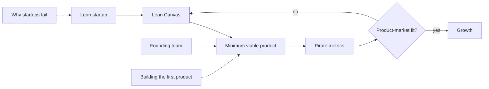

# Entrepreneurship and startups

How new businesses are founded, tested and kept alive. This subfield belongs to [Business and management](../README.md). A *startup* here means a young organization searching for a repeatable and profitable business model under high uncertainty, as Steve Blank defines it. The notes follow the order in which a founder meets the problems: the method (lean startup), the first product (MVP), the model on one page (Lean Canvas), what to measure (pirate metrics), the signal that the product works (product-market fit), why most attempts fail, who should be on the team, how to build the first version and a set of practical lessons.

## Map of the subfield

The notes form a loop: a hypothesis on the canvas is tested with an MVP, measured with pirate metrics and either confirmed (product-market fit) or changed.

## Notes in reading order

1. [Lean startup](lean-startup.md): validated learning, the build-measure-learn loop, pivots and what the evidence shows.
2. [Minimum viable product](minimum-viable-product.md): the smallest test that produces learning, its types and common misreadings.
3. [Lean Canvas](lean-canvas.md): a business model on one page, block by block, with a scooter-sharing example.
4. [Pirate metrics (AARRR)](pirate-metrics.md): acquisition, activation, retention, referral and revenue as a funnel of key metrics.
5. [Product-market fit](product-market-fit.md): definitions, the 40% survey test and flattening retention curves.
6. [Why startups fail](why-startups-fail.md): seven internal causes, premature scaling and what post-mortem studies show.
7. [Founding team](founding-team.md): the roles an early team needs, co-founder risks and equity.
8. [Building the first product](building-the-first-product.md): nine principles for getting a first software version out quickly.
9. [Entrepreneurship lessons](entrepreneurship-lessons.md): maxims on offers, pricing, sales, marketing and reputation, each checked against evidence.

## How to use this subfield

Read notes 1 to 3 and fill in a Lean Canvas for an idea. Design one MVP test (note 2) and decide its pirate metric (note 4) before running it. Use notes 5 and 6 as a checklist every quarter. Growth after product-market fit is covered in [growth](../growth/README.md), and the numbers in [business metrics](../business-metrics/README.md).

## Navigation

- Back to [Business and management](../README.md).
