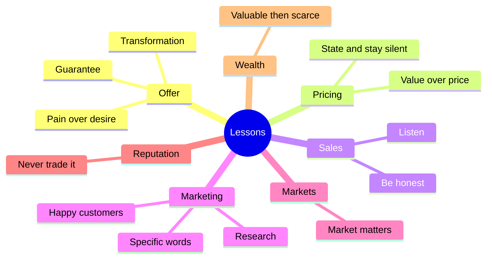

# Entrepreneurship lessons

## Summary

Practitioners pass on their experience as short maxims: sell the transformation, state your price and stop talking, solve pains rather than desires, compete on value, never trade reputation for money. This note collects 42 such lessons, groups them by theme (offer, pricing, sales, marketing and copywriting, markets, reputation and ethics, wealth) and checks each against research where research exists. Most are useful rules of thumb. A few are exaggerations that need a qualification.

## Prerequisites

No prior notes are needed.

## Core concepts

### Definition

An *entrepreneurship lesson* in this note is a compressed rule from practice about selling, marketing or running a business. Each lesson below carries a status: **supported** (consistent with research), **plausible** (good practice without strong evidence), or **overstated** (true in some cases but misleading as a general rule). The underlying topics have their own notes, linked in each group.

### Analogy

Maxims are like proverbs in a cookbook margin: "never let the pan get cold" is right most of the time and wrong for slow-cooked stews. They compress experience into memorable form and lose the conditions under which they hold. The status labels restore some of those conditions.

### Mechanism

Many lessons rest on one observation: people buy with emotion and then justify with logic. Research on judgment supports a softer version: decisions combine fast, intuitive and emotional processing with slower deliberation, and both matter (Kahneman, 2011). Persuasion principles are covered in [Persuasion principles](../../../personal-development/skills/hard-skills/copywriting/persuasion-principles.md).

### Offer

| Lesson | Status and comment |
| --- | --- |
| Sell the transformation, not the product. | Supported. Customers buy outcomes; see [Value proposition and benefits](../../../personal-development/skills/hard-skills/copywriting/value-proposition-and-benefits.md). |
| It is easier to sell an offer that solves a pain than one that fulfills a desire. | Plausible. Urgent problems create active buyers. Desire-driven markets (luxury, hobbies) also sell well, with different marketing. |
| If your offer has a solid guarantee, it will bring more sales than refunds. | Plausible. Common practitioner finding, but it depends on product quality and buyer behavior; see [Calls to action and risk reversal](../../../personal-development/skills/hard-skills/copywriting/calls-to-action-and-risk-reversal.md). |
| Your product should meet demand, not try to create it. | Supported for startups with limited capital. Creating a new category is possible but costly. |
| People do not care about your offer, only about what it can do for them. | Supported. Same idea as selling the transformation. |
| Quantify the timeframe of your offer. | Plausible. Specific promises ("in 30 days") are clearer, but they must be honest and deliverable. |
| You can be terrible at sales calls if you have a great offer. | Overstated. A strong offer reduces the need for persuasion, but discovery and listening still matter; see [Sales conversations](../../../personal-development/skills/hard-skills/client-acquisition/sales-conversations.md). |
| If what you sell is confusing, nobody will buy. | Supported. Clarity and processing fluency raise trust. |

### Pricing

| Lesson | Status and comment |
| --- | --- |
| State your price, then stay silent. | Plausible. Filling the silence with discounts or justifications weakens the offer. |
| There is no price that is too high, only too little value. | Overstated. Perceived value limits price, but so do budgets, alternatives and market norms. |
| On a sales call say "it is a one-time investment of..." rather than "the price is...". | Plausible but use with care. Framing can help, but calling a cost an investment must be honest. |
| Charge "high" prices so that you can deliver more value. | Plausible. Higher margins fund service and quality; see [Proposals and pricing](../../../personal-development/skills/hard-skills/client-acquisition/proposals-and-pricing.md). |
| Compete on value, not price. | Supported for small firms. Price wars favor the firm with the lowest costs. |

### Sales

| Lesson | Status and comment |
| --- | --- |
| Sales are about listening. | Supported by research on consultative selling (Rackham's SPIN studies). |
| Your sales pitch should not be over two minutes. | Plausible as a rule for the first statement of the offer. Discovery takes longer. |
| If you do not think you can help a prospect, be honest. | Supported. It protects reputation and referrals. |
| Handle objections in the FAQ section of your landing page to increase conversions. | Plausible. Answering doubts where they arise is good practice; test it. |

### Marketing and copywriting

| Lesson | Status and comment |
| --- | --- |
| Whatever business you are in, study psychology, cognitive biases and body language. | Plausible. Useful for empathy and ethics, but body language reading is less reliable than popular books suggest. |
| Memes are one of the strongest forms of marketing. | Overstated. They spread cheaply in some audiences and backfire in others. |
| Copywriting is 80% research and 20% writing. | Plausible as an emphasis; the ratio is not measured. See [Customer research for copywriting](../../../personal-development/skills/hard-skills/copywriting/customer-research.md). |
| Using pictures with written testimonials makes them more believable. | Supported in part. Photos increase perceived truth of claims in experiments (the truthiness effect), but fake photos are deceptive. |
| Specific words and numbers are more believable than broad ones. | Supported. |
| A happy customer is the strongest form of marketing. | Supported. Word of mouth and referrals; see [Referrals and retention](../../../personal-development/skills/hard-skills/client-acquisition/referrals-and-retention.md). |
| Marketing is about empathy. | Plausible. |
| Use "you" and "your" in your copy to make it more engaging. | Plausible. Common copywriting practice. |
| Use headlines to steal attention and hooks to keep it. | Supported as practice; see [Headlines](../../../personal-development/skills/hard-skills/content-marketing/headlines.md). |
| An average product with great marketing outsells a great product with bad marketing. | Overstated. True in the short run in many markets; poor products struggle with retention and reviews. |
| A fifth grader should be able to understand your writing. | Supported as a target for broad audiences; see [Writing for the web](../../../personal-development/skills/hard-skills/copywriting/writing-for-the-web.md). |
| Use the same words and phrases as your target market. | Supported. Voice-of-customer research. |
| Study talented fiction writers to learn engaging storytelling. | Plausible; see [Storytelling](../../../personal-development/skills/hard-skills/content-marketing/storytelling.md). |
| Your zero-to-hero story is one of your strongest marketing assets. | Plausible, if true. |
| Persuasive writing sounds conversational, not academic. | Supported for most audiences. |
| People want to see pictures of your product or service in use. | Supported. |

### Markets

| Lesson | Status and comment |
| --- | --- |
| The market is not "saturated", your offer is weak. | Overstated. Some markets are saturated; a better offer or a niche can still win. |
| Selling a good product in a bad market is a losing battle. | Supported. Andreessen (2007) argued that the market matters more than the team or the product. |
| There will always be a market for health, wealth and relationships. | Plausible. These are lasting human needs, and also crowded markets. |

### Reputation and ethics

| Lesson | Status and comment |
| --- | --- |
| Never sacrifice your reputation for money. | Supported. |
| If you would not work with someone for a year, do not work with them for a day. | Plausible. Bad clients cost more than they pay. |
| Give value with zero expectations and you will get tenfold returns in the long run. | Overstated in the number; supported in direction by reciprocity research. |

### Wealth and starting

| Lesson | Status and comment |
| --- | --- |
| You do not need an expensive laptop, an expensive logo or an expensive degree to start a business. | Supported. Early spending should go to learning about customers. |
| You become wealthy by becoming valuable, then becoming scarce. | Plausible. Combines skill and supply; scarcity without value does not work. |

The lessons group into seven themes:

## Worked example

A web designer applies five lessons to a proposal for a dental clinic:

1. **Transformation:** the proposal opens with "more booked appointments from people searching for a dentist in your district", not with "a new website".
2. **Specific numbers:** "booking in two clicks from the home page" instead of "easy booking".
3. **Price:** the call states "the project is 9,000 zł", then the designer waits for the client to respond.
4. **Guarantee:** if the site is not live within six weeks, the last installment is waived.
5. **Honesty:** the clinic also asks for a new logo, which the designer does not do well, so the designer recommends a colleague.

The numbers are invented for the example.

## Trade offs and when to use it

Maxims are quick to apply and hard to verify. Their danger is overconfidence: a lesson that worked for one seller in one market is repeated as a law. Use them as prompts, check the linked notes for evidence, and test the important ones on your own customers.

## Common mistakes

- **Using pressure tactics justified by "people buy on emotion".** Emotion and logic both matter, and manipulation damages reputation and can break consumer law.
- **Raising prices without raising value.** Price follows perceived value, alternatives and budgets.
- **Copying lessons without testing.** Run small tests with your own customers.

## Practice

1. Which lesson is marked overstated about saturated markets, and why?
2. What evidence supports "sales are about listening"?
3. Rewrite "Our software is fast and easy" using two lessons from the marketing group.

### Answers

1. "The market is not saturated, your offer is weak": some markets really are saturated, though a better offer or a niche can still win.
2. Rackham's research on consultative selling found that questions exploring implications and needs were associated with success in larger sales.
3. For example: "Your team sends its first invoice within 10 minutes of signing up" (specific numbers, "you" language, transformation).

## Further reading

- Kahneman, D. (2011). *Thinking, Fast and Slow*. Farrar, Straus and Giroux. Fast and slow thinking in decisions.
- Andreessen, M. (2007). The only thing that matters. pmarca blog. [Link](https://pmarchive.com/guide_to_startups_part4.html). Why the market matters most.
- Hormozi, A. (2021). *$100M Offers: How to Make Offers So Good People Feel Stupid Saying No*. Acquisition.com. A practitioner view of offers, guarantees and pricing.
