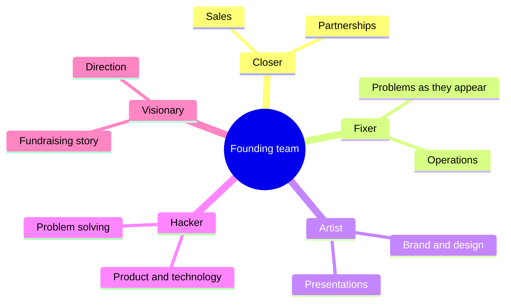

# Founding team

## Summary

An early-stage company needs a small team that together covers selling, building, designing, solving problems and setting direction. A practical way to check coverage is five roles: the closer, the fixer, the artist, the hacker and the visionary. One person can hold several roles, but a missing role usually shows up as a recurring problem. The biggest team risk is not missing skills but conflict between co-founders, which is easier to prevent with early agreements on roles, decisions and equity.

## Prerequisites

No prior notes are needed.

## Core concepts

### Definition

The *founding team* is the group that starts a company and carries it until it can hire specialists. Five roles describe what that group must be able to do:

- **The closer:** can close a deal even with the hardest client.
- **The fixer:** solves the operational problems that appear while the business is being built.
- **The artist:** creative, makes visuals and presentations that sell on their own.
- **The hacker:** has a logical mind, identifies problems and finds solutions, often in technology.
- **The visionary:** sees the best possible future and the path to it.

The roles overlap with the common "hacker, hustler, designer" trio of technology startups, with the fixer (operations) and the visionary (strategy) made explicit.

### Analogy

A founding team is like a band: someone writes songs (visionary), someone plays well (hacker), someone designs the stage show (artist), someone books concerts (closer) and someone fixes the van at 2 a.m. (fixer). A band can start with three people covering five jobs, but if nobody books concerts it does not matter how good the songs are. The analogy breaks because band members rarely own shares that become worth millions, which makes startup conflicts sharper.

### Mechanism

**Coverage.** Map each founder to the roles and mark gaps. Gaps can be covered by an early hire, an adviser or a contractor, but the closer and the hacker roles are hard to outsource in the first year, because selling and building are where most learning happens.

**Complementarity and conflict.** Noam Wasserman (2012) studied thousands of founding teams and described recurring dilemmas: whether to found alone or with others, with friends or strangers, how to split equity and roles, and when to bring in a professional CEO. Teams of friends start faster but avoid hard conversations. Equal equity splits agreed quickly are common and can cause trouble later if contributions differ.

**Experience.** Gompers, Kovner, Lerner and Scharfstein (2010) found that founders who had already built a successful venture-backed company were more likely to succeed again than first-time founders or founders who had failed before, which they attributed partly to skill and partly to reputation with investors and suppliers.

**Agreements.** A *founders' agreement* records roles, decision rights, time commitment, equity and *vesting* (equity earned over time, typically four years with a one-year *cliff*, so that a founder who leaves early does not keep a large share). In a Polish limited liability company, such terms are written into the articles of association and a separate shareholders' agreement (see [Articles of association](../../../social-sciences/law/company-law/articles-of-association.md)).

The five roles and the core work each one covers:

## Worked example

Two founders start a software company for dental clinics. One is a developer (hacker, partly fixer), the other a former dental equipment salesperson (closer, partly visionary). Their gap is the artist role: their website and pitch deck look amateurish, and clinics doubt the product. Instead of a third co-founder, they hire a freelance designer for a fixed project and agree that the salesperson owns brand decisions.

They also sign a founders' agreement: equity 50/50 with four-year vesting and a one-year cliff, the developer decides on technology, the salesperson on sales and pricing, and disagreements on strategy go to an agreed adviser.

## Trade offs and when to use it

More co-founders cover more roles but split equity and decisions further. A solo founder decides fast but carries every role. Hiring early for missing roles costs cash, while adding a co-founder costs equity and adds a person who is hard to remove. Choose based on which roles are core to learning in the next year.

## Common mistakes

- **Founding with friends without discussing roles and equity.** Have the hard conversation in the first month and write it down.
- **Three technical founders and no one selling.** Assign the closer role explicitly, even if someone must learn it.
- **No vesting.** Use vesting with a cliff so that equity follows contribution.
- **Treating the visionary role as enough.** Vision without someone who closes deals and someone who builds produces presentations, not a business.

## Practice

1. Name the five roles and what each contributes.
2. What is vesting with a cliff?
3. Which risk did Wasserman identify as common in teams of friends?

### Answers

1. Closer (closes deals), fixer (solves operational problems), artist (visuals that sell), hacker (logical problem solving, often technology), visionary (sees the future and the path).
2. Equity earned gradually over time, with nothing earned until the cliff date (often one year), so a founder who leaves early does not keep a large share.
3. Avoiding hard conversations about roles and equity, which leads to conflict later.

## Further reading

- Wasserman, N. (2012). *The Founder's Dilemmas: Anticipating and Avoiding the Pitfalls That Can Sink a Startup*. Princeton University Press. Research on founder dilemmas.
- Gompers, P., Kovner, A., Lerner, J. et al. (2010). Performance persistence in entrepreneurship. Journal of Financial Economics, 96(1), 18-32. [DOI](https://doi.org/10.1016/j.jfineco.2009.11.001). Evidence on serial entrepreneurs.
