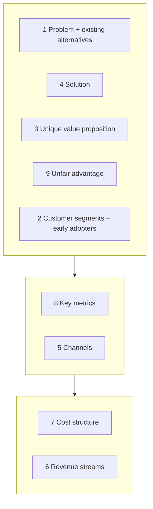

# Lean Canvas

## Summary

The Lean Canvas is a one-page template for describing a business model as a set of testable assumptions. It has nine blocks: problem, customer segments, unique value proposition, solution, channels, revenue streams, cost structure, key metrics and unfair advantage. Ash Maurya adapted it in 2010 from Osterwalder's Business Model Canvas to fit early-stage startups, where the problem and the customer are still uncertain. A canvas takes about 20 minutes to fill in and is meant to be rewritten as tests produce evidence.

## Prerequisites

- [Lean startup](lean-startup.md)

## Core concepts

### Definition

The *Lean Canvas* (also called the lean template) is a single-page model of a business, small enough to fit on an A4 sheet, that leaves out everything not needed to judge whether the business can work. Each block holds the current best guess, and the riskiest guesses are tested first. It differs from a business plan in length and purpose: a plan describes how to execute, while the canvas lists what must be true for the plan to make sense.

### Analogy

The canvas is like the one-page summary a doctor writes on a patient's chart: the problem, the likely cause, the treatment and what to monitor, without the full medical history. It is quick to read and update after each test. The comparison breaks because a doctor can rely on established knowledge of diseases, while most of a startup canvas is unproven guesswork at the start.

### Mechanism

The nine blocks are usually filled in this order, because each depends on the previous ones:

1. **Problem.** The top three problems or needs of the customer segment. Add the *existing alternatives*: how people solve the problem today (a competitor, a spreadsheet, doing nothing). If no one solves it today, ask whether it is really a problem.
2. **Customer segments.** Who has the problems. Mark the *early adopters*, the subgroup that feels the problem most and will try an unfinished product first.
3. **Unique value proposition (UVP).** One clear, attractive message that says why you are different and worth buying. Add a short *high-level concept*, a slogan-like line such as "Uber for dog walking". The goal is to catch the attention of early adopters.
4. **Solution.** The top features that address each problem. Map each feature to a problem. These features define the scope of the MVP (see [Minimum viable product](minimum-viable-product.md)).
5. **Channels.** The paths to customers. Some channel must work from day one, to reach the people who will test the product.
6. **Revenue streams.** How the product makes money: pricing model, price, margin, and less obvious sources.
7. **Cost structure.** The main costs of reaching the market and running the business: development, hosting, people, customer acquisition, service. Together with revenue it gives a first estimate of the break-even point.
8. **Key metrics.** The few numbers that show whether customers use the product as intended. Pirate metrics are a common framework for choosing them (see [Pirate metrics (AARRR)](pirate-metrics.md)).
9. **Unfair advantage.** Something that cannot easily be copied or bought: inside knowledge, a community, a network effect, exclusive data, a dream team. Many early canvases leave this block empty, and that is an honest answer.

The layout below follows the usual arrangement of the canvas: the product side on the left, the market side on the right, and money at the bottom.

### Lean Canvas and Business Model Canvas

Osterwalder and Pigneur's *Business Model Canvas* (2010) describes an existing or planned business with nine blocks, several of which (key partners, key activities, key resources, customer relationships) matter most once a business works. Maurya replaced four of them with blocks that matter more when the problem itself is uncertain:

| Business Model Canvas | Lean Canvas |
| --- | --- |
| Key partners | Problem |
| Key activities | Solution |
| Key resources | Key metrics |
| Customer relationships | Unfair advantage |

The remaining five blocks (customer segments, value proposition, channels, revenue streams, cost structure) are shared. Use the Lean Canvas while searching for a model and the Business Model Canvas once you are executing one.

## Worked example

An electric scooter sharing service in a mid-sized city:

| Block | Content |
| --- | --- |
| Problem | Last-mile trips of 1 to 3 km are too long to walk and too short for a car. Buses are infrequent. Existing alternatives: walking, private bikes, taxis. |
| Customer segments | Commuters and students in the city center. Early adopters: students living in dormitories 2 km from campus. |
| UVP | "From door to lecture hall in eight minutes." High-level concept: a bike-share without docks. |
| Solution | App to find and start scooters, per-minute pricing, parking zones on the map. |
| Channels | Campus events, student unions, scooters placed visibly at dormitories. |
| Revenue streams | Start fee plus per-minute price, monthly passes. Less obvious sources: advertising for partners on scooters, in the app or at charging stations. |
| Cost structure | Scooters and their depreciation, charging, servicing and repairs, vandalism, insurance, staff, customer service, app development, a website and social media profiles, city permits. |
| Key metrics | Rides per scooter per day, share of users riding again within a week, cost per ride. |
| Unfair advantage | An exclusive agreement with the university for parking on campus (if it can be obtained). |

Costs are easy to underestimate. Purchasing scooters and advertising is only part of the picture: charging, service, hiring and customer support often decide whether the business covers its costs. Revenue is the block founders think about most, but the question is not only how much but how long until the business pays back what was invested.

## Trade offs and when to use it

The canvas is fast, visual and easy to share, which makes assumptions explicit. Its weaknesses: it can give a false sense of rigor (a filled-in block is still a guess), it says nothing about competition in depth, and it does not replace a financial model once the business is real. Use it for the search phase and for comparing several ideas side by side.

## Common mistakes

- **Filling every block with confident statements.** Mark each entry as tested or untested, and test the riskiest untested block next.
- **Listing features as the problem.** The problem block describes the customer's pain, not your solution.
- **Writing "everyone" as the customer segment.** Name the early adopters, the subgroup with the most acute problem.
- **Claiming an unfair advantage that can be bought.** Money, a first-mover position or a patent application rarely qualify. Leave the block empty until you have one.

## Practice

1. Which four blocks of the Business Model Canvas does the Lean Canvas replace, and with what?
2. Why should the problem block include existing alternatives?
3. Fill in the problem, customer segment and UVP blocks for a tutoring app for adults learning to swim.

### Answers

1. Key partners with problem, key activities with solution, key resources with key metrics, customer relationships with unfair advantage.
2. Because they show how people solve the problem today, which is the real competition and a test of whether the problem matters.
3. Example: problem: fear of water, few adult classes, schedules for children; segment: adults 30 to 50, early adopters: parents who want to swim with their children; UVP: "Swim a length in ten evenings, in classes only for adults."

## Further reading

- Maurya, A. (2012). *Running Lean: Iterate from Plan A to a Plan That Works*. O'Reilly Media. The Lean Canvas and how to use it.
- Osterwalder, A., Pigneur, Y. (2010). *Business Model Generation*. Wiley. The Business Model Canvas it adapts.
- Ries, E. (2011). *The Lean Startup: How Today's Entrepreneurs Use Continuous Innovation to Create Radically Successful Businesses*. Crown Business. Testing the assumptions on the canvas.
