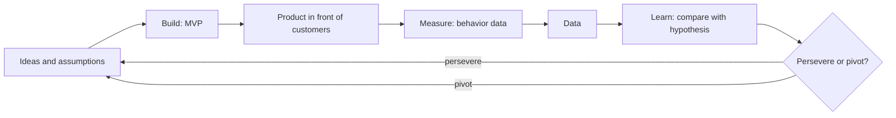

# Lean startup

## Summary

The lean startup is a method for building new products under high uncertainty. Instead of writing a detailed plan and executing it, a team states its assumptions as testable hypotheses, builds the smallest thing that can test the riskiest one, measures what real customers do and decides whether to continue or change course. The aim is to find a product that customers want and will pay for as quickly and cheaply as possible, by removing work that does not produce learning. The method was named by Eric Ries (2011), building on Steve Blank's customer development and on lean manufacturing.

## Prerequisites

No prior notes are needed.

## Core concepts

### Definition

The *lean startup* is an approach to creating new products and businesses in which every activity is judged by how much *validated learning* it produces: knowledge about customers that is backed by evidence from their behavior, not by opinion. It applies the lean idea of eliminating waste (from the Toyota Production System, Ohno, 1988) to innovation, where the biggest waste is building something nobody wants.

Its goal is to reach the right product, one that customers want and are willing to pay for, as quickly as possible. It differs from classic business planning in that the plan is treated as a set of guesses to be tested, not as a forecast to be executed.

### Analogy

A lean startup works like a scientist running cheap experiments instead of an architect drawing a complete building before anyone has asked for it. Each experiment answers one question ("will busy parents pay for pre-cut vegetables?") before the next, more expensive, question is asked. The analogy breaks in one place: a scientist aims for general truths, while a startup only needs to learn enough to make the next business decision, and markets change while it learns.

### Mechanism

The method runs as a feedback loop of three steps, called *build, measure, learn*:

1. **Build.** Turn the riskiest assumption into a hypothesis and build a *minimum viable product* (MVP) that can test it (see [Minimum viable product](minimum-viable-product.md)).
2. **Measure.** Expose real customers to the MVP and collect data on what they do: sign-ups, activation, repeat use, payment. Ries calls the discipline of measuring progress against a baseline *innovation accounting*, and warns against *vanity metrics* (totals that only grow, such as registered users) in favor of *actionable metrics* (rates per cohort, such as the share of new users who return in week two).
3. **Learn.** Compare the result with the hypothesis and decide to *persevere* (keep the strategy and optimize) or *pivot* (change one element of the strategy while keeping what was learned).

The loop is planned in reverse: first decide what you need to learn, then which data would show it, then the smallest product that produces that data. The speed of the loop matters more than the quality of any single iteration, because each turn reduces uncertainty.

Steve Blank's *customer development* (2005) supplies the outer process: customer discovery (do the problem and the customer exist?), customer validation (is there a repeatable sales process?), customer creation and company building. The lean startup is often summarized as customer development plus agile development plus business model hypotheses (Blank, 2013).

The loop is drawn below. It is run as many times as needed, and every turn ends with a persevere or pivot decision.

### Types of pivot

Ries lists several kinds of pivot. Each changes one part of the business model and keeps the rest:

| Pivot | What changes | Example |
| --- | --- | --- |
| Zoom-in | One feature becomes the whole product | A photo app keeps only its filters |
| Zoom-out | The product becomes one feature of a larger one | A single tool grows into a suite |
| Customer segment | Same product, different customer | A consumer app finds its buyers in small firms |
| Customer need | Same customer, different problem | Research shows a more urgent pain |
| Platform | Application becomes a platform or the reverse | A tool opens an API for others |
| Business architecture | High margin and low volume or the reverse | Enterprise sales replace self-service |
| Value capture | How money is made | Subscription replaces one-time sale |
| Engine of growth | How customers are acquired | Paid ads replace sales staff |
| Channel | How the product reaches customers | Direct sales replace retail |
| Technology | Same solution, cheaper technology | A new method lowers the cost per unit |

### Evidence

The method comes from practice, and controlled evidence is limited but growing. In a randomized trial with 116 Italian startups, Camuffo, Cordova, Gambardella and Spina (2020) trained one group to treat their ideas as hypotheses and test them, as the lean startup recommends. The trained startups pivoted more often to better ideas, abandoned weak projects earlier and, on average, earned more revenue than the control group. This supports the core idea of disciplined testing. The rest of the method, such as specific metrics and pivot types, rests on case studies and practitioner experience.

## Worked example

A founder believes that working parents will pay 15 euros a week for pre-cut, portioned vegetables delivered on Sundays.

1. **Riskiest assumption:** parents will pay before they have tried the product. If this is false, nothing else matters.
2. **MVP:** a landing page with the offer, a price and a "reserve your first box" button that takes a 5 euro deposit (see [Minimum viable product](minimum-viable-product.md)). The founder packs the first boxes by hand.
3. **Hypothesis written before the test:** at least 4% of visitors from a parents' Facebook group will pay the deposit, and at least half of the first 20 customers will order a second box.
4. **Measure:** 1,000 visitors, 31 deposits (3.1%), 9 of the first 20 customers order again (45%).
5. **Learn:** both numbers are close to but below the target. Interviews with the 11 customers who did not reorder show that they liked the product but wanted delivery on Wednesday. The founder perseveres with the segment and changes the delivery day, then runs the loop again.

The numbers are invented for the example.

## Trade offs and when to use it

**Benefits.** Lower cost of failure, faster learning, less time spent building unwanted features, and a habit of deciding from evidence.

**Costs.** Constant change can tire a team and confuse early customers. Small experiments can miss ideas whose value appears only at scale (network effects, brand).

**When it is the wrong choice.** In regulated or capital-heavy fields (medical devices, aircraft, chips), a minimum product can be expensive, slow or illegal to release, so testing moves to interviews, prototypes and pilot customers. When the problem and the solution are well known (opening a franchise outlet), classic planning and execution work better. The lean startup is a method for uncertainty, not for every business.

## Common mistakes

- **Treating "lean" as "cheap and low quality".** Lean means removing work that does not produce learning. The MVP must still be good enough for the test to be fair.
- **Measuring vanity metrics.** Use rates by cohort (activation, week-four retention, conversion), not cumulative totals.
- **Running experiments without a written hypothesis.** Write the expected result and the decision rule before the test, or every result will look like success.
- **Pivoting after every disappointing week.** Agree in advance how many loops a strategy gets and what result would justify a pivot.
- **Testing the easiest assumption instead of the riskiest.** Rank assumptions by how fatal they would be if false and how little you know about them.

## Practice

1. What is validated learning, and how does it differ from customer opinions collected in a survey?
2. A team reports 50,000 registered users. Why is this a vanity metric, and what would you ask for instead?
3. Name three types of pivot and give an example of each.
4. Why does the build-measure-learn loop get planned in reverse?

### Answers

1. Validated learning is knowledge about customers backed by evidence from what they do (sign up, return, pay). Survey opinions describe what people say they would do, which predicts behavior only weakly.
2. A cumulative total only grows and says nothing about whether the product works. Ask for activation and retention rates per weekly cohort.
3. For example: customer segment pivot (same product sold to small firms instead of consumers), zoom-in pivot (one feature becomes the product), value capture pivot (subscription instead of one-time sale).
4. Because the goal is learning: decide what you need to learn, then which data would show it, then the smallest product that generates that data.

## Further reading

- Ries, E. (2011). *The Lean Startup: How Today's Entrepreneurs Use Continuous Innovation to Create Radically Successful Businesses*. Crown Business. The book that named the method.
- Blank, S. G. (2005). *The Four Steps to the Epiphany*. Cafepress. Customer development, the outer process.
- Blank, S. (2013). Why the lean start-up changes everything. Harvard Business Review, 91(5), 63-72. [Link](https://hbr.org/2013/05/why-the-lean-start-up-changes-everything). Short overview of the method and its parts.
- Camuffo, A., Cordova, A., Gambardella, A. et al. (2020). A scientific approach to entrepreneurial decision making: Evidence from a randomized control trial. Management Science, 66(2), 564-586. [DOI](https://doi.org/10.1287/mnsc.2018.3249). Randomized trial of hypothesis-driven entrepreneurship.
- Ohno, T. (1988). *Toyota Production System: Beyond Large-Scale Production*. Productivity Press. The lean manufacturing roots.
