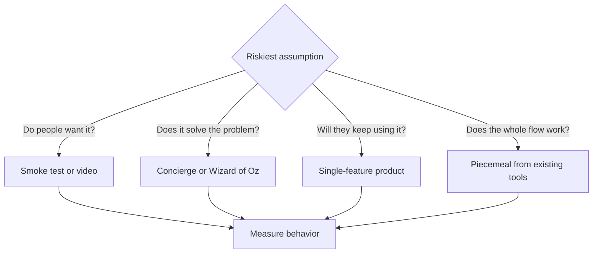

# Minimum viable product

## Summary

A minimum viable product (MVP) is the smallest version of a product, or a substitute for it, that lets a team test its most important assumption with real customers. Its purpose is learning, not revenue or polish. An MVP can be a landing page, a video, a manual service behind a simple interface or a product with one feature. The word "minimum" refers to the effort, while "viable" means the test must be good enough to give an honest answer.

## Prerequisites

- [Lean startup](lean-startup.md)

## Core concepts

### Definition

Eric Ries (2011) defines the *minimum viable product* as the version of a new product that allows a team to collect the maximum amount of validated learning about customers with the least effort. It is an experiment, not a cheap first release. It is distinct from a *prototype*, which tests whether something can be built or how it should look, and from a *proof of concept*, which tests technical feasibility. An MVP tests demand or behavior: will people use it, come back and pay.

### Analogy

An MVP is like a restaurant that starts as a weekend food stall with three dishes. The owner learns which dishes sell, at what price and to whom, before signing a ten-year lease on a dining room. The analogy holds for the logic of testing demand cheaply. It breaks because a software MVP can often be changed daily, while a stall still has fixed costs, and because some MVPs (such as a landing page) do not deliver any product at all.

### Mechanism

Designing an MVP follows the build-measure-learn loop in reverse (see [Lean startup](lean-startup.md)):

1. **Choose the riskiest assumption**, usually about demand ("people will pay"), value ("it solves the problem well enough to keep using") or channel ("we can reach them at an acceptable cost").
2. **Write the hypothesis and the success criterion** with a number and a deadline.
3. **Pick the cheapest test** that produces behavior, not opinions.
4. **Run it with real target customers**, measure and decide.

Common MVP types, ordered roughly from least to most effort:

| Type | How it works | Tests | Known example |
| --- | --- | --- | --- |
| Smoke test (landing page) | Describe the offer, measure sign-ups or pre-orders | Demand, messaging, price | Many waitlist launches |
| Explainer video | Show the product working before it exists | Interest and understanding | Dropbox's demo video, 2007 |
| Concierge | Deliver the service by hand, openly | Value, process, willingness to pay | Food delivery founders delivering themselves |
| Wizard of Oz | Customers see a product, humans do the work behind it | Value of an automated product | Zappos photographing shoes in local shops before holding stock |
| Single-feature product | Build only the core feature | Retention and usage | Early versions of many apps |
| Piecemeal | Combine existing tools (forms, spreadsheets, no-code) | Whole flow before custom code | A marketplace run on a form and a spreadsheet |

The decision path below shows how the riskiest assumption leads to the type of MVP.

### MVP, prototype and first release

A useful question before building is what the first version is for. The answer decides what "minimum" means:

- A **prototype for investors** must look credible and tell a story. It may not work end to end.
- An **MVP for real customers** must deliver enough value to measure behavior honestly.
- An **internal tool for process optimization** must fit the existing process and save time.

Confusing these goals produces products that impress investors but cannot be tested, or tests that cannot be shown to anyone. See [Building the first product](building-the-first-product.md) for the full set of principles.

## Worked example

A team wants to build a mobile app that matches dog owners with nearby walkers.

- **Riskiest assumption:** owners will trust a stranger found through an app and pay 20 zł per walk.
- **MVP chosen:** concierge. A one-page site with a booking form. The founders personally vet five walkers, match bookings by phone and collect payment by bank transfer.
- **Success criterion:** within four weeks, 30 paid walks and at least 40% of first-time customers booking again.
- **Result:** 41 paid walks, 52% repeat bookings, and the most common question was "can I see where the dog is during the walk?"
- **Decision:** persevere, and make live GPS tracking the first feature of the real app.

The numbers are invented for the example.

## Trade offs and when to use it

An MVP saves time and money and reduces the risk of building the wrong thing. Its costs are reputational (a weak test can disappoint early customers), ethical (a smoke test that takes orders for a product that does not exist must be honest about it, see [Private label](../../../personal-development/skills/hard-skills/e-commerce/private-label.md) for the legal limits on selling stock you do not have) and methodological (a small sample can mislead). Where safety, privacy or regulation matter, the minimum bar is set by law, not by the team.

## Common mistakes

- **Building a "minimum" product that is too poor to test anything.** If customers leave because of bugs, you learn nothing about demand. Make the core experience work.
- **Adding features "just in case" before launch.** Every feature must serve the hypothesis. Keep a list of later ideas instead.
- **Testing with friends and family.** They are kind, not representative. Recruit strangers from the target segment.
- **No success criterion.** Write the number that would mean success or failure before running the test.
- **Hiding a Wizard of Oz MVP in a way that misleads customers about safety or data use.** Manual work behind an interface is fine, but customers must not be harmed or deceived about what matters to them.

## Practice

1. How does an MVP differ from a prototype?
2. Which MVP type would you use to test whether people will pay for an AI tax assistant before building the AI?
3. Why is "minimum" not the same as "low quality"?

### Answers

1. An MVP tests customer behavior (demand, use, payment). A prototype tests whether something can be built or how it should look.
2. A Wizard of Oz MVP: customers use the interface, and accountants answer behind it.
3. Minimum refers to scope and effort. The part that is tested must be good enough to give an honest answer.

## Further reading

- Ries, E. (2011). *The Lean Startup: How Today's Entrepreneurs Use Continuous Innovation to Create Radically Successful Businesses*. Crown Business. Definition of the MVP.
- Maurya, A. (2012). *Running Lean: Iterate from Plan A to a Plan That Works*. O'Reilly Media. Practical guidance on testing and MVP design.
- Fitzpatrick, R. (2013). *The Mom Test*. Self-published. How to talk to early customers without biasing them.
