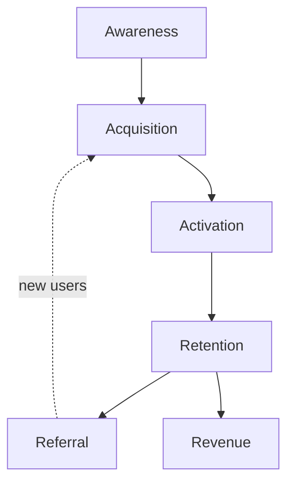
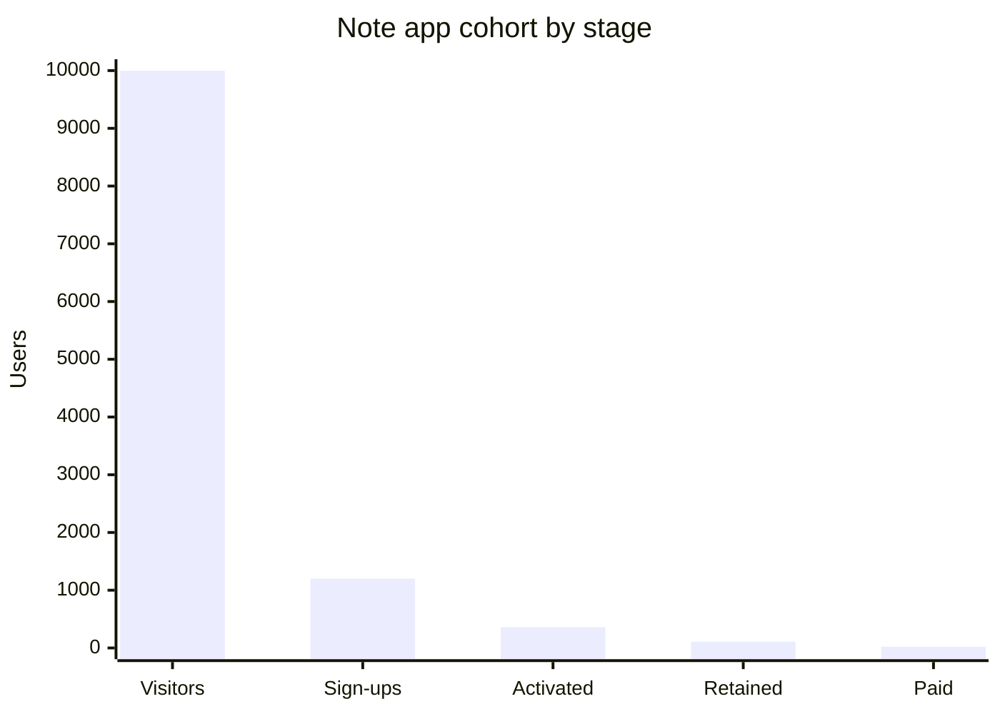

# Pirate metrics (AARRR)

## Summary

Pirate metrics are a framework for choosing a startup's key metrics along the customer lifecycle: acquisition, activation, retention, referral and revenue. The initials spell AARRR, which explains the name. Dave McClure proposed it in 2007 so that founders would track a few rates that show where customers drop out, instead of totals that only grow. Many teams add awareness at the start of the funnel.

## Prerequisites

- [Lean Canvas](lean-canvas.md)

## Core concepts

### Definition

*Pirate metrics* (AARRR) are five stages of the customer lifecycle, each measured by one or two conversion rates:

- **Acquisition:** people arrive at the product (visit the site, install the app).
- **Activation:** they have a first good experience (complete onboarding, reach the "aha" moment).
- **Retention:** they come back and keep using it.
- **Referral:** they bring others.
- **Revenue:** they pay.

It is a selection framework, not a list of required numbers: each business defines what activation or retention means for its product.

### Analogy

The funnel is like a series of doors in a museum: many people enter the lobby, fewer buy a ticket, fewer reach the main hall, and only some come back or recommend it. Counting visitors at each door shows which door loses the most people. The analogy breaks because real customers do not move in a straight line: referral can happen before payment, and retention feeds revenue repeatedly.

### Mechanism

For each stage, define a specific event and a rate:

| Stage | Example event | Example metric |
| --- | --- | --- |
| Awareness (optional) | Sees an ad or a post | Reach, impressions |
| Acquisition | Visits the landing page | Visitors per channel, cost per visitor |
| Activation | Creates first project within 24 hours | Activation rate = activated / new sign-ups |
| Retention | Active in week four | Week-four retention per weekly cohort |
| Referral | Invites a colleague who signs up | Invites per user, viral coefficient |
| Revenue | Starts a paid plan | Conversion to paid, ARPU (see [Average revenue per user (ARPU)](../business-metrics/arpu.md)) |

The weakest stage is the one to work on. Improving acquisition while activation is broken only pours more people into a leaky funnel. For a subscription business, retention is usually the most important stage, because it multiplies the value of every other improvement (see [Churn rate](../business-metrics/churn-rate.md)).

The funnel below shows the stages in the usual order, with referral feeding back into acquisition.

## Worked example

A note-taking app has these weekly numbers for one cohort:

| Stage | Count | Rate from previous stage |
| --- | --- | --- |
| Visitors | 10,000 | |
| Sign-ups | 1,200 | 12% |
| Activated (created three notes on day one) | 360 | 30% |
| Retained (active in week four) | 108 | 30% |
| Paid | 22 | 20% of retained |

The biggest relative loss is between sign-up and activation: 70% of new users never create three notes. The team tests a template gallery on the first screen. If activation rises to 45%, the number of paying users rises proportionally, from 22 to about 32, without any change in marketing spend.

The chart shows the drop between stages.

The numbers are invented for the example.

## Trade offs and when to use it

AARRR is simple and helps a team agree on where to focus. Its limits: the stages are not strictly sequential, it says nothing about costs or margins (add CAC and LTV, see [Customer acquisition cost (CAC)](../business-metrics/customer-acquisition-cost.md) and [Customer lifetime value (LTV)](../business-metrics/customer-lifetime-value.md)), and it was designed for consumer internet products. In B2B sales, stages such as qualified lead, demo and contract matter more.

## Common mistakes

- **Tracking totals instead of rates.** Use conversion rates between stages and compare cohorts.
- **Defining activation vaguely ("logged in").** Choose the event that best predicts later retention, found from data.
- **Working on acquisition first.** Fix the stage with the biggest loss, usually activation or retention.

## Practice

1. What do the letters AARRR stand for?
2. A funnel has 40% activation and 5% week-four retention. Where should the team focus, and why?
3. How would you choose the activation event for a project management tool?

### Answers

1. Acquisition, activation, retention, referral, revenue.
2. On retention, because almost everyone who activates leaves, so more acquisition or activation would be wasted.
3. Look at which early action (for example inviting a teammate and creating three tasks in the first day) best separates users who are still active after a month from those who left.

## Further reading

- McClure, D. (2007). Startup Metrics for Pirates: AARRR. Presentation, 500 Startups. [Link](https://www.slideshare.net/dmc500hats/startup-metrics-for-pirates-long-version). The original presentation.
- Ellis, S., Brown, M. (2017). *Hacking Growth: How Today's Fastest-Growing Companies Drive Breakout Success*. Currency. How growth teams use the funnel in practice.
- Ries, E. (2011). *The Lean Startup: How Today's Entrepreneurs Use Continuous Innovation to Create Radically Successful Businesses*. Crown Business. Actionable versus vanity metrics.
