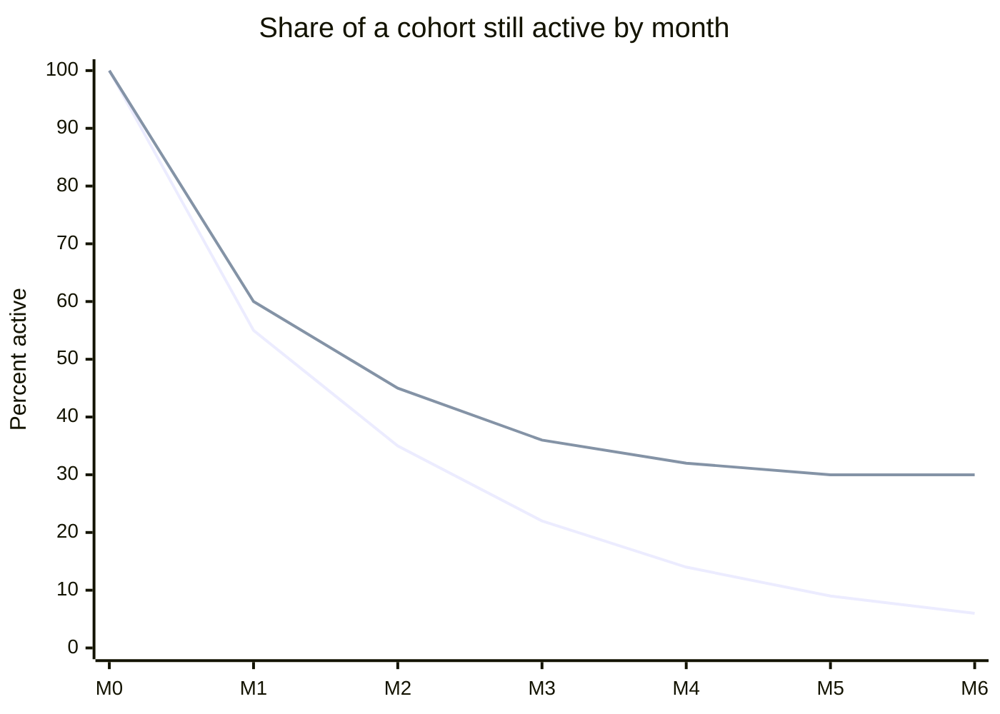

# Product-market fit

## Summary

Product-market fit (PMF) is the point at which a product satisfies a strong demand in a specific market, so that customers keep using it, pay for it and recommend it without being pushed. Marc Andreessen popularized the term in 2007 and called it the only thing that matters for a startup. The most reliable signal is a retention curve that flattens: a stable share of each cohort keeps using the product month after month. Survey tests, such as asking how disappointed users would be without the product, give an early but weaker signal.

## Prerequisites

- [Pirate metrics (AARRR)](pirate-metrics.md)

## Core concepts

### Definition

*Product-market fit* means being in a good market with a product that can satisfy that market (Andreessen, 2007). It is a state that can be measured roughly, not a single event: a product can have fit with one segment and not with another, and fit can be lost when the market changes. It differs from *problem-solution fit*, which only shows that the proposed solution addresses a real problem for some customers, usually established through interviews before much is built.

### Analogy

Product-market fit is like a key that finally turns in a lock. Before it, a team pushes, jiggles and forces, and every sale takes effort. After it, customers pull the product: they find it, use it and tell others. The analogy breaks because a lock does not change, while markets do: fit must be maintained as competitors, technology and customer needs move.

### Mechanism

Three kinds of evidence are used, from weakest to strongest:

1. **Qualitative signals.** Customers describe the product in their own words, complain when it is down, and ask for more. Andreessen described the feeling of fit as customers buying the product as fast as you can make it.
2. **The 40% survey test.** Sean Ellis proposed asking active users "How would you feel if you could no longer use this product?" with the answers very disappointed, somewhat disappointed, not disappointed. If at least 40% answer "very disappointed", the product has a strong base of users who depend on it (Ellis and Brown, 2017). Rahul Vohra (2018) described how Superhuman used this survey to segment users, find who loved the product and focus the roadmap on them. The 40% threshold is a practitioner benchmark, not a validated cut-off.
3. **Retention curves.** Plot, for each monthly cohort, the share of users still active after 1, 2, 3 and more months. Without fit, the curve keeps falling toward zero. With fit, it flattens at some level. Rachitsky and Winters (2021) collected practitioner benchmarks for six-month retention: about 25% good and 45% great for consumer social products, 40% good and 70% great for consumer subscription software, and 60% good and 80% great for small and mid-market business software. Low but flat retention can still support a business if acquisition is cheap.

The chart contrasts two retention curves. The first keeps falling (no fit), the second flattens near 30% (fit with a stable core of users).

The numbers are invented to show the two shapes.

## Worked example

A language learning app surveys 400 users active in the last two weeks. 152 (38%) answer "very disappointed". The team groups the answers by user type: among adults preparing for a work relocation, 61% are very disappointed, while among casual learners only 18% are. Retention curves confirm the pattern: the relocation cohort flattens at 35% after month four, the casual cohort keeps falling.

The team concludes it has fit with one segment, focuses marketing and product work on people relocating for work, and treats casual learners as a later expansion. The numbers are invented for the example.

## Trade offs and when to use it

Searching for fit before scaling protects a startup from spending on growth that leaks away. The risk is the opposite error: waiting too long for perfect certainty while competitors move. Fit is also segment-specific, so an average across all users can hide strong fit with a small group or weak fit overall.

## Common mistakes

- **Declaring fit from growth driven by paid ads.** Check retention by cohort. Growth bought with ads can hide a falling curve.
- **Averaging survey answers across all users.** Segment the answers and look for the group that loves the product.
- **Treating the 40% rule as a law.** Use it as a prompt for investigation together with retention data.
- **Assuming fit lasts.** Re-check retention curves each quarter.

## Practice

1. What shape of the retention curve signals product-market fit?
2. What question does the Sean Ellis survey ask, and what threshold is commonly used?
3. How does product-market fit differ from problem-solution fit?

### Answers

1. A curve that flattens at a stable level instead of falling toward zero.
2. "How would you feel if you could no longer use this product?" with at least 40% answering "very disappointed".
3. Problem-solution fit shows that the solution addresses a real problem for some customers. Product-market fit shows that a market keeps using and paying for the product.

## Further reading

- Andreessen, M. (2007). The only thing that matters. pmarca blog. [Link](https://pmarchive.com/guide_to_startups_part4.html). The essay that popularized the term.
- Ellis, S., Brown, M. (2017). *Hacking Growth: How Today's Fastest-Growing Companies Drive Breakout Success*. Currency. The 40% survey test.
- Vohra, R. (2018). How Superhuman built an engine to find product/market fit. First Round Review. [Link](https://review.firstround.com/how-superhuman-built-an-engine-to-find-product-market-fit/). A detailed account of using the survey to steer a product.
- Rachitsky, L., Winters, C. (2021). What is good retention?. Lenny's Newsletter. [Link](https://www.lennysnewsletter.com/p/what-is-good-retention-issue-29). Practitioner benchmarks for good and great retention.
