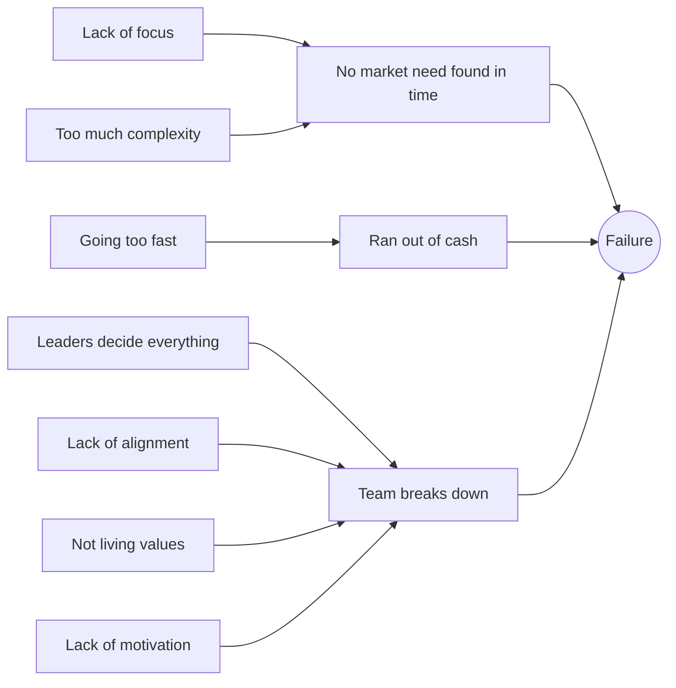

# Why startups fail

## Summary

Most startups fail, and studies of failed companies point to the same few causes: building something the market does not need, running out of money, and team problems. Inside the company, the failure usually shows up as one of seven patterns: lack of focus, growing too fast, lack of alignment, leaders who decide everything, too much complexity, leaders who do not live their stated values, and lack of motivation. Each has a known remedy. This note describes the patterns, the evidence behind them and the fixes.

## Prerequisites

No prior notes are needed.

## Core concepts

### Definition

A startup *fails* when it shuts down or is sold for less than the money invested, usually because it cannot find a repeatable business model before its cash runs out. The causes fall into two groups: *external* (no market need, competition, regulation, timing) and *internal* (focus, pace, alignment, leadership, complexity, culture, motivation). Post-mortem surveys mostly capture the first group, because founders name the visible end point. Practitioners stress the second group, because internal problems often explain why a team did not notice or fix the external ones in time.

### Analogy

A startup is like a small boat crossing open water with limited fuel. It can sink because there was no harbor where it was heading (no market), because it burned fuel too fast (going too fast), or because the crew rowed in different directions (no alignment). Most sinkings combine several of these. The analogy breaks because a startup can change destination mid-voyage, which a boat with fixed fuel rarely can.

### Mechanism

**What post-mortems say.** CB Insights analyzed 101 founder post-mortems in 2017. The most cited reason was no market need, followed by running out of cash and not having the right team, with getting outcompeted, pricing and cost problems, poor product and lack of a business model further down. Later updates of the analysis are reported to list running out of cash (about 38%) and no market need (about 35%) as the top two. These are counts of reasons named by founders who chose to publish, so they are a biased sample and the percentages are rough.

**Premature scaling.** The Startup Genome report (2011), based on data from several thousand startups, argued that scaling one part of the business (hiring, marketing spend, product scope) ahead of the others, and especially ahead of product-market fit, was the most common cause of failure among high-growth startups. The report is a practitioner study and its headline percentages have not been independently replicated.

**Seven internal killers.** The patterns below are practitioner knowledge rather than findings of controlled studies, but each is consistent with research on teams and organizations:

| Pattern | What happens | Remedy |
| --- | --- | --- |
| Lack of focus | Too many goals at once, so none is reached. | Three goals at most, known to everyone. |
| Going too fast | Expansion outruns capability, the team burns out and loses sight of the main goal. WeWork is the best-known example. | Balanced, profitable growth that can survive a downturn. |
| Lack of alignment | Like a crew rowing in different directions, effort cancels out. | Align everyone with the mission, the vision and the goals, from top to bottom. |
| Team of doers, not leaders | Founders make every decision and become the bottleneck, others wait for approval. | Grow leaders: let them decide, set their own goals and bring forward opportunities. Optimize for individual autonomy. |
| Too much complexity | Meetings, processes and approval steps multiply and slow every decision. | Keep only essential meetings, cut red tape, optimize for fast decisions. |
| Not living values | Leaders say one thing and do another, which erodes trust slowly, like a disease spreading from inside. | Lead by example. |
| Lack of motivation | People do not know how the company is doing or how their work fits in, and start asking "why even bother?" | Always communicate purpose, direction and progress, transparently. |

The diagram links the seven internal patterns to the external outcomes founders report in post-mortems.

### Case: WeWork

WeWork, a provider of shared office space, was valued at about 47 billion dollars in a private funding round in January 2019. It expanded rapidly into many cities while making large losses, signing long leases while renting desks on short contracts. When it filed for a public listing in August 2019, investors questioned its losses and its governance, and the offering was withdrawn in September 2019. The company was later listed at a much lower valuation and filed for bankruptcy protection in the United States in November 2023. It illustrates growing too fast and governance problems at once.

## Worked example

A food delivery startup with 25 employees reviews itself against the seven patterns:

- **Focus:** the team is working on 11 company goals. It cuts them to three: reach 30% four-week retention, sign 40 restaurants in one district, and lower delivery cost per order below 9 zł.
- **Pace:** it planned to open in three new cities. It postpones this until the first district is profitable.
- **Alignment:** a short written page states the mission, the vision and the three goals, and every team's plan must refer to one of them.
- **Doers versus leaders:** the CEO approves every marketing spend above 200 zł. The limit is raised to 5,000 zł, and team leads own their budgets.
- **Complexity:** a weekly status meeting with 18 people is replaced by a written update.
- **Values:** the founders, who preached frugality, cancel a planned team trip abroad that they had approved for themselves.
- **Motivation:** a monthly all-hands shows the three goals and progress on each.

The numbers are invented for the example.

## Trade offs and when to use it

Checklists of failure causes are useful for regular self-review, but they are easy to apply after the fact and hard to apply in advance: almost every failed startup can be described as lacking focus or moving too fast. The value lies in agreeing on concrete thresholds (three goals, approval limits, a growth rule tied to unit economics) before trouble starts.

## Common mistakes

- **Blaming failure only on "running out of cash".** Ask why the money ran out: usually no market need, too much spending before fit, or both.
- **Reading post-mortem percentages as precise risks.** They are reasons named by a self-selected group of founders.
- **Hiring and spending ahead of product-market fit.** Tie hiring and marketing budgets to retention and unit economics (see [Customer lifetime value (LTV)](../business-metrics/customer-lifetime-value.md)).
- **Centralizing decisions as the team grows.** Delegate decisions together with goals and budgets.

## Practice

1. Name the three most common reasons for failure in the CB Insights post-mortem analysis.
2. What is premature scaling?
3. A founder approves every decision. Which pattern is this, and what is the fix?
4. Why are post-mortem surveys a biased source?

### Answers

1. No market need, running out of cash, and not having the right team.
2. Scaling one part of the business, such as hiring or marketing, ahead of the others and ahead of product-market fit.
3. A team of doers, not leaders. Let others make decisions, set their own goals and bring forward opportunities.
4. Only some founders publish, and they name the visible end point rather than the underlying causes.

## Further reading

- CB Insights (2017). *The top 20 reasons startups fail*. [Link](https://www.cbinsights.com/research/startup-failure-reasons-top/). The post-mortem analysis (figures checked only in secondary reports).
- Marmer, M., Herrmann, B. L., Dogrultan, E. et al. (2011). *Startup Genome Report Extra on Premature Scaling*. Startup Genome. The premature scaling report.
- Wasserman, N. (2012). *The Founder's Dilemmas: Anticipating and Avoiding the Pitfalls That Can Sink a Startup*. Princeton University Press. Research on founder decisions and team conflict.
- Ries, E. (2011). *The Lean Startup: How Today's Entrepreneurs Use Continuous Innovation to Create Radically Successful Businesses*. Crown Business. Why learning before scaling matters.
