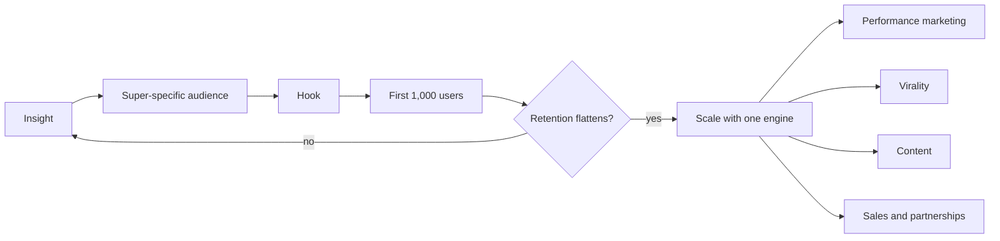

# Growth

How a consumer product goes from an idea to its first users and then to sustained growth. This subfield belongs to [Business and management](../README.md). The notes follow a six-step sequence described by Lenny Rachitsky (2022), based on how well-known consumer companies started: an insight, a super-specific audience, a hook, the first 1,000 users, retention and scale through a growth engine. The main lesson is that the tactics that win the first thousand users are manual and unscalable, and that scaling before retention works only burns money.

## Map of the subfield

The sequence runs left to right. Retention is the gate: without it, the scaling step is skipped and the team returns to the earlier steps.

## Notes in reading order

1. [Consumer growth sequence](consumer-growth-sequence.md): the six steps, why their order matters and the common mistakes.
2. [Super-specific audience](super-specific-audience.md): choosing a narrow first niche, the four tests of a good niche and how large companies started small.
3. [The hook](hook.md): a one-sentence pitch that makes the niche want the product now.
4. [First 1,000 users](first-thousand-users.md): seven manual acquisition tactics with examples, and how to match them to the product.
5. [Retention](retention.md): cohort curves, benchmarks and the leaky bucket.
6. [Growth engines](growth-engines.md): the racecar model of engines, turbo boosts, lubricants and fuel.
7. [Performance marketing engine](performance-marketing-engine.md): paid acquisition and its math.
8. [Virality](virality.md): word of mouth and product loops, and the viral coefficient.
9. [Content engine](content-engine.md): user-generated and editorial content that captures search and social demand.
10. [Sales and partnerships engine](sales-and-partnerships-engine.md): human-led acquisition of supply and partners.

## How to use this subfield

Read notes 1 to 3 before launching and write the audience and the hook down. Use note 4 to plan the first months of acquisition. Measure retention by cohort (note 5) every month, and only then choose an engine (notes 6 to 10). The metrics behind the engines are in [business metrics](../business-metrics/README.md). Startup method is in [entrepreneurship and startups](../entrepreneurship-and-startups/README.md).

## Navigation

- Back to [Business and management](../README.md).
