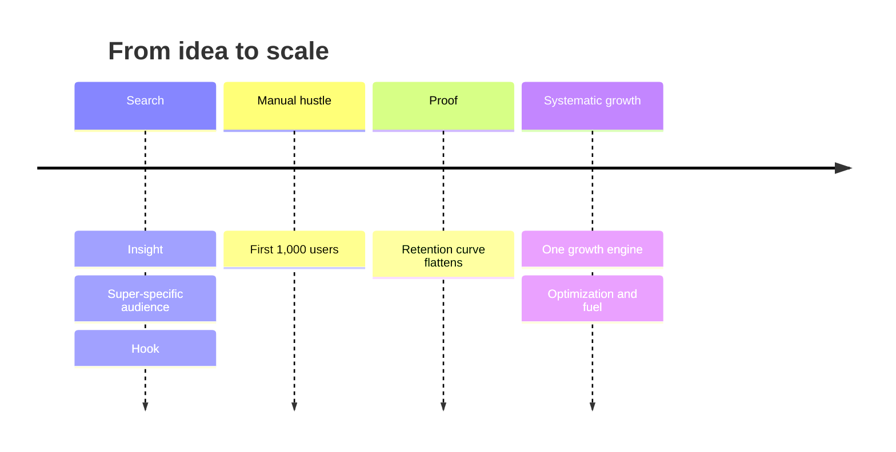

# Consumer growth sequence

## Summary

Successful consumer startups tend to grow through six steps in a fixed order: find an insight (a real pain point), choose a super-specific audience, craft a hook, manually win the first 1,000 users, reach retention that flattens (product-market fit), and only then scale with one growth engine. The steps call for different mindsets: manual hustle early, systematic engines later. The most common and most expensive mistake is to skip retention and pour money into scaling.

## Prerequisites

- [Product-market fit](../entrepreneurship-and-startups/product-market-fit.md)

## Core concepts

### Definition

The *consumer growth sequence* is a six-step model of how consumer businesses go from zero to scale, described by Lenny Rachitsky (2022) from interviews and public accounts of companies such as Airbnb, Tinder, DoorDash and Instagram. The path is not linear growth but a series of distinct phases, each with its own tactics and metrics:

1. **Insight (idea).** A real pain point, usually a personal problem of the founders or a friction they observed in a specific market.
2. **Audience.** A super-specific niche. A broad audience too early dilutes the value proposition. The goal is to own a small "monopoly" before expanding.
3. **Hook.** A simple, urgent pitch. If you cannot explain in one sentence why someone in the niche needs the product, the hook is too weak.
4. **Reach.** Manually recruit the first 1,000 users with high-effort, low-scale tactics.
5. **Retain.** Iterate until the retention curve flattens. A flat line at the end of a cohort's life, for example 20% to 40% of users still active after six months depending on the category, is the strongest signal of product-market fit.
6. **Scale.** Move to one of four sustainable growth engines.

### Analogy

The sequence is like starting a fire. First you need dry material (the insight), then a small, sheltered spot (the niche), a match that actually lights (the hook), and careful blowing by hand on the first flames (the first users). Only when the fire keeps burning on its own (retention) does it make sense to add big logs (scaling). Throwing logs on a fire that has not caught smothers it. The analogy breaks because a startup can return to earlier steps, while a fire that goes out must be relit from scratch.

### Mechanism

The order matters because each step makes the next one cheaper:

- A sharp **insight** makes it easy to find people who feel the problem.
- A **narrow audience** makes the hook specific and the users easy to reach.
- A specific **hook** raises conversion in manual outreach.
- The **first 1,000 users** give enough data to measure retention and enough conversations to fix the product.
- **Retention** means each acquired user stays, so acquisition spending builds value instead of leaking.
- An **engine** turns retained users and money into new users repeatedly.

Four insights follow from the model:

- **The leaky bucket.** Scaling before retention is fatal. If users do not stay, more paid acquisition only accelerates the burn of cash without building value.
- **One engine.** Most large consumer companies grew mainly through one dominant engine (Facebook through virality, Booking.com through performance marketing). Do not try to master all four at once.
- **The power of the niche.** The more specific the first audience, the easier it is to find, to speak to and to win.
- **Do things that do not scale.** The first 1,000 users are almost always won through manual, unscalable work (Graham, 2013). That phase is where the team learns enough to perfect the product before automating growth.

The timeline shows how the work changes from manual to systematic across the six steps.

## Worked example

A founder who commutes by train notices that parents of small children struggle to find baby-changing facilities at stations.

1. **Insight:** parents traveling with infants waste time and feel stressed looking for changing rooms and lifts.
2. **Audience:** parents of children under two who commute on one railway line around one large city.
3. **Hook:** "Every changing table and lift on your line, with live status, in one map."
4. **Reach:** the founder visits three parent groups in person, posts in two local forums and hands out cards at one station's family waiting room. After eight weeks, 1,100 people have installed the app.
5. **Retain:** monthly cohorts show 28% still active after five months, and the curve is flat from month three. Parents mostly open the app before trips.
6. **Scale:** with retention proven, the founder tests content (station guides that rank in search) as the engine, because parents search for "changing table + station name" before trips.

The numbers are invented for the example.

## Trade offs and when to use it

The sequence gives a clear order of priorities and a test (retention) before spending heavily. It is a model drawn from successful consumer companies, so it carries survivorship bias: failed startups that followed the same steps are less visible. It also fits consumer products better than enterprise software, where sales cycles and buying committees change the early steps (see [Client acquisition fundamentals](../../../personal-development/skills/hard-skills/client-acquisition/client-acquisition-fundamentals.md)).

## Common mistakes

- **Skipping retention and scaling with ads.** Measure cohort retention first. Paid acquisition into a leaky product burns cash.
- **Targeting "everyone" from day one.** Start with a niche small enough to dominate.
- **Automating acquisition before talking to users.** Win the first users by hand and learn from each conversation.
- **Trying several engines at once.** Find the engine that fits how users already behave and focus on it.

## Practice

1. List the six steps in order.
2. Why is the retention step a gate before scaling?
3. What does "do things that do not scale" mean for the first 1,000 users?

### Answers

1. Insight, audience, hook, reach (first 1,000 users), retain, scale.
2. Because without retention, acquired users leave and spending on growth builds no lasting value.
3. Win them through manual, personal work, which also teaches the team what to fix before automating.

## Further reading

- Rachitsky, L. (2022). How to kickstart and scale a consumer business (six-part series). Lenny's Newsletter. [Link](https://www.lennysnewsletter.com/p/kickstarting-and-scaling-a-consumer). The six-step series.
- Graham, P. (2013). Do things that don't scale. [Link](https://paulgraham.com/ds.html). The classic essay on unscalable early tactics.
- Rachitsky, L., Winters, C. (2021). What is good retention?. Lenny's Newsletter. [Link](https://www.lennysnewsletter.com/p/what-is-good-retention-issue-29). Retention benchmarks.
