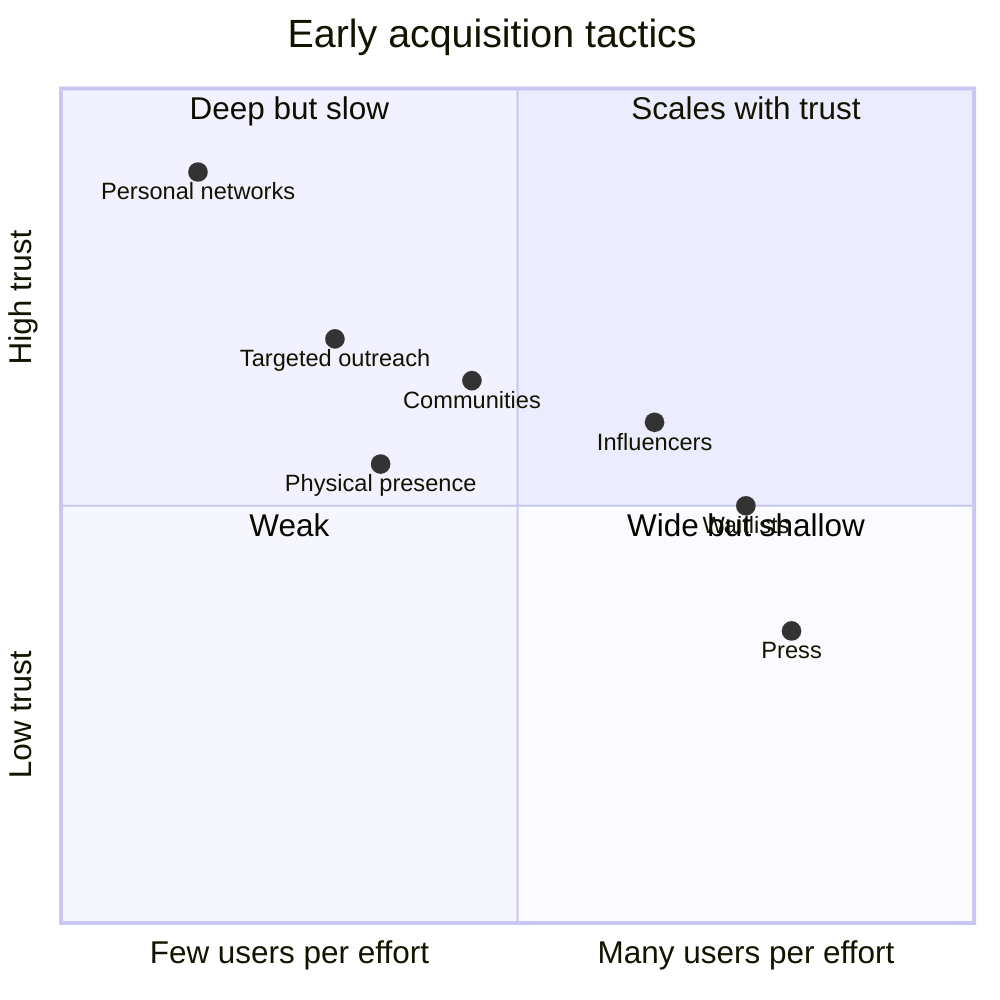

# First 1,000 users

## Summary

The first 1,000 users of a consumer product are almost always won by hand. Seven tactics account for most early successes: personal networks, targeted outreach, community infiltration, influencer partnerships, physical presence, press and viral waitlists. Which one works depends on where the super-specific audience gathers and on the type of product: marketplaces need targeted outreach to build supply, social apps need density, utilities often grow through communities and press. Startups should master one or two tactics instead of trying all seven.

## Prerequisites

- [The hook](hook.md)

## Core concepts

### Definition

The *first 1,000 users* phase (the "reach" step in Rachitsky's sequence) is the period in which a startup has no growth engine yet and acquires users through personal, high-effort work. Its goals are users and learning: each early user is also a source of feedback. The tactics below were collected by Rachitsky (2022) from the early histories of consumer companies; the examples are reported accounts, not audited data.

### Analogy

The first 1,000 users are like the first guests of a new restaurant. The owner invites friends, walks the street handing out menus, asks the local food blogger to visit and makes sure the first room is full on opening night. None of this scales to 100 restaurants, but without it the first one never fills. The analogy breaks because many digital products need users to attract other users, which makes density even more important than for a restaurant.

### Mechanism

### The seven tactics

1. **Personal networks.** One-to-one recruitment of friends, colleagues and alumni. It is the lowest-friction way to get first feedback, and the most dangerous for validation, because friends are kind. Use it to find bugs, not to prove product-market fit. Reported examples: LinkedIn's founders invited their professional networks; Facebook started among Harvard students.
2. **Targeted outreach.** Finding individuals who clearly have the problem and contacting them by message, email or phone, with high personalization. You are recruiting early adopters, not marketing. Reported examples: Airbnb's founders went door to door in New York to help hosts take better photos and recruit them (Graham, 2013), and Airbnb contacted people with good listings on Craigslist, inviting them to cross-post on Airbnb.
3. **Community infiltration, online and offline.** Joining existing high-density groups (forums, subreddits, Facebook groups, Discord servers, campuses, office buildings). Give value first: answer questions and offer the product only where it solves a problem someone raised. Spam fails. A reported example: Netflix's founders spent time in DVD enthusiast forums mentioning the new service.
4. **Influencer and authority partnerships.** Borrowing trust from people the audience already trusts. Relevance beats reach: one micro-influencer with 5,000 devoted fans in the niche can be worth more than a celebrity with a million random followers. Reported example: Cameo recruited lesser-known celebrities and athletes by hand, knowing their fans would follow.
5. **Physical presence and stunts.** Flyers, booths, parties and face-to-face meetings where the niche lives or works, to create a hyper-local monopoly. Reported example: Tinder's early team presented at sorority chapter meetings at the University of Southern California, had members install the app, then did the same at the fraternity next door, and held parties that required the app for entry.
6. **Press and earned media.** A unique, controversial or underdog story pitched to tech or mainstream press. Press gives a spike, not a loop. Use it to jump-start the system only when the product is sticky enough to keep the people it sends. Reported example: Instagram gained early coverage by presenting its filters as a more beautiful alternative to other photo apps.
7. **Viral mechanisms and waitlists.** Building recruitment into onboarding ("invite three friends to skip the line"), using scarcity and social proof. Reported examples: Robinhood's waitlist moved people up as they invited friends, and Superhuman's invitation-only access created an aura of exclusivity. PayPal is reported to have used a bot that bought items on eBay and insisted on paying with PayPal, which pushed sellers to adopt it (see Jackson, 2004, for PayPal's early history).

### Channel-product fit

| Product type | Tactics that usually work first |
| --- | --- |
| Marketplaces (Uber, Etsy) | Targeted outreach or physical presence to build the supply side first |
| Social apps (Tinder, Snapchat) | Physical density or virality, so that friends are present |
| Utilities (Dropbox, Evernote) | Press or online communities |

The seven tactics differ in effort per user and in how many users each can bring.

The positions are illustrative, based on the descriptions above.

### Strategic takeaways

- **Hand-to-hand combat cannot be automated.** If the founders do not personally talk to the first 100 users, the product will likely never reach retention, because nobody learns what to fix.
- **Density beats total users.** 100 users who use the app every day because all their friends are there are worth more than 10,000 who use it once a month.
- **Master one or two tactics.** Spreading effort across seven tactics produces seven weak efforts.
- **Turbo boosts are not engines.** Press, launches on Product Hunt or a celebrity mention give spikes. If growth stops when the effort stops, it was a boost (see [Growth engines](growth-engines.md)).

## Worked example

A peer-to-peer marketplace for renting camping gear in one city plans its first eight weeks:

- **Supply first (targeted outreach):** the founders search local classifieds and outdoor club member lists for people selling or lending tents, message 200 of them personally and sign up 60 owners with 140 items. They photograph the gear themselves.
- **Demand (community infiltration):** they answer questions in two regional hiking groups and offer a free first rental to people planning trips mentioned in posts.
- **Density:** they focus on one neighborhood near a train station with trains to the mountains, so pick-up is easy.
- **Boost:** a local news site covers the story "neighbors rent tents to each other". Sign-ups spike for three days; the team measures whether those users rent again.

After eight weeks: 1,050 registered users, 310 completed rentals, 34% of renters book a second time. The numbers are invented for the example.

## Trade offs and when to use it

Manual tactics are slow and do not scale, but they are cheap in money and rich in learning. Their danger is staying in manual mode too long, or mistaking a press spike for traction. Plan the move to an engine once retention is proven.

## Common mistakes

- **Using friends' enthusiasm as proof of demand.** Recruit strangers from the niche and measure whether they come back.
- **Spamming communities with links.** Contribute first and offer the product only where it answers a stated problem.
- **Building demand before supply in a marketplace.** Recruit enough supply in one area so that the first buyers find what they need.
- **Paying for reach instead of relevance.** Choose influencers who are authorities in the niche.

## Practice

1. Name the seven tactics for the first 1,000 users.
2. Why is the personal network tactic dangerous for validation?
3. Which tactics usually suit a marketplace, and why?
4. What distinguishes a turbo boost from an engine?

### Answers

1. Personal networks, targeted outreach, community infiltration, influencer partnerships, physical presence, press, viral mechanisms and waitlists.
2. Friends are kind and not representative, so their use does not prove product-market fit.
3. Targeted outreach or physical presence, because the supply side must be built first and by hand.
4. A boost produces a one-time spike; an engine produces repeatable growth that continues without a new effort each time.

## Further reading

- Rachitsky, L. (2022). How to kickstart and scale a consumer business (six-part series). Lenny's Newsletter. [Link](https://www.lennysnewsletter.com/p/kickstarting-and-scaling-a-consumer). The seven tactics and their examples.
- Graham, P. (2013). Do things that don't scale. [Link](https://paulgraham.com/ds.html). Doing things that do not scale, including the Airbnb story.
- Jackson, E. M. (2004). *The PayPal Wars: Battles with eBay, the Media, the Mafia, and the Rest of Planet Earth*. World Ahead Publishing. PayPal's early growth.
- Weinberg, G., Mares, J. (2015). *Traction: How Any Startup Can Achieve Explosive Customer Growth*. Portfolio. A broader list of traction channels.
