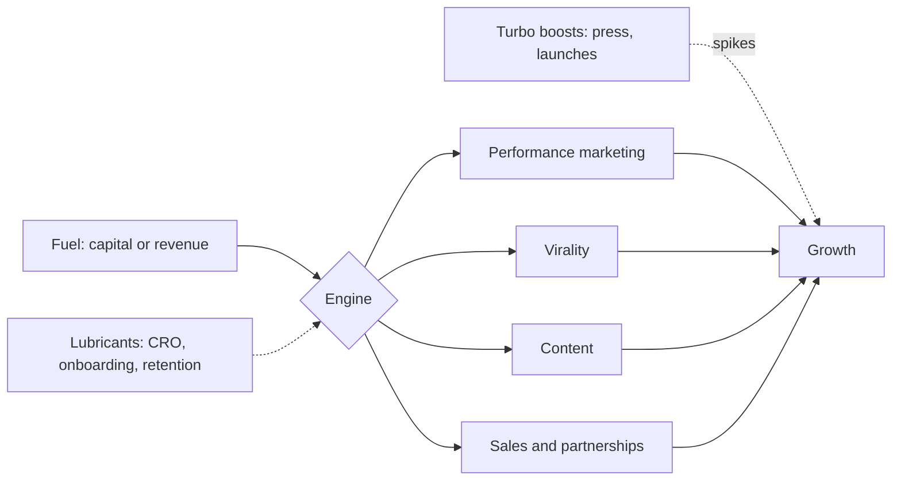

# Growth engines

## Summary

Once a product retains users, growth must come from a repeatable system rather than manual effort. The racecar model describes it: an engine (performance marketing, virality, content or sales and partnerships) drives growth, turbo boosts (press, launches, celebrity mentions) give short spikes, lubricants (conversion optimization, onboarding, retention) make the engine efficient, and fuel (capital or revenue) feeds it. Most large consumer companies grew mainly through one dominant engine, and the engine must fit how users already behave.

## Prerequisites

- [Retention](retention.md)

## Core concepts

### Definition

A *growth engine* is a repeatable mechanism that turns existing users or money into new users without a new manual effort each time (Rachitsky, 2022). The four engines for consumer businesses are:

- **Performance marketing:** paid acquisition (Meta, Google, TikTok, Apple Search Ads).
- **Virality:** word of mouth or product loops in which users bring users.
- **Content:** searchable or shareable content that captures users with intent.
- **Sales and partnerships:** human-led acquisition of high-value partners or supply.

Rachitsky notes that for most consumer businesses only the first three are economical as a primary engine; sales and partnerships matter mainly for the supply side of marketplaces.

### Analogy

Think of the business as a racecar. The **engine** produces the motion. **Turbo boosts** are bursts of extra speed that cannot be sustained. **Lubricants** reduce friction so the same engine goes faster. **Fuel** is what the engine burns. A car with a turbo and no engine does not move; a car with an engine and no fuel stops. The analogy breaks in one way: a business engine can be changed while driving, though it is slow and risky.

### Mechanism

**Turbo boosts.** Product Hunt launches, press hits, influencer mentions, large one-off ad campaigns and celebrity posts. They produce a spike, not a loop. Use them to help the engine (a press spike can lower paid acquisition cost for a week), never as the strategy. The test: if growth stops when the effort stops, it was a boost.

**Lubricants.** Internal improvements that make the engine more efficient: conversion rate optimization (more visitors sign up), onboarding (shorter time to value), and retention (less leakage).

**Fuel.** Venture capital or profit poured into the engine, mainly into paid acquisition or sales, to speed up the cycle.

**Principles.**

- **One engine.** Diversification is a trap for startups. Most large consumer companies were built on one dominant engine. Rachitsky's series reports that about 90% of successful consumer companies scaled through one of the four engines, that more than 70% of the top consumer companies relied on just one of them for most of their growth, and that growth-stage companies often get 80% to 90% of their growth from a single engine. These figures come from his own review of company histories and have not been checked independently. Find the engine that fits the product and ignore the others until you reach scale.
- **Engine-product fit.** Not every product can use every engine. A product people search for before acting (restaurant reviews, salaries) suits content. A visual, broadly appealing product suits paid social. A product that requires other users suits virality.
- **Do not pour fuel into a leaky bucket.** If retention does not flatten, paid acquisition is the fastest way to kill the company.
- **Find the constraint.** In a marketplace, growth is limited either by supply (not enough drivers) or by demand (not enough customers). Point the engine at the side that is the bottleneck.
- **Optimization over diversification.** Once an engine works, spend most growth effort on optimizing its conversion rates and a small share on experiments with boosts. A common split is 80% and 20%.
- **The founder's job changes.** After an engine works, the work shifts from product discovery to operational excellence: tuning the loops and scaling the spend.

The racecar model and the four engines:

The comparison below summarizes the engines:

| Engine | Scalability | Cost | Speed | Main risk |
| --- | --- | --- | --- | --- |
| Paid | High | High | Fast | Ad fatigue and rising acquisition cost |
| Viral | Very high | Low | Can compound quickly | Low retention or churn breaks the loop |
| Content | High | Low to medium | Slow | Search algorithm changes |
| Sales | Medium | Medium | Medium | High overhead and burn |

## Worked example

A meditation app with 38% six-month retention compares engines:

- **Virality:** meditation is private; users rarely invite others. Weak fit.
- **Content:** people search "how to fall asleep fast", which the app could answer with articles and free audio. Medium fit, slow.
- **Performance marketing:** the product is broadly appealing, subscriptions give a lifetime value of about 60 euros, and paid social reaches people with sleep problems at about 20 euros per subscriber. Strong fit, with a lifetime value to acquisition cost ratio of 3.

The team chooses paid acquisition as the engine, invests in onboarding and paywall tests as lubricants, and treats a planned celebrity partnership as a boost. The numbers are invented for the example.

## Trade offs and when to use it

One engine concentrates effort and learning but makes the business dependent on one channel, for example on an advertising platform's prices or a search algorithm. Late-stage companies add engines to reduce this risk. Early-stage companies that diversify too soon usually do several things badly.

## Common mistakes

- **Treating a successful launch as an engine.** Check whether growth continues after the effort stops.
- **Running four engines at once.** Choose the one that fits how users already behave.
- **Scaling paid acquisition with falling retention.** Fix the lubricants first.
- **Ignoring the marketplace bottleneck.** Point acquisition at the constrained side.

## Practice

1. Name the four growth engines and the three other parts of the racecar model.
2. How do you tell a turbo boost from an engine?
3. Which engine suits a product that people search for before acting, and why?

### Answers

1. Engines: performance marketing, virality, content, sales and partnerships. Other parts: turbo boosts, lubricants, fuel.
2. If growth stops when the effort stops, it was a boost.
3. Content, because intent-based search traffic can be captured by pages that answer those searches.

## Further reading

- Rachitsky, L. (2022). Step 6: Growth engines. Lenny's Newsletter. [Link](https://www.lennysnewsletter.com/p/growth-engines). The growth engines and the racecar model.
- Balfour, B., Winters, C., Kwok, K. (2018). Growth loops are the new funnels. Reforge. [Link](https://www.reforge.com/blog/growth-loops). Growth loops as a related model.
- Weinberg, G., Mares, J. (2015). *Traction: How Any Startup Can Achieve Explosive Customer Growth*. Portfolio. Traction channels.
