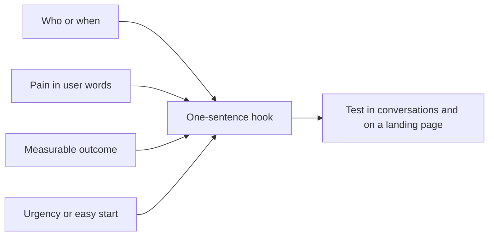

# The hook

## Summary

The hook is a simple, urgent pitch that makes someone in the target niche want the product now. If you cannot explain in one sentence why a person in your niche needs the product, the hook is too weak, and no acquisition tactic will compensate. A good hook names the audience or their situation, the painful problem and a concrete outcome, often with a time or number. It is tested in conversations and on landing pages before money goes into reach.

## Prerequisites

- [Super-specific audience](super-specific-audience.md)

## Core concepts

### Definition

The *hook* is the third step of the consumer growth sequence: the short pitch that turns a niche's pain into a reason to try the product immediately (Rachitsky, 2022, "craft your pitch"). It is close to the *unique value proposition* on the Lean Canvas (see [Lean Canvas](../entrepreneurship-and-startups/lean-canvas.md)) but more concrete and more urgent. It is not the product's full positioning, only the opening line that earns attention.

### Analogy

A hook works like the first line a street musician plays: passers-by decide in a few seconds whether to stop. A familiar, catchy line stops the right people; a long tuning session stops no one. The analogy breaks because a product hook must also be true and deliverable, while a musician only needs people to listen.

### Mechanism

A strong hook usually has four parts:

1. **Who or when:** the niche or the situation ("for parents commuting with a baby").
2. **The pain:** in the user's own words, found in interviews and forums.
3. **The outcome:** what changes, ideally measurable ("in two minutes", "without a spreadsheet").
4. **Urgency or ease:** why now, why it is easy to start ("free for your first trip").

Common formats include problem-first ("Tired of...? Now..."), the *high-level concept* ("Airbnb for boats"), and the outcome promise ("Your first sale in seven days"). The best words come from customer research (see [Customer research for copywriting](../../../personal-development/skills/hard-skills/copywriting/customer-research.md)). Headlines and attention are covered in [Headlines](../../../personal-development/skills/hard-skills/content-marketing/headlines.md).

Test a hook cheaply: say it in ten conversations and watch reactions, then run two versions on a landing page with the same traffic and compare sign-up rates (see [A/B testing](../../../personal-development/skills/hard-skills/copywriting/ab-testing.md)).

The parts of a hook combine into one sentence:

## Worked example

For an app that shows changing tables and lifts at railway stations:

- **Weak:** "A smart travel companion for modern families." It names no pain, no outcome and no niche.
- **Better:** "Find a changing table at any station on your line." Specific, but no urgency.
- **Strong:** "Traveling with a baby? See every changing table and working lift on your train line, live, before you leave home."

In a test with 600 visitors per version from the same parents' group, the strong version converted 9.5% to install, the weak one 3.1%. The numbers are invented for the example.

## Trade offs and when to use it

A sharp hook speaks loudly to the niche and may leave others cold, which is the point at this stage. As the business expands to new niches, the hook must change. Exaggerated hooks win clicks and lose trust; promise only what the product delivers.

## Common mistakes

- **Describing features instead of the outcome.** Lead with what changes for the user.
- **Writing the hook before talking to users.** Use the words customers use for their problem.
- **Making it clever rather than clear.** A reader should understand it in one pass.

## Practice

1. What four parts does a strong hook usually have?
2. Rewrite "An all-in-one platform for creators" as a hook for wedding photographers.

### Answers

1. Who or when, the pain, a measurable outcome, urgency or an easy start.
2. For example: "Deliver a wedding gallery your couple can share the same night, without uploading 2,000 photos twice."

## Further reading

- Rachitsky, L. (2022). How to kickstart and scale a consumer business (six-part series). Lenny's Newsletter. [Link](https://www.lennysnewsletter.com/p/kickstarting-and-scaling-a-consumer). The hook as step three.
- Maurya, A. (2012). *Running Lean: Iterate from Plan A to a Plan That Works*. O'Reilly Media. Unique value proposition and high-level concept.
