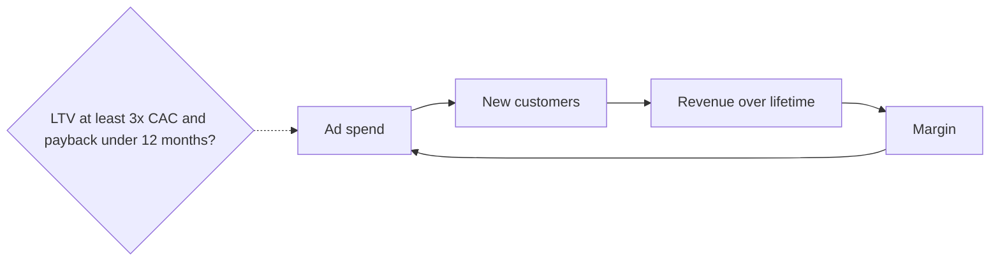

# Performance marketing engine

## Summary

Performance marketing is growth through paid acquisition: buying ads on platforms such as Meta, Google, TikTok and Apple Search Ads and reinvesting revenue into more ads. It works when each acquired customer is worth clearly more than they cost, usually a lifetime value at least three times the acquisition cost and a payback within 6 to 12 months. It suits products with high order values or subscriptions that appeal broadly enough for algorithmic targeting. Its main risks are rising costs and ad fatigue.

## Prerequisites

- [Growth engines](growth-engines.md)

## Core concepts

### Definition

The *performance marketing engine* buys traffic at a cost lower than the value that traffic generates and reinvests the margin to buy more. "Performance" means that spend is tied to measured results (installs, sign-ups, purchases) rather than to awareness. The channel mechanics are covered in [Paid social advertising](../../../personal-development/skills/hard-skills/social-media/paid-social-advertising.md); this note covers the economics that make it an engine.

### Analogy

Performance marketing is like a vending machine that returns three coins for every coin inserted, slowly. As long as the machine pays out more than it takes and you have enough coins to wait for the payout, you keep feeding it. The analogy breaks because the payout ratio worsens as you insert more coins: the cheapest customers are reached first, and costs rise with scale.

### Mechanism

**The loop.** Spend on ads, acquire customers, earn revenue over their lifetime, reinvest. The engine runs if:

- **LTV/CAC is healthy.** Lifetime value (LTV) divided by customer acquisition cost (CAC) of about 3 or more is the usual benchmark (see [LTV to CAC ratio](../business-metrics/ltv-to-cac-ratio.md)).
- **Payback is short.** Companies typically aim to recover CAC within 6 to 12 months, because cash spent today returns slowly (see [CAC payback period](../business-metrics/cac-payback-period.md)).

**Requirements.** High average order value or high retention (subscriptions), and a product that is broadly appealing enough for platforms' algorithms to find buyers. Reported examples of companies that grew mainly this way include Calm, HelloFresh, Casper and Booking.com.

**Diminishing returns.** Each channel has a point beyond which extra spend buys more expensive customers. If a channel's return on ad spend is well above break-even, keep increasing spend until returns fall to the break-even level (see [Return on ad spend (ROAS)](../business-metrics/return-on-ad-spend.md)).

The loop that makes paid acquisition an engine:

## Worked example

A meal-kit service pays 45 euros to acquire a customer. The average customer orders for 9 months at a contribution margin of 18 euros per month, so margin-based LTV is 162 euros and LTV/CAC is 3.6. Payback is 45 / 18 = 2.5 months. The company raises its monthly budget from 50,000 to 150,000 euros; CAC rises to 62 euros as the cheapest audiences are used up. LTV/CAC falls to 2.6 and payback rises to 3.4 months. The team stops increasing spend and works on retention to raise LTV. The numbers are invented for the example.

## Trade offs and when to use it

Paid acquisition is fast, measurable and controllable. It is also expensive, dependent on platforms whose prices and tracking rules change (for example Apple's App Tracking Transparency since 2021), and it stops the moment spending stops. Products with low margins or low retention rarely sustain it.

## Common mistakes

- **Judging campaigns by ROAS without margins.** Use contribution margin and break-even ROAS.
- **Scaling spend in a straight line.** Expect CAC to rise with spend and watch marginal CAC.
- **Using revenue LTV.** Use margin-based LTV for budget decisions.

## Practice

1. What two conditions make paid acquisition an engine?
2. Why does CAC usually rise as spend rises?

### Answers

1. LTV clearly above CAC (about 3x) and a short payback period (6 to 12 months).
2. Because the cheapest, most responsive audiences are reached first.

## Further reading

- Rachitsky, L. (2022). Step 6: Growth engines. Lenny's Newsletter. [Link](https://www.lennysnewsletter.com/p/growth-engines). Performance marketing as an engine.
- Skok, D. (2013). SaaS Metrics 2.0: A guide to measuring and improving what matters. For Entrepreneurs. [Link](https://www.forentrepreneurs.com/saas-metrics-2/). LTV/CAC and payback benchmarks.
