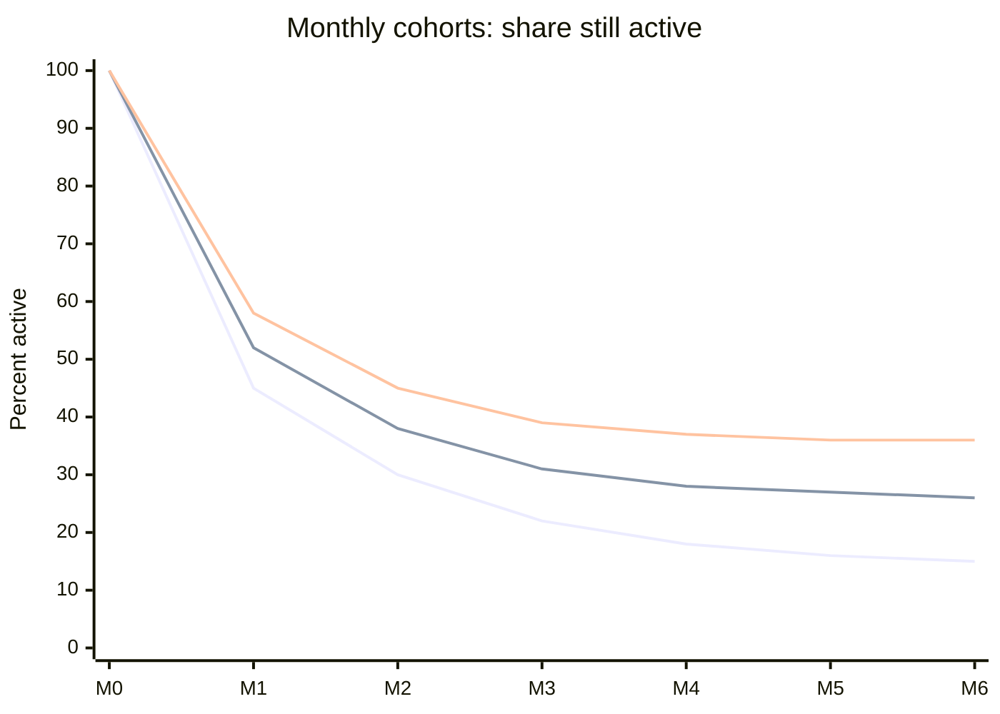

# Retention

## Summary

Retention is the share of users who keep using a product over time. It is measured per cohort, a group of users who started in the same period, and drawn as a curve. When the curve flattens, a stable core of users has found lasting value, which is the main signal of product-market fit and the condition for scaling. Practitioner benchmarks for six-month retention range from about 25% (good) for consumer social apps to 60% (good) for small business software. Scaling before retention flattens is pouring water into a leaky bucket.

## Prerequisites

- [First 1,000 users](first-thousand-users.md)

## Core concepts

### Definition

*Retention* is the proportion of a cohort still active (or still paying) after a given time since their start. *Churn* is its complement for paying customers (see [Churn rate](../business-metrics/churn-rate.md)). A *cohort* is a group of users who started in the same period, usually a week or a month. "Active" must be defined for the product: opened the app, completed a core action, or paid.

### Analogy

Retention is like water level in a bucket with holes. Acquisition pours water in, churn lets it out. If the holes are large, pouring faster only wastes water; the level rises only when the holes are small enough that what stays exceeds what leaks. The analogy breaks because in a business some leaked water comes back (reactivated users) and some stays because others are there (network effects).

### Mechanism

**Measuring.** For each cohort, count the share still active at day 1, week 1, month 1, month 2 and so on, and plot the curves side by side. Read three things:

1. **Shape.** A curve that keeps falling toward zero means no lasting value. A curve that flattens means a core of users has formed. A curve that rises again ("smile") means users return, often through network effects.
2. **Level.** Where the curve flattens. Benchmarks collected by Rachitsky and Winters (2021) from about 20 product and growth leaders, for users active after six months: consumer social about 25% good and 45% great; consumer transactional 30% and 50%; consumer subscription software 40% and 70%; small and mid-market business software 60% and 80%.
3. **Trend across cohorts.** Newer cohorts flattening higher means the product is improving.

**Levers ("lubricants").** Retention improves through better *activation* (users reach the core value fast), *onboarding* that shortens the time to value, habit-forming triggers that match how often the problem occurs, and fixing the reasons users give when they leave. These do not add new users; they make each acquired user count.

**Why it gates scaling.** Customer lifetime value depends on how long users stay (see [Customer lifetime value (LTV)](../business-metrics/customer-lifetime-value.md)). With a falling curve, lifetime value is small and almost any paid acquisition loses money.

The chart shows three monthly cohorts. Later cohorts flatten at a higher level, which shows the product improving.

The numbers are invented for the example.

## Worked example

A habit-tracking app has a January cohort that flattens at 15% after month five. Interviews with users who left show that most stopped after missing a day, because the app reset their streak to zero. The team introduces "streak freezes" and a gentler message after a missed day. The March cohort flattens at 26%, the May cohort at 36%. At 36%, the app clears the "good" benchmark for consumer subscriptions, and the team starts testing paid acquisition. The numbers are invented for the example.

## Trade offs and when to use it

Focusing on retention delays growth and can frustrate investors who want user numbers. The opposite error, chasing growth with poor retention, is usually worse. Low but flat retention can still support a business if acquisition is very cheap, for example through virality or search.

## Common mistakes

- **Reporting one average retention number.** Look at curves per cohort and per segment.
- **Counting any login as active.** Define active by the core action that delivers value.
- **Comparing your numbers with benchmarks from another category.** Use benchmarks for your product type, and focus on your own trend.

## Practice

1. What does a flattening retention curve mean?
2. Give the "good" six-month retention benchmarks for consumer social and consumer subscription products.
3. Why should retention come before scaling acquisition?

### Answers

1. A stable core of users has found lasting value, which signals product-market fit.
2. About 25% for consumer social and 40% for consumer subscription software.
3. Because lifetime value depends on how long users stay, so without retention paid acquisition loses money.

## Further reading

- Rachitsky, L., Winters, C. (2021). What is good retention?. Lenny's Newsletter. [Link](https://www.lennysnewsletter.com/p/what-is-good-retention-issue-29). Benchmarks for good and great retention.
- Rachitsky, L. (2022). How to kickstart and scale a consumer business (six-part series). Lenny's Newsletter. [Link](https://www.lennysnewsletter.com/p/kickstarting-and-scaling-a-consumer). Retention as the gate to scaling.
