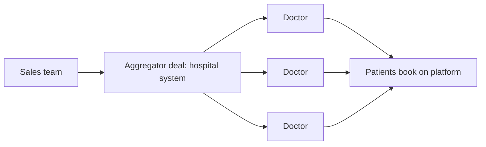

# Sales and partnerships engine

## Summary

The sales and partnerships engine grows a business through people: a sales or business development team signs up partners or professional suppliers who bring their own users or inventory. In consumer businesses it rarely drives demand, but it is often essential for the supply side of marketplaces, such as restaurants for a delivery app or doctors for a booking platform. It works when each deal is large enough to pay for the salesperson, ideally by signing aggregators that bring many suppliers at once.

## Prerequisites

- [Growth engines](growth-engines.md)

## Core concepts

### Definition

The *sales and partnerships engine* is human-led acquisition of high-value accounts, partners or supply. Its economic condition: the revenue from a partnership must justify the salesperson's salary and commission. For consumer startups, Rachitsky (2022) describes sales as rarely economical for acquiring individual consumers and important mainly for professional supply. Sales skills are covered in [client acquisition](../../../personal-development/skills/hard-skills/client-acquisition/README.md).

### Analogy

The engine is like signing a wholesale deal instead of selling to shoppers one by one: one conversation with a supermarket chain places the product in hundreds of stores. It works only if the deal is big enough to pay for the long negotiation.

### Mechanism

**Mechanics.** A professional team signs partners who bring their own audience or supply. Scaling comes from *aggregators*: signing a hospital system brings many doctors at once, signing a restaurant chain brings many outlets.

**Requirements.** A supply side that is professional or commercial (not individual consumers), and a contract value high enough to cover the cost of selling. In business-to-business terms, *annual contract value* (ACV) must justify the salesperson's cost.

**Reported examples.** DoorDash signing restaurant chains, GrubHub, Zocdoc signing doctors and hospital systems.

**Risks.** High overhead and cash burn, long sales cycles, and dependence on a few large partners.

The aggregator pattern: one deal brings many suppliers.

## Worked example

A physiotherapy booking platform needs supply in three cities. Signing clinics one by one costs about 900 zł of sales time per clinic, and a clinic brings 3 therapists on average. A deal with a chain of 40 clinics takes four months and about 15,000 zł of sales time but brings 140 therapists at once, about 107 zł per therapist instead of 300 zł. The team prioritizes chains. The numbers are invented for the example.

## Trade offs and when to use it

Sales gives control over who joins and can bring in supply that would never sign up by itself. It is slow and costly, and its capacity grows only with headcount. Use it where each deal is large or where supply is the bottleneck.

## Common mistakes

- **Using sales to acquire individual consumers.** Reserve human selling for high-value partners and supply.
- **Signing small partners one by one when aggregators exist.** Look for chains, associations and platforms that bring many at once.

## Practice

1. When does a sales engine make economic sense?
2. What is an aggregator in this context?

### Answers

1. When the value of each deal covers the salesperson's cost, typically for professional supply or large partners.
2. A partner that brings many suppliers or users in one deal, such as a hospital system or restaurant chain.

## Further reading

- Rachitsky, L. (2022). Step 6: Growth engines. Lenny's Newsletter. [Link](https://www.lennysnewsletter.com/p/growth-engines). Sales and partnerships as an engine.
