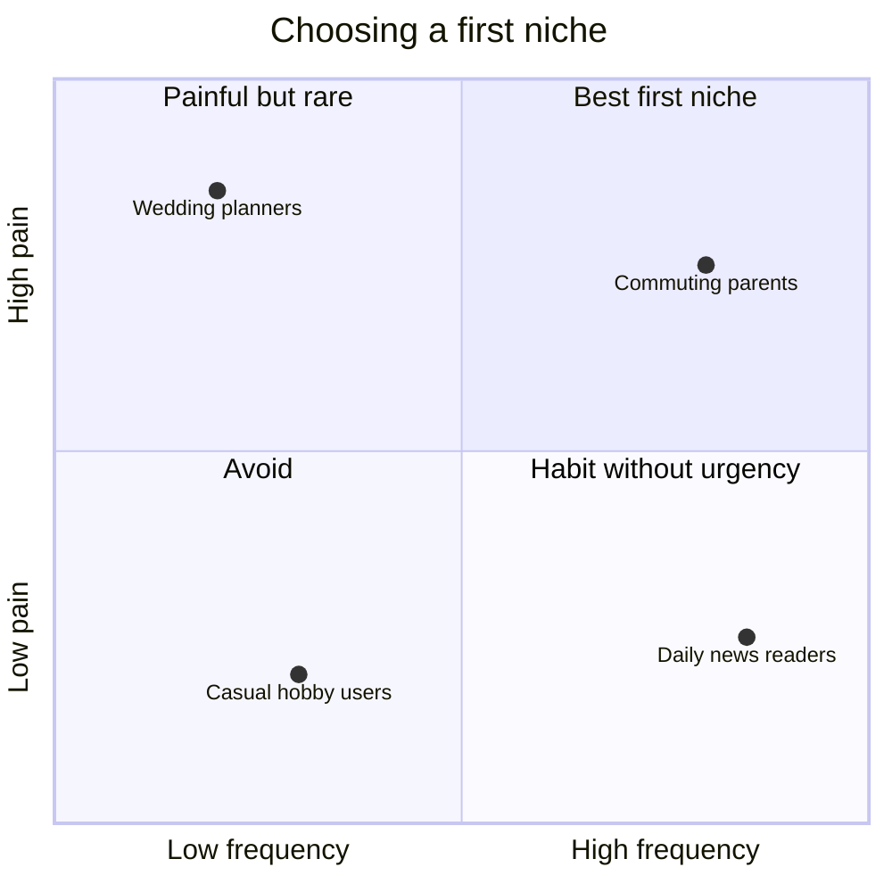

# Super-specific audience

## Summary

In the early stage of a consumer business, "everyone" is the wrong target. Broad appeal is the result of a successful growth strategy, not its starting point. A super-specific first audience, chosen because the problem is most acute there, makes the message clearer, the product smaller and the users easier to find. A good first niche passes four tests: high pain, high frequency, underserved and high density. Many large companies started this way, for example Facebook with Harvard students.

## Prerequisites

- [Consumer growth sequence](consumer-growth-sequence.md)

## Core concepts

### Definition

A *super-specific audience* (Rachitsky, 2022, "find your super-specific who") is a narrow first group of users defined tightly enough that you could list where they gather and what they say about their problem. It is the starting niche of a business, not its final market. It is related to the *beachhead market* in strategy and to *early adopters* on the Lean Canvas (see [Lean Canvas](../entrepreneurship-and-startups/lean-canvas.md)).

### Analogy

Choosing a first niche is like a small army landing on one beach instead of the whole coastline: concentrated force wins a foothold that a spread-out force would not. Once the beach is held, the army moves inland. The analogy fits the "wedge" strategy below. It breaks because customers are not territory: a niche can be lost to a competitor even after you have won it, and adjacent niches must want the product for their own reasons.

### Mechanism

**Why constraints speed things up.** A narrow audience gives three advantages:

- **Message clarity.** The hook can feel written for that person, which raises conversion.
- **Product focus.** You build only the features this group needs, launch sooner and iterate more precisely.
- **Concentrated reach.** Finding 1,000 people in one forum or on one campus is far cheaper than finding 1,000 random people across the world.

**Four tests of a winning first niche.**

| Test | Question | Why it matters |
| --- | --- | --- |
| High pain | Are they desperately looking for a solution ("hair on fire")? | Pain overcomes the friction of trying an unknown product. |
| High frequency | Do they meet the problem daily or weekly? | Frequent use builds habits and shows retention quickly. |
| Underserved | Are current solutions hacked together, missing or frustrating? | Less competition and lower expectations. |
| High density | Are they physically or digitally clustered? | Essential for marketplaces and social products, where users need other users nearby. |

**How large companies started small.** The examples below come from public accounts collected by Rachitsky (2022):

| Company | Initial super-specific audience | Logic |
| --- | --- | --- |
| Facebook | Harvard students | High density, high social status, a closed loop. |
| Tinder | Sorority members at the University of Southern California | If the popular students used it, others would follow. |
| Uber | Tech-savvy commuters in San Francisco | People who disliked the local taxi system and were comfortable paying by phone. |
| DoorDash | Residents of Palo Alto | High disposable income and a suburban area where delivery was scarce. |
| Poshmark | iPhone-owning fashion enthusiasts | A technical constraint (iPhone only) combined with a passionate hobby. |
| Etsy | Craft-fair artisans | An existing offline community without a digital home. |

The quadrant places niches by pain and frequency. The best first niches sit in the upper right. Density and how underserved a niche is are checked separately.

The positions are illustrative.

### Strategic takeaways

- **The wedge.** Treat the first niche as a wedge into the market, not a permanent home. Once you own it, move to the most logical adjacent niche, as Facebook moved from Harvard to other Ivy League universities and then to all colleges.
- **Build for the extreme user.** Building for an average user produces a product nobody loves. Build for the person in your niche who will use the product ten times more than anyone else.
- **Density over volume.** For any product with network effects (marketplaces, social, communication), 1,000 users in one city are worth more than 10,000 users spread across 100 cities, because each user finds others.

## Worked example

A founder wants to build a marketplace for home cooking lessons. Instead of "people who want to cook better", she compares three niches against the four tests:

| Niche | Pain | Frequency | Underserved | Density |
| --- | --- | --- | --- | --- |
| International students in one city who miss home food | Medium | High (daily meals) | Yes | High (dormitories) |
| Newly retired men | Medium | Medium | Yes | Low |
| Parents of children with food allergies | High | High | Yes | Medium (online groups) |

She starts with parents of children with food allergies in one city, because pain and frequency are highest and they gather in a few online groups. International students become the second wedge.

## Trade offs and when to use it

A narrow niche limits early revenue and can feel too small to investors. The risk is choosing a niche that is a dead end with no adjacent market. Check before committing that at least two adjacent niches exist and share part of the problem.

## Common mistakes

- **Defining the niche by demographics only ("women 25 to 40").** Define it by the problem and the situation, and name where they gather.
- **Choosing a niche for its size.** Choose it for pain, frequency, lack of solutions and density.
- **Staying in the first niche forever.** Plan the next wedge once retention in the first niche is proven.

## Practice

1. What are the four tests of a winning first niche?
2. Why is density essential for marketplaces?
3. Explain the wedge strategy with Facebook as the example.

### Answers

1. High pain, high frequency, underserved, high density.
2. Because users need other users (buyers, sellers, friends) nearby for the product to be useful.
3. Win one tight niche (Harvard), then move to the most logical adjacent one (other Ivy League schools, then all colleges).

## Further reading

- Rachitsky, L. (2022). Step 2: Find your super-specific who. Lenny's Newsletter. [Link](https://www.lennysnewsletter.com/p/consumer-business-super-specific-who). The super-specific who step.
- Chen, A. (2021). *The Cold Start Problem: How to Start and Scale Network Effects*. Harper Business. Network effects and atomic networks.
