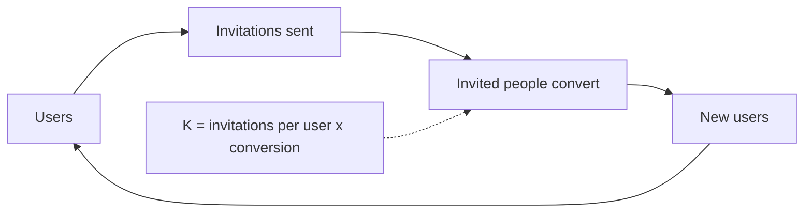

# Virality

## Summary

Virality is growth in which existing users bring new users as part of using or talking about the product. As an engine it is not "going viral" once, but a built-in mechanism: word of mouth, an organic loop where the product needs other people to work, or an incentivized loop with rewards for invitations. It is measured by the viral coefficient, the number of new users each user brings. When the coefficient is above one, growth compounds without spending; in practice, even a coefficient below one lowers acquisition costs.

## Prerequisites

- [Growth engines](growth-engines.md)

## Core concepts

### Definition

*Virality* is the property of a product that makes users recruit other users. The *viral coefficient* (also *K-factor*) is:

K = invitations sent per user × conversion rate of invitations

If K is above 1, each cohort of users brings a larger cohort, and growth compounds without paid acquisition. The *viral cycle time* is how long one round of invitations takes; shorter cycles grow faster at the same K.

### Analogy

A viral product spreads like a cold in an office: each infected person passes it to others during normal contact. If each person infects more than one other, the outbreak grows; if fewer, it fades. The analogy breaks because people choose to pass on a product, and they stop when it embarrasses them or brings no benefit.

### Mechanism

**Three types.**

| Type | Mechanism | Examples |
| --- | --- | --- |
| Word of mouth | People talk about a remarkable product | Tesla, Slack |
| Organic loop | The product needs others to function: you invite them to use it with you | WhatsApp, Zoom, "Powered by" links on forms |
| Incentivized loop | Users get a reward for invitations | Dropbox's extra storage, PayPal's cash referral bonus |

**Requirements.** High usage frequency (daily or weekly), low friction for new users to sign up, and a fast route to the "aha" moment, so that invited people stay and invite others.

**Retention matters.** A viral loop needs users who stay long enough to invite. Low retention and churn are the main risks of this engine. Reported examples of companies built mainly on virality include Facebook, Tinder, Snapchat and WhatsApp.

The loop: each cycle multiplies the user base by K.



## Worked example

A shared shopping list app: each new user invites on average 2.5 household members or friends in the first week, and 30% of invitees sign up. K = 2.5 × 0.30 = 0.75.

```python
# Python 3.12. Users after each viral cycle, starting from 1,000 users acquired by other means.
def viral_growth(seed, k, cycles):
    total, new = seed, seed
    for _ in range(cycles):
        new = new * k          # each new cohort invites the next
        total += new
    return round(total)

for k in (0.5, 0.75, 1.1):
    print(k, viral_growth(1000, k, 6))
```

Output:

```text
0.5 1984
0.75 3466
1.1 9487
```

With K = 0.75, every 1,000 users acquired by other means become about 3,500 after six cycles, so the effective acquisition cost falls to less than a third. With K = 1.1, growth keeps compounding. The numbers are invented for the example.

## Trade offs and when to use it

Virality brings users at almost no marginal cost, but it is hard to design into products that are used privately or rarely. Incentivized loops can attract users who come only for the reward. Aggressive invitation flows (importing contacts and messaging them without clear consent) damage trust and can break data protection law.

## Common mistakes

- **Confusing a one-off viral post with a viral engine.** Measure K and cycle time over many cohorts.
- **Optimizing invitations while retention is low.** Invited users must stay; fix activation first.
- **Spamming contacts.** Make invitations a real benefit to both sides and respect consent rules.

## Practice

1. Calculate K if each user sends 4 invitations and 20% convert.
2. Name the three types of virality with one example each.
3. Why can a K below one still be valuable?

### Answers

1. K = 4 × 0.20 = 0.8.
2. Word of mouth (Slack), organic loop (Zoom), incentivized loop (Dropbox).
3. Each user acquired by other means brings additional users, which lowers the effective acquisition cost.

## Further reading

- Rachitsky, L. (2022). Step 6: Growth engines. Lenny's Newsletter. [Link](https://www.lennysnewsletter.com/p/growth-engines). Virality as an engine.
- Chen, A. (2008). What's your viral loop? Understanding the engine of adoption. andrewchen.com. [Link](https://andrewchen.com/whats-your-viral-loop-understanding-the-engine-of-adoption/). Viral loops and the viral coefficient.
- Chen, A. (2021). *The Cold Start Problem: How to Start and Scale Network Effects*. Harper Business. Network effects.
