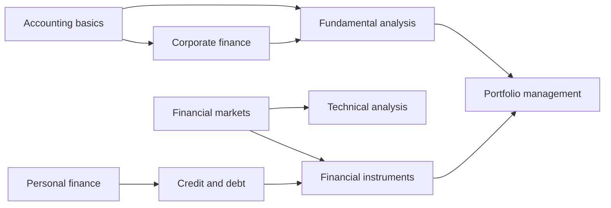

# Finance and investing

Managing money, markets and risk. This field belongs to [Applied sciences](../README.md). It follows the usual division of finance into the finance of households (personal finance and credit), the finance of companies (accounting and corporate finance), financial markets and instruments, the management of portfolios and the two schools of security analysis, fundamental and technical. The classification of the American Economic Association groups the same topics under household finance (D14, G51), financial markets (G1), corporate finance (G3) and accounting (M41), and the CFA Institute curriculum follows a similar order for investment analysis.

## Subfields

- [Personal finance](personal-finance/README.md): the five areas, budgeting, the emergency fund, the financial plan, personal statements, spending traps and rules of thumb.
- [Credit and debt](credit-and-debt/README.md): interest rates, APR and APY, debt, repayment strategies, mortgages, credit scores and cards.
- [Accounting basics](accounting-basics/README.md): the accounting equation, assets, liabilities, income and the cash flow statement.
- [Corporate finance](corporate-finance/README.md): financial statements, the time value of money, EBITDA, operating and capital expenditure, free cash flow, discounted cash flow valuation, WACC, NPV, IRR and the payback period.
- [Financial markets](financial-markets/README.md): market structure, equity markets, order types, market efficiency and short selling.
- [Financial instruments](financial-instruments/README.md): asset classes, stocks, bonds, funds and ETFs, derivatives, real estate, commodities, currencies and cryptocurrencies.
- [Portfolio management](portfolio-management/README.md): risk and return, diversification, asset allocation, dollar-cost averaging, leverage and margin.
- [Fundamental analysis](fundamental-analysis/README.md): value, market capitalization, financial ratios, earnings per share, P/E and PEG.
- [Technical analysis](technical-analysis/README.md): charts, trends, patterns, candlesticks, indicators and the evidence on whether they work.

## Map of the field

The map shows the order in which the subfields build on each other. A reader new to the topic can follow the arrows from the left.

## Planned topics

- Insurance and risk transfer
- Taxes for individuals and companies
- Retirement planning and pensions
- Banking and financial institutions
- Public finance
- Behavioral finance

Business metrics for subscription and online businesses (MRR, CAC, LTV, ROI, ROAS) are in [business metrics](../business-and-management/business-metrics/README.md). Economic concepts that finance relies on, such as [economic value](../../social-sciences/economics/microeconomics/economic-value.md) and [gross domestic product](../../social-sciences/economics/macroeconomics/gross-domestic-product.md), have their home in [economics](../../social-sciences/economics/README.md).

These notes are educational. They are not investment, tax, legal or accounting advice.

## Navigation

- Back to [Applied sciences](../README.md).
