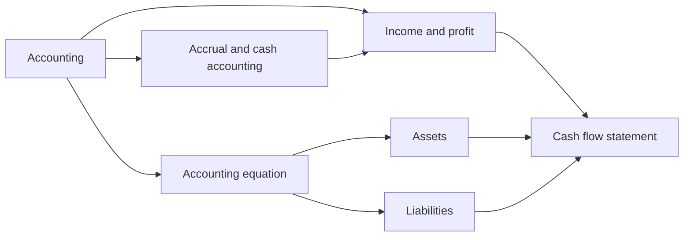

# Accounting basics

How financial activity is recorded and reported: the accounting equation, assets and liabilities, income and profit, and the cash flow statement. This subfield belongs to [Finance and investing](../README.md). It gives the vocabulary that every later note in the field uses. The three company statements as a set are explained in [financial statements](../corporate-finance/financial-statements.md) in corporate finance.

## Map of the subfield

The map shows how the notes relate. The accounting equation is the base, assets and liabilities fill in its two sides, and the income and cash flow notes explain how the numbers change over a period.

## Notes in reading order

1. [Accounting](accounting.md): what accounting is, its branches, accrual versus cash, IFRS and US GAAP.
2. [Accrual and cash accounting](accrual-and-cash-accounting.md): when to recognize revenue and expenses, with a three-month comparison.
3. [Accounting equation](accounting-equation.md): assets = liabilities + equity and double entry.
4. [Assets](assets.md): definition, classification and measurement, depreciation.
5. [Liabilities](liabilities.md): current and non-current, provisions, contingent liabilities, leases and deferred revenue.
6. [Income and profit](income-and-profit.md): gross, net and taxable income and the income statement ladder.
7. [Cash flow statement](cash-flow-statement.md): operating, investing and financing cash flows and the indirect method.

## Planned topics

- Inventory valuation methods
- Revenue recognition
- Depreciation methods
- Auditing and internal control

## How to use this subfield

Read notes 1 and 2 first. Then read the other notes in any order, and test them on the annual report of a listed company. The household version of the same ideas is in [personal financial statements](../personal-finance/personal-financial-statements.md).

These notes are educational. They are not accounting, tax or legal advice.

## Navigation

- Back to [Finance and investing](../README.md).
