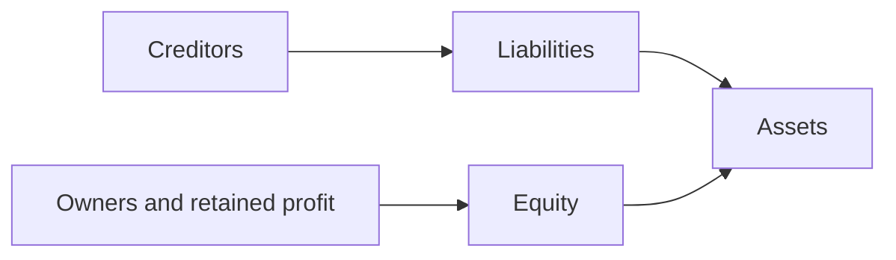
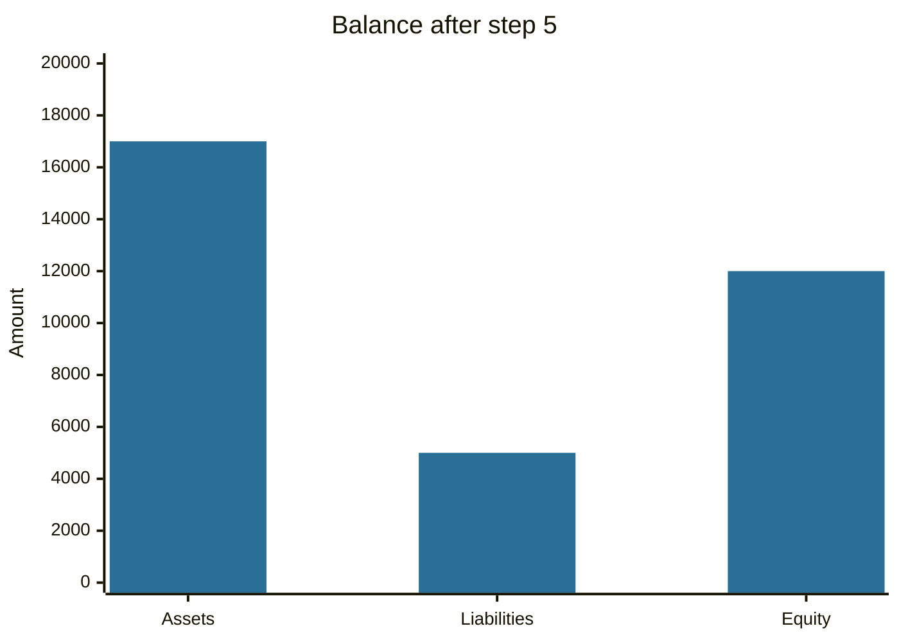

# Accounting equation

## Summary

The accounting equation states that assets equal liabilities plus equity. Everything a business owns was paid for either by creditors (liabilities) or by owners (equity). Every transaction changes at least two items in a way that keeps the two sides equal, which is the basis of double-entry bookkeeping and of the balance sheet. Rearranged, equity (net worth) is assets minus liabilities.

*This note is educational. It is not accounting advice.*

## Prerequisites

- [Accounting](accounting.md).

## Core concepts

### Definition

```text
Assets = Liabilities + Equity
Equity = Assets - Liabilities
```

- *Assets* are resources the entity controls that are expected to bring future economic benefits (see [assets](assets.md)).
- *Liabilities* are present obligations to give up resources (see [liabilities](liabilities.md)).
- *Equity* is the residual interest in the assets after deducting liabilities: owners' capital plus retained earnings. For a company it is also called shareholders' equity or book value, and for a person it is net worth.

### Analogy

A balance scale: assets sit on one pan, claims on those assets (creditors first, owners last) on the other. The scale cannot be out of balance, because the claims are defined as whatever the assets are worth. The analogy breaks because the owners' claim is a residual and is not a fixed amount: if assets fall, it is equity that absorbs the loss first.

### Mechanism

A transaction affects the equation in one of a few patterns, and the equation holds after each.



The diagram shows where the funding for the assets comes from: creditors and owners.

| Event | Assets | Liabilities | Equity |
| --- | --- | --- | --- |
| Owner invests cash | up | no change | up |
| Borrow from a bank | up (cash) | up | no change |
| Buy equipment with cash | up (equipment), down (cash) | no change | no change |
| Buy on credit | up | up | no change |
| Earn revenue in cash | up | no change | up |
| Pay an expense in cash | down | no change | down |
| Repay a loan | down | down | no change |

In double entry, each event is recorded as debits and credits of equal amounts: debits increase assets and expenses, credits increase liabilities, equity and revenue.

## Worked example

A new company has the following transactions.

| Step | Event | Assets | Liabilities | Equity |
| --- | --- | --- | --- | --- |
| 1 | Owner invests 10,000 cash | 10,000 | 0 | 10,000 |
| 2 | Bank loan of 5,000 | 15,000 | 5,000 | 10,000 |
| 3 | Buys equipment for 8,000 cash | 15,000 | 5,000 | 10,000 |
| 4 | Sales of 3,000 in cash | 18,000 | 5,000 | 13,000 |
| 5 | Pays rent of 1,000 | 17,000 | 5,000 | 12,000 |

After step 5, the balance sheet shows cash 9,000 (10,000 + 5,000 - 8,000 + 3,000 - 1,000) and equipment 8,000, so assets are 17,000. Liabilities are 5,000, equity is 12,000 (10,000 invested plus profit of 2,000), and 17,000 = 5,000 + 12,000.



Assets equal the sum of the other two bars.

## Trade offs and when to use it

The equation is exact by construction, so it is a check on the books: if it fails, there is a recording error. It does not say whether the numbers are right, since assets can be overstated and the equation still balances. It also hides market values, as most assets are recorded at cost.

## Common mistakes

- **Treating equity as cash.** Equity is a claim measure, and assets are what exist.
- **Calling revenue equity.** Revenue increases equity only through profit; expenses decrease it.
- **Forgetting that a loan raises assets and liabilities together,** so equity does not change.

## Practice

1. A company has assets of 80,000 and liabilities of 50,000. What is its equity?
2. How does buying inventory on credit change the equation?
3. If equity is negative, what does it say?

### Answers

1. 30,000.
2. Assets (inventory) and liabilities (payable) both rise by the cost. Equity does not change.
3. Liabilities exceed assets, so the company is insolvent on a balance sheet basis.

## Further reading

- IFRS Foundation (2018). Conceptual Framework for Financial Reporting. IFRS Foundation. [Link](https://www.ifrs.org/issued-standards/list-of-standards/conceptual-framework/). Official definitions of asset, liability and equity.
- Brealey, R. A., Myers, S. C., Allen, F. et al. (2023). *Principles of Corporate Finance (14th ed.)*. McGraw Hill. Covers valuation, risk and the cost of capital.
