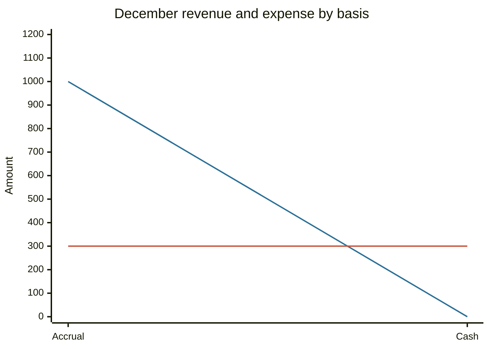

# Accounting

## Summary

Accounting is the system for recording, classifying, summarizing and reporting the financial transactions of an organization so that owners, lenders, managers, tax authorities and regulators can make decisions. Its output is a set of financial statements prepared under a framework such as IFRS or US GAAP. Accounting measures what happened, and finance uses those numbers to decide what to do next.

*This note is educational. It is not accounting, tax or legal advice.*

## Prerequisites

No prior notes are needed.

## Core concepts

### Definition

*Accounting* is the process of identifying, measuring, recording and communicating economic information about an entity. *Bookkeeping* is the recording part: entering each transaction in the books. Accounting adds classification, adjustment, analysis and reporting. A *certified* or *chartered* accountant is a licensed professional, a role that is regulated differently in each country.

### Analogy

Accounting is the instrument panel of an organization. It does not drive the car, but without speed, fuel and temperature readings the driver cannot decide anything. The panel shows the past and the present, and is only as good as the sensors (the records) behind it.

### Branches

| Branch | Question it answers | Main user |
| --- | --- | --- |
| Financial accounting | What is our position and performance, under standard rules? | Investors, lenders, regulators |
| Managerial accounting | What should we do next? Internal budgets, forecasts, performance | Management |
| Cost accounting | What does a product or service cost to make? | Management, pricing |
| Tax accounting | What do we owe under tax law? | Tax authorities, the company |
| Auditing | Are the statements free of material misstatement? | Investors, lenders, regulators |

### Mechanism

**The accounting cycle.** Transactions are recorded in journals, posted to ledger accounts, summed in a trial balance, adjusted at period end and presented as statements. Double-entry bookkeeping, described in print by Luca Pacioli in 1494, records every transaction in two accounts so that debits equal credits, which gives a built-in check (see [accounting equation](accounting-equation.md)).

**Accrual versus cash accounting.** Under *accrual accounting* revenue is recorded when it is earned and expenses when they are incurred, regardless of when cash moves. Under *cash accounting* a transaction is recorded when cash is received or paid. Companies reporting under IFRS or US GAAP use accrual accounting, and small businesses and households often use the cash basis. The difference is why profit and cash differ (see [accrual and cash accounting](accrual-and-cash-accounting.md) and [cash flow statement](cash-flow-statement.md)).

**Frameworks.** IFRS (International Financial Reporting Standards, issued by the IASB) are required or permitted for listed companies in most countries. US GAAP (Generally Accepted Accounting Principles, issued by the FASB) apply to US companies. The two frameworks agree on the basic structure and differ in details such as inventory methods and the treatment of development costs.

## Worked example

A consultant invoices a client 1,000 on 28 December and is paid on 10 January. The consultant paid 300 for a software license on 15 December.

| Basis | Revenue in December | Expense in December | Profit in December | Cash change in December |
| --- | --- | --- | --- | --- |
| Accrual | 1,000 | 300 | 700 | -300 |
| Cash | 0 | 300 | -300 | -300 |

Accrual accounting shows that the work was done and earned 700 in December. Cash accounting shows only the cash movement and reports a loss for the month. Both are valid for different purposes, and a user must know which one a number comes from.

The first line is revenue and the second line is expense. Profit is revenue minus expense: 700 under accrual accounting and a loss of 300 under cash accounting.

## Trade offs and when to use it

Accrual accounting gives a better picture of performance but requires estimates (depreciation, bad debts, provisions) that managers can influence. Cash accounting is simple and cannot be manipulated by timing, and it misleads when sales are on credit. Statutory financial statements follow the required framework, and internal reports can use any basis that helps decisions.

## Common mistakes

- **Equating profit with cash.** A profitable company can run out of cash, and a loss-making one can have cash.
- **Reading statements without the notes.** Policies and estimates are in the notes.
- **Mixing frameworks** when comparing companies from different countries.
- **Thinking accounting numbers are exact.** They contain estimates and judgment.

## Practice

1. What is the difference between bookkeeping and accounting?
2. Under accrual accounting, when is revenue recorded?
3. Why do investors read the notes to the statements?

### Answers

1. Bookkeeping records transactions. Accounting also classifies, adjusts, analyzes and reports them.
2. When it is earned, regardless of when cash is received.
3. The notes explain the policies, estimates and contingent items behind the numbers.

## Further reading

- IFRS Foundation (2018). Conceptual Framework for Financial Reporting. IFRS Foundation. [Link](https://www.ifrs.org/issued-standards/list-of-standards/conceptual-framework/). Official definitions of asset, liability and equity.
- IFRS Foundation. IAS 7 Statement of Cash Flows. IFRS Foundation. [Link](https://www.ifrs.org/issued-standards/list-of-standards/ias-7-statement-of-cash-flows/). The standard that defines operating, investing and financing cash flows.
- Brealey, R. A., Myers, S. C., Allen, F. et al. (2023). *Principles of Corporate Finance (14th ed.)*. McGraw Hill. Covers valuation, risk and the cost of capital.
- American Economic Association. JEL classification system. American Economic Association. [Link](https://www.aeaweb.org/econlit/jelCodes.php?view=jel). Places accounting (JEL M41) next to finance in the classification of economic research
