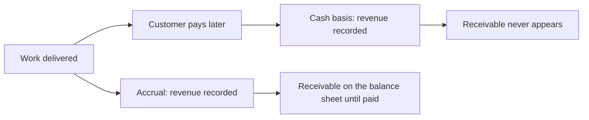
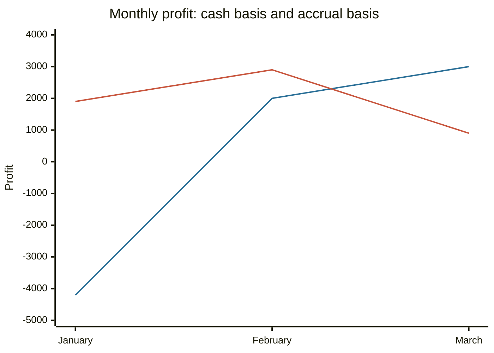

# Accrual and cash accounting

## Summary

Accounting can recognize a transaction when it is earned and incurred (accrual basis) or when cash moves (cash basis). Accrual accounting matches revenue with the costs that produced it, so it shows performance more fairly, and it is required for most larger and listed companies. Cash accounting is simpler and tracks the bank balance, which suits very small businesses and households. The two give the same total over the life of a business, and different results in any single period.

*This note is educational. It is not accounting or tax advice. Which method a business may use depends on its country and size.*

## Prerequisites

- [Accounting](accounting.md).
- [Accounting equation](accounting-equation.md).

## Core concepts

### Definition

- **Accrual accounting** records revenue when it is earned (the goods or services are delivered) and expenses when they are incurred, whatever the date of payment. It creates balance sheet items for the gap: *accounts receivable* (earned, not yet paid by the customer), *accounts payable* and *accrued expenses* (incurred, not yet paid), *prepaid expenses* (paid, not yet used) and *deferred revenue* (received, not yet earned).
- **Cash accounting** records revenue when cash is received and expenses when cash is paid.
- The IFRS Conceptual Framework states that financial statements are prepared on the accrual basis, because information about economic resources and claims, and their changes, is a better guide to future cash flows than cash receipts and payments alone.

### Analogy

Cash accounting is a bank statement: it lists what went in and out on which day. Accrual accounting is a story of the work done: a freelancer who finished a job in March has earned the money in March, even if the client pays in April. The analogy has a limit: the story relies on estimates (will the client pay?), while the bank statement is a fact.

### Mechanism

Two principles drive accrual accounting. The *revenue recognition principle* says revenue is recorded when the performance obligation is met. The *matching principle* says expenses are recorded in the same period as the revenue they helped to earn, so a 1,200 annual software license is spread as 100 a month.

| | Accrual | Cash |
| --- | --- | --- |
| Revenue recognized | When earned | When cash is received |
| Expense recognized | When incurred, matched to revenue | When cash is paid |
| Balance sheet items | Receivables, payables, prepaid, deferred revenue | Mostly cash only |
| Complexity | Higher, needs estimates | Low |
| Typical users | Listed and larger companies, lenders' reporting | Small businesses, sole traders, households |
| Weakness | Estimates can be managed | Timing of payments can distort profit |

Tax rules often allow the cash method below a size threshold and require accrual above it, and some systems let small firms use cash accounting for tax and accrual for other reports. Switching methods usually needs a one-time adjustment.

## Worked example

A consultant delivers work worth 5,000 in January, 6,000 in February and 4,000 in March, and each client pays one month later. Monthly running costs are 3,000, paid in the month. In January the consultant also pays 1,200 for a 12-month software license.

| Month | Cash revenue | Cash expense | Cash profit | Accrual revenue | Accrual expense | Accrual profit |
| --- | --- | --- | --- | --- | --- | --- |
| January | 0 | 4,200 | -4,200 | 5,000 | 3,100 | 1,900 |
| February | 5,000 | 3,000 | 2,000 | 6,000 | 3,100 | 2,900 |
| March | 6,000 | 3,000 | 3,000 | 4,000 | 3,100 | 900 |
| Total | 11,000 | 10,200 | 800 | 15,000 | 9,300 | 5,700 |

The first quarter looks like a loss in January and a small profit overall on the cash basis, and like three profitable months on the accrual basis. The gap of 4,900 is on the balance sheet at 31 March: a receivable of 4,000 (March work not yet paid) and a prepaid expense of 900 (nine months of the license). Over time, when receivables are collected and the license is used, the two totals converge.

The first line is the cash profit and the second is the accrual profit.

## Trade offs and when to use it

Use accrual accounting when profit must reflect the work done in a period, when there are credit sales, inventory or multi-period contracts, and when outsiders such as investors or lenders rely on the statements. Use cash accounting when transactions are few and settle at once, and the cash position is the main question. Accrual profit does not show liquidity: a company can be profitable and short of cash, which is why the [cash flow statement](cash-flow-statement.md) exists. The cash method can be steered by delaying invoices or payments around period end, and the accrual method by optimistic estimates.

## Common mistakes

- **Treating accrual profit as cash available.** Receivables are not cash.
- **Expensing a prepayment at once** under accrual accounting. Spread it over the period it covers.
- **Mixing methods inside one report.**
- **Ignoring bad debts.** An accrual receivable that will not be paid must be written down.

## Practice

1. A 2,400 annual insurance premium is paid in July. How much is the accrual expense for the first six months after payment?
2. A firm delivers a service in December and is paid in January. In which year is the revenue under each method?
3. Why must large companies use accrual accounting?

### Answers

1. 1,200 (6 / 12 of 2,400); the remaining 1,200 is a prepaid expense.
2. Accrual: December's year. Cash: January's year.
3. Investors and lenders need the performance of the period matched with its costs, and cash timing alone would hide receivables, payables and long-term obligations.

## Further reading

- IFRS Foundation (2018). Conceptual Framework for Financial Reporting. IFRS Foundation. [Link](https://www.ifrs.org/issued-standards/list-of-standards/conceptual-framework/). Official definitions of asset, liability and equity.
- Brealey, R. A., Myers, S. C., Allen, F. et al. (2023). *Principles of Corporate Finance (14th ed.)*. McGraw Hill. Covers valuation, risk and the cost of capital.
- IFRS Foundation. IAS 7 Statement of Cash Flows. IFRS Foundation. [Link](https://www.ifrs.org/issued-standards/list-of-standards/ias-7-statement-of-cash-flows/). The standard that defines operating, investing and financing cash flows.
