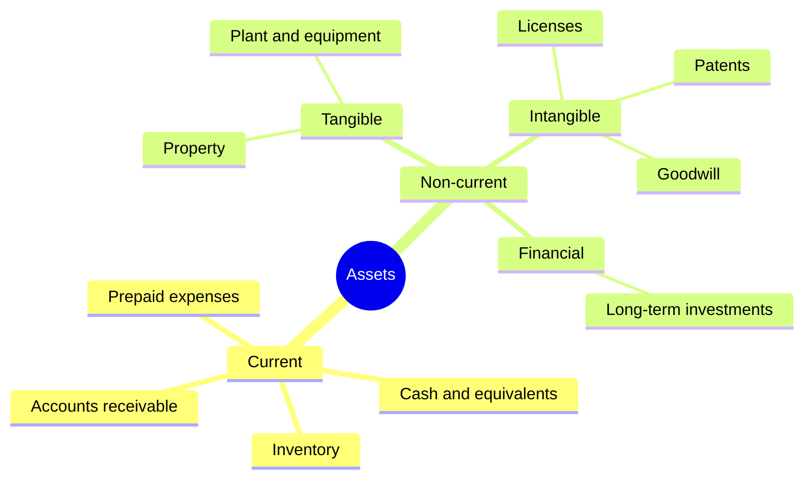
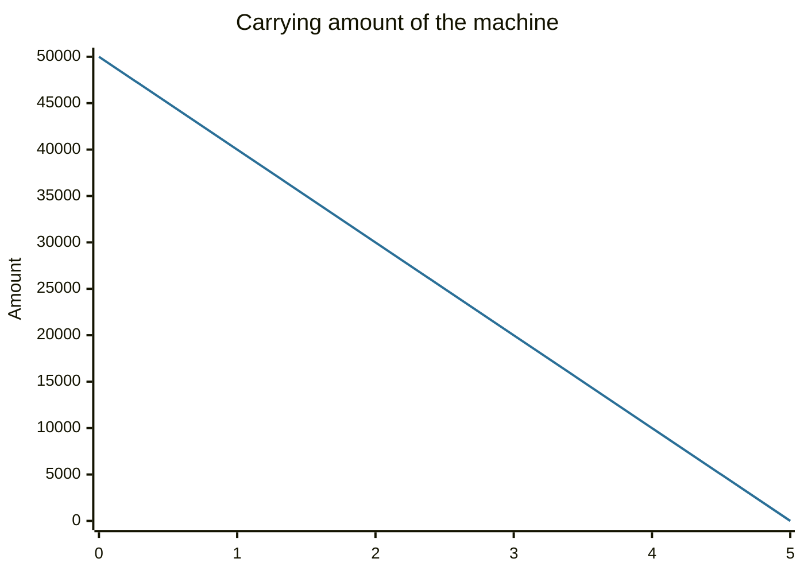

# Assets

## Summary

An asset is a resource that an entity controls and expects to produce future economic benefits, such as cash, inventory, equipment, a building, a patent or a financial investment. Assets are listed on the balance sheet in order of liquidity and grouped as current or non-current. How an asset is valued (historical cost, fair value or net of depreciation) decides what the balance sheet number means.

*This note is educational. It is not accounting or investment advice.*

## Prerequisites

- [Accounting equation](accounting-equation.md).

## Core concepts

### Definition

The IFRS Conceptual Framework (2018) defines an *asset* as a present economic resource controlled by the entity as a result of past events. An *economic resource* is a right that has the potential to produce economic benefits. Three elements follow: **control** (not necessarily legal ownership), a **past event** (a purchase or production) and **future benefit** (cash inflow, or a reduction in future outflows).

### Analogy

Assets are the tools in a workshop. Some are used up within weeks (materials), others last years (machines), and some cannot be touched at all (the reputation that brings customers). The analogy fails because a tool in a workshop always has a visible price tag, and many assets (brands, know-how developed in house) are not on the balance sheet at all.

### Classification

- **Current assets** are expected to be turned into cash, sold or used within one year or one operating cycle: cash, receivables, inventory, prepaid expenses.
- **Non-current (fixed) assets** are held for longer use: property, plant and equipment (tangible), patents, licenses, software and goodwill (intangible), and long-term investments (financial).
- **Financial assets** are cash, equity in another company or a contractual right to receive cash: bonds, shares, loans receivable.

Personal balance sheets use a similar split: liquid assets, investments and use assets such as a home and car (see [personal financial statements](../personal-finance/personal-financial-statements.md)).

### Measurement

| Basis | Meaning | Typical use |
| --- | --- | --- |
| Historical cost | Price paid, less depreciation | Equipment, buildings (under the cost model) |
| Fair value | Price that would be received in an orderly sale | Many financial instruments, investment property under some policies |
| Net realizable value | Expected selling price less costs of sale | Inventory (lower of cost and net realizable value) |
| Amortized cost | Cost adjusted for repayments and interest | Loans and bonds held to collect cash flows |

*Depreciation* spreads the cost of a tangible asset over its useful life, and *amortization* does the same for an intangible one. *Impairment* reduces the carrying amount when it exceeds what the asset can recover.

## Worked example

A company buys a machine for 50,000 with a useful life of 5 years and no residual value. Under straight-line depreciation, annual depreciation is 10,000.

| End of year | Carrying amount |
| --- | --- |
| 0 | 50,000 |
| 1 | 40,000 |
| 2 | 30,000 |
| 3 | 20,000 |
| 4 | 10,000 |
| 5 | 0 |

The carrying amount is an accounting figure. The market value of the machine after 3 years may be higher or lower than 20,000. If it fell to 12,000, an impairment loss of 8,000 would be recognized.

## Trade offs and when to use it

Historical cost is objective and verifiable but can be far from current value. Fair value is relevant but depends on estimates and markets that may be illiquid. The balance sheet leaves out many valuable assets created inside the company (brand, customer relationships, trained staff), so market value often exceeds book value (see [market value and intrinsic value](../fundamental-analysis/market-value-and-intrinsic-value.md)).

## Common mistakes

- **Confusing book value with market value.**
- **Treating all assets as liquid.** A factory cannot pay a bill next week.
- **Counting an expense as an asset** to raise profit: capitalizing costs that should be expensed.
- **Forgetting that assets can be financed by debt,** so a large asset base does not mean a strong equity position.

## Practice

1. What are the three elements of the definition of an asset?
2. A machine costing 24,000 has a life of 6 years and no residual value. What is the carrying amount after 2 years?
3. Is inventory a current or a non-current asset?

### Answers

1. Control, a past event and future economic benefit.
2. 24,000 - 2 × 4,000 = 16,000.
3. Current, because it is expected to be sold within the operating cycle.

## Further reading

- IFRS Foundation (2018). Conceptual Framework for Financial Reporting. IFRS Foundation. [Link](https://www.ifrs.org/issued-standards/list-of-standards/conceptual-framework/). Official definitions of asset, liability and equity.
- Brealey, R. A., Myers, S. C., Allen, F. et al. (2023). *Principles of Corporate Finance (14th ed.)*. McGraw Hill. Covers valuation, risk and the cost of capital.
- Damodaran, A. (2012). *Investment Valuation: Tools and Techniques for Determining the Value of Any Asset (3rd ed.)*. Wiley. A detailed treatment of intrinsic and relative valuation, including the earnings multiples.
