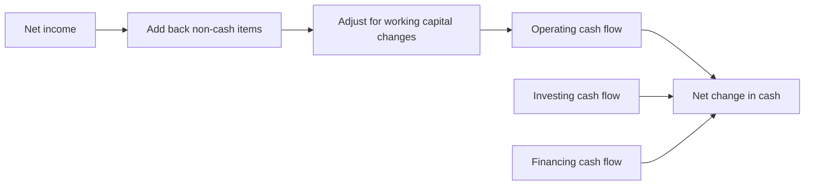
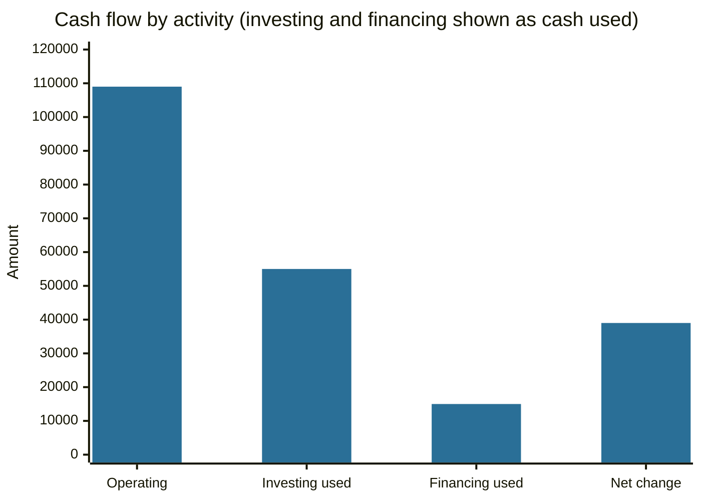

# Cash flow statement

## Summary

The cash flow statement explains why cash changed during a period by sorting every cash movement into operating, investing and financing activities. It starts from net income in the indirect method and adjusts for non-cash items and changes in working capital. It answers the question that the income statement cannot: where did the money come from and where did it go.

*This note is educational. It is not accounting or investment advice.*

## Prerequisites

- [Accounting](accounting.md).
- [Income and profit](income-and-profit.md).
- [Financial statements](../corporate-finance/financial-statements.md) for how the three statements connect.

## Core concepts

### Definition

The *statement of cash flows* (IAS 7 under IFRS) reports cash receipts and payments in a period, classified into three activities:

- **Operating activities (CFO):** the principal revenue-producing activities: cash from customers, payments to suppliers and employees, taxes.
- **Investing activities (CFI):** buying and selling long-term assets and investments: capital expenditure, purchase and sale of securities.
- **Financing activities (CFF):** transactions with owners and lenders: issuing shares, borrowing, repaying debt, paying dividends and buying back shares.

*Net cash flow* is CFO + CFI + CFF, and it equals the change in cash and cash equivalents.

### Analogy

If the income statement is the story of what the company earned, the cash flow statement is the bank statement. A business can report a profit on paper and still have an empty account, like a freelancer who has issued invoices that clients have not yet paid.

### Mechanism: the indirect method

The *direct method* lists actual receipts and payments. The *indirect method*, used by most companies, starts from net income and adjusts:

1. Add back non-cash expenses (depreciation, amortization, impairments).
2. Subtract an increase in receivables or inventory (sales or purchases made without cash movement), and add a decrease.
3. Add an increase in payables (expenses incurred but not yet paid), and subtract a decrease.

Analysts use the statement in several ways. **Operating cash flow margin** is CFO divided by revenue and shows how much cash each unit of sales produces. **Free cash flow** is CFO minus capital expenditure (see [free cash flow](../corporate-finance/free-cash-flow.md)). Rising [CapEx](../corporate-finance/capital-expenditure.md) lowers free cash flow now and may fund growth. Positive cash flow from investing driven by selling assets, together with negative operating cash flow, is a warning: the company may be financing operations by selling assets.

## Worked example

The company of the [income and profit](income-and-profit.md) example has net income of 104,000 and revenue of 1,000,000. Other facts: depreciation 30,000, receivables up by 20,000, inventory up by 15,000, payables up by 10,000, capital expenditure 60,000, sale of old equipment 5,000, new loan 40,000, loan repayment 25,000, dividends 30,000, opening cash 20,000.

| Section | Item | Amount |
| --- | --- | --- |
| Operating | Net income | 104,000 |
| | Depreciation | +30,000 |
| | Increase in receivables | -20,000 |
| | Increase in inventory | -15,000 |
| | Increase in payables | +10,000 |
| | **Operating cash flow** | **109,000** |
| Investing | Capital expenditure | -60,000 |
| | Sale of equipment | +5,000 |
| | **Investing cash flow** | **-55,000** |
| Financing | New loan | +40,000 |
| | Loan repayment | -25,000 |
| | Dividends | -30,000 |
| | **Financing cash flow** | **-15,000** |
| | **Net change in cash** | **+39,000** |
| | Closing cash | 59,000 |

Free cash flow is 109,000 - 60,000 = 49,000, and the operating cash flow margin is 109,000 / 1,000,000 = 10.9%.

Operating cash flow of 109,000, less 55,000 used in investing and 15,000 used in financing, leaves the net increase of 39,000.

## Trade offs and when to use it

The statement is hard to manipulate through accounting estimates, so it is a useful check on net income. Its limits: it reports the past, it does not show the profit from non-cash items, and a single period can be distorted by timing (for example, a customer paying early). Negative cash flow is not always bad: a growing company that invests heavily has negative investing cash flow by design. Look at several years and at the pattern across the three sections.

## Common mistakes

- **Reading negative net cash flow as distress** without checking its source.
- **Treating depreciation as a cash flow.** It is added back only because it was deducted without cash leaving.
- **Confusing interest and dividends classification.** IAS 7 allows some choices, so compare companies with care.
- **Ignoring working capital.** Fast-growing companies often consume cash in receivables and inventory.

## Practice

1. Which section does a bank loan repayment belong to?
2. Net income is 50, depreciation 10, receivables rose by 25. What is operating cash flow, ignoring other items?
3. Why is positive investing cash flow not always good news?

### Answers

1. Financing.
2. 50 + 10 - 25 = 35.
3. It may come from selling assets, which cannot be repeated and may be funding operating losses.

## Further reading

- IFRS Foundation. IAS 7 Statement of Cash Flows. IFRS Foundation. [Link](https://www.ifrs.org/issued-standards/list-of-standards/ias-7-statement-of-cash-flows/). The standard that defines operating, investing and financing cash flows.
- Brealey, R. A., Myers, S. C., Allen, F. et al. (2023). *Principles of Corporate Finance (14th ed.)*. McGraw Hill. Covers valuation, risk and the cost of capital.
- Damodaran, A. (2012). *Investment Valuation: Tools and Techniques for Determining the Value of Any Asset (3rd ed.)*. Wiley. A detailed treatment of intrinsic and relative valuation, including the earnings multiples.
