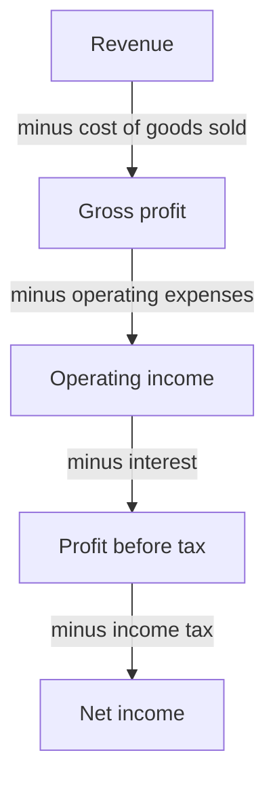
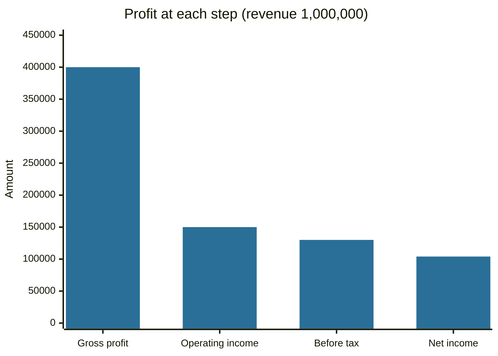

# Income and profit

## Summary

"Income" means different things for a person and for a company, and in tax, accounting and economics. For a person, gross income is everything earned before deductions, and net income is what remains after taxes and deductions. For a company, the income statement steps down from revenue to gross profit, operating income and net income. Knowing which layer a number refers to avoids most confusion when reading reports and comparing companies.

*This note is educational. It is not accounting or tax advice.*

## Prerequisites

- [Accounting](accounting.md).

## Core concepts

### Definition

- **Income** is the value received over a period in exchange for work, goods, services or the use of capital.
- **Gross income** is income before deductions. For a person it is gross pay plus other income (interest, dividends, rent, pensions). For a company the term is used as a synonym of *gross profit*: revenue minus the cost of goods sold (COGS).
- **Net income** (net earnings, profit after tax) is what remains after all expenses, interest and taxes. For a person it is take-home pay.
- **Taxable income** is gross income minus exclusions, exemptions and deductions allowed by tax law. It is the base on which income tax is computed.
- **Revenue** (sales, turnover) is the amount a company earns from its operations before any cost.

### Analogy

Income is water poured into a series of filters. Revenue is the water at the top. Each cost removes some: the cost of goods sold gives gross profit, operating expenses give operating income, interest and tax give net income. What reaches the bottom is the owners' share. The analogy breaks because, unlike water, some costs (like depreciation) involve no cash leaving.

### Mechanism: the income statement ladder

The ladder reads from top to bottom: each arrow names the cost that is subtracted.

Each step answers a question: gross profit asks whether the product earns more than it costs to make, operating income asks whether the business covers its running costs, and net income asks what is left for owners after financing and taxes. Net income is the basis of [earnings per share](../fundamental-analysis/earnings-per-share.md). The measures of operating costs and cash profit are in [EBITDA](../corporate-finance/ebitda.md) and [operating expenses](../corporate-finance/operating-expenses.md).

## Worked example

A company has revenue of 1,000,000 and COGS of 600,000. Operating expenses (sales, general, administration, research) are 250,000. Interest is 20,000 and the tax rate is 20%.

| Line | Amount | Margin on revenue |
| --- | --- | --- |
| Revenue | 1,000,000 | 100% |
| COGS | 600,000 | |
| Gross profit | 400,000 | 40% |
| Operating expenses | 250,000 | |
| Operating income | 150,000 | 15% |
| Interest | 20,000 | |
| Profit before tax | 130,000 | 13% |
| Tax at 20% | 26,000 | |
| Net income | 104,000 | 10.4% |

A person with gross pay of 5,000 a month, 1,000 of income tax and social contributions and no other deductions has net income of 4,000. If a 300 deduction applies, taxable income is 4,700 and the tax is computed on that amount, so the order matters.

## Trade offs and when to use it

Use gross income or gross profit to judge the product or the pricing, operating income to judge the core business independent of financing, and net income to judge the result for owners. Net income can be changed by accounting choices (depreciation methods, provisions, one-off items), and a company can show profit and still lack cash, so read it with the [cash flow statement](cash-flow-statement.md).

## Common mistakes

- **Using "gross income" without saying which meaning.** For a person it is before tax. For a company it is gross profit.
- **Comparing net income across countries without tax adjustment.**
- **Ignoring one-off items** that distort a single year.
- **Budgeting on gross pay.** Personal budgets should start with net income.

## Practice

1. Revenue is 500,000, COGS 350,000 and operating expenses 90,000. What are gross profit and operating income?
2. What is the difference between gross and taxable income for a person?
3. Why can a profitable company run out of cash?

### Answers

1. Gross profit 150,000 and operating income 60,000.
2. Taxable income is gross income less exclusions, exemptions and deductions allowed by tax law.
3. Profit is measured on an accrual basis, while cash is spent on inventory, receivables, investment and debt repayment.

## Further reading

- IFRS Foundation (2018). Conceptual Framework for Financial Reporting. IFRS Foundation. [Link](https://www.ifrs.org/issued-standards/list-of-standards/conceptual-framework/). Official definitions of asset, liability and equity.
- Brealey, R. A., Myers, S. C., Allen, F. et al. (2023). *Principles of Corporate Finance (14th ed.)*. McGraw Hill. Covers valuation, risk and the cost of capital.
- Damodaran, A. (2012). *Investment Valuation: Tools and Techniques for Determining the Value of Any Asset (3rd ed.)*. Wiley. A detailed treatment of intrinsic and relative valuation, including the earnings multiples.
