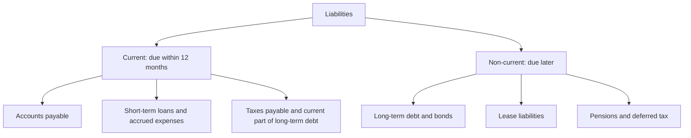

# Liabilities

## Summary

A liability is a present obligation of an entity to transfer an economic resource as a result of past events. Loans, bonds, supplier invoices, wages owed, taxes due, leases and customer prepayments are liabilities. Liabilities are the claims of outsiders on the assets of an entity. They are split into current and non-current by when they fall due, and some are uncertain (provisions and contingent liabilities). Debt is one kind of liability, and many liabilities carry no interest.

*This note is educational. It is not accounting, tax or legal advice.*

## Prerequisites

- [Accounting equation](accounting-equation.md).
- [Assets](assets.md).

## Core concepts

### Definition

The IFRS Conceptual Framework (2018) defines a *liability* as a present obligation of the entity to transfer an economic resource as a result of past events. The older formulation, still used in IAS 37 and in many textbooks, says that settling the obligation is expected to result in an outflow of resources embodying economic benefits. Three elements must be present: a **present obligation** (legal or constructive), a **past event** and a **transfer** of resources (cash, goods or services). If one is missing, there is no liability.

### Analogy

Liabilities are IOUs written by the company. Some are due next week (the invoice from the supplier), some in ten years (a bond), and some depend on an outcome (a lawsuit). The analogy breaks because an IOU is always a specific amount, while some liabilities have to be estimated.

### Classification and types

| Type | Meaning | Example |
| --- | --- | --- |
| Financial liability | Contractual duty to deliver cash or another financial asset | Loans, bonds, trade payables |
| Operating liability | Arises in normal operations | Accrued wages, deferred revenue |
| Provision | A liability of uncertain timing or amount that is recognized | Warranty costs, restructuring, environmental clean-up |
| Contingent liability | A possible obligation that depends on a future event | A lawsuit, a guarantee |
| Lease liability | Present value of lease payments | Office or equipment leases under IFRS 16 |
| Deferred revenue | Cash received before the goods or services are delivered | Annual software subscription paid in advance |

**Recognition.** Under IAS 37, a provision is recognized when there is a present obligation from a past event, an outflow is probable (more likely than not) and the amount can be estimated reliably. If the outflow is only possible, or cannot be measured reliably, the item is a contingent liability and is disclosed in the notes, not recognized. US GAAP uses a higher "probable" threshold (likely to occur), which is a known difference between the frameworks.

**Leases.** IFRS 16 requires a lessee to recognize a right-of-use asset and a lease liability for most leases, with exemptions for short-term and low-value leases.

**Measurement.** Liabilities are measured at amortized cost, fair value or present value, depending on the item. A bond issued by a company is normally carried at amortized cost using the effective interest method.

### Liability versus expense and versus debt

- **Liability versus expense.** A liability is an obligation, and an expense is a cost recognized in the income statement. Accrued salary is both: an expense in the period, and a liability until it is paid.
- **Liability versus debt.** Debt is the interest-bearing part (see [debt](../credit-and-debt/debt.md)). Deferred revenue is a liability, not debt, and it is not profit: the company still owes the service.

### Liabilities and risk

Higher liabilities relative to assets and cash flow raise financial leverage, default risk and sensitivity to interest rates. Leverage helps when the return on assets is above the cost of debt and hurts when it is below. In an insolvency, creditors are paid before owners. Companies with *limited liability* protect owners' private property: shareholders can lose their investment, but not more. Off-balance-sheet obligations (guarantees, some commitments) can hide risk, so analysts read the notes.

## Worked example

A software company has the following at year end.

| Item | Amount | Classification |
| --- | --- | --- |
| Supplier invoices | 40,000 | Current, financial |
| Salaries earned but unpaid | 25,000 | Current, operating |
| Annual subscriptions paid in advance | 120,000 | Current, deferred revenue |
| Bank loan due in 3 years | 200,000 | Non-current |
| Pending lawsuit, loss possible but not probable | 0 recognized | Contingent, disclosed |

Total recognized liabilities are 385,000, of which 185,000 are current. If current assets are 300,000, the current ratio is 300,000 / 185,000 = 1.62, so current assets cover current liabilities 1.62 times. The 120,000 deferred revenue will not be paid in cash, but the company must still deliver the service, so it is not counted as profit.

## Trade offs and when to use it

Liabilities give a company funds without selling ownership and can lower the cost of capital, because interest is a tax-deductible cost in many systems. They also commit future cash. A company with stable cash flow can carry more than one with volatile cash flow. Compare liabilities with cash flow and asset quality, and not with the total alone.

## Common mistakes

- **Calling every liability debt.**
- **Treating deferred revenue as profit.**
- **Ignoring contingent liabilities** that are disclosed in the notes.
- **Assuming that more liabilities always mean bankruptcy risk.** It depends on cash flow stability and asset quality.

## Practice

1. Name the three elements of a liability.
2. Is a customer prepayment for a service a liability? Why?
3. When is a provision recognized under IAS 37?

### Answers

1. A present obligation, a past event and an expected transfer of resources.
2. Yes, because the company owes the service, and a present obligation exists from a past event (receiving the payment).
3. When there is a present obligation from a past event, an outflow is probable and the amount can be estimated reliably.

## Further reading

- IFRS Foundation (2018). Conceptual Framework for Financial Reporting. IFRS Foundation. [Link](https://www.ifrs.org/issued-standards/list-of-standards/conceptual-framework/). Official definitions of asset, liability and equity.
- IFRS Foundation. IAS 37 Provisions, Contingent Liabilities and Contingent Assets. IFRS Foundation. [Link](https://www.ifrs.org/issued-standards/list-of-standards/ias-37-provisions-contingent-liabilities-and-contingent-assets/). The recognition rules for provisions and contingent liabilities.
- IFRS Foundation. IFRS 16 Leases. IFRS Foundation. [Link](https://www.ifrs.org/issued-standards/list-of-standards/ifrs-16-leases/). The standard behind lease liabilities on the balance sheet.
- Brealey, R. A., Myers, S. C., Allen, F. et al. (2023). *Principles of Corporate Finance (14th ed.)*. McGraw Hill. Covers valuation, risk and the cost of capital.
