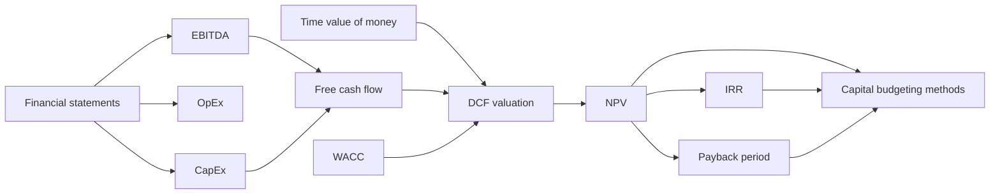

# Corporate finance

How a company measures profit and cash, how much it is worth and which investments it should make. This subfield belongs to [Finance and investing](../README.md). It starts with the three financial statements and the time value of money, moves to the operating measures that managers and investors use (EBITDA, OpEx, CapEx, free cash flow) and ends with valuation and capital budgeting (DCF, WACC, NPV, IRR, payback period).

## Map of the subfield

The chain below shows how the notes depend on each other: statements supply the numbers, free cash flow is the input to valuation, and WACC is the discount rate.

## Notes in reading order

**Foundations**

1. [Financial statements](financial-statements.md): income statement, balance sheet and cash flow statement and how they connect.
2. [Time value of money](time-value-of-money.md): compounding, discounting and present value.

**Operating measures**

3. [EBITDA](ebitda.md): earnings before interest, taxes, depreciation and amortization, its uses and blind spots.
4. [Operating expenses (OpEx)](operating-expenses.md): day-to-day costs, the OpEx-first trend and operating leverage.
5. [Capital expenditure (CapEx)](capital-expenditure.md): investment in long-lived assets, depreciation and capital intensity.
6. [Free cash flow (FCF)](free-cash-flow.md): cash left after operating costs and investment, and why it matters more than profit.

**Valuation and investment decisions**

7. [Discounted cash flow (DCF)](discounted-cash-flow.md): valuing a business from its future free cash flows.
8. [Weighted average cost of capital (WACC)](wacc.md): the hurdle rate, cost of equity and the tax shield.
9. [Net present value (NPV)](net-present-value.md): the value an investment adds in today's money.
10. [Internal rate of return (IRR)](internal-rate-of-return.md): the break-even discount rate and its traps.
11. [Payback period](payback-period.md): how fast an investment returns its cost, simple and discounted.
12. [Capital budgeting methods](capital-budgeting-methods.md): payback, NPV, IRR and ROI compared, and how firms use them.

## How to use this subfield

Read notes 1 and 2 first even if you know accounting, because the rest assumes them. Then work through the examples in notes 7 to 11 with your own numbers in a spreadsheet. Business-level metrics for subscription companies are in [business metrics](../../business-and-management/business-metrics/README.md).

These notes are educational. They are not investment, tax or accounting advice.

## Navigation

- Back to [Finance and investing](../README.md).
