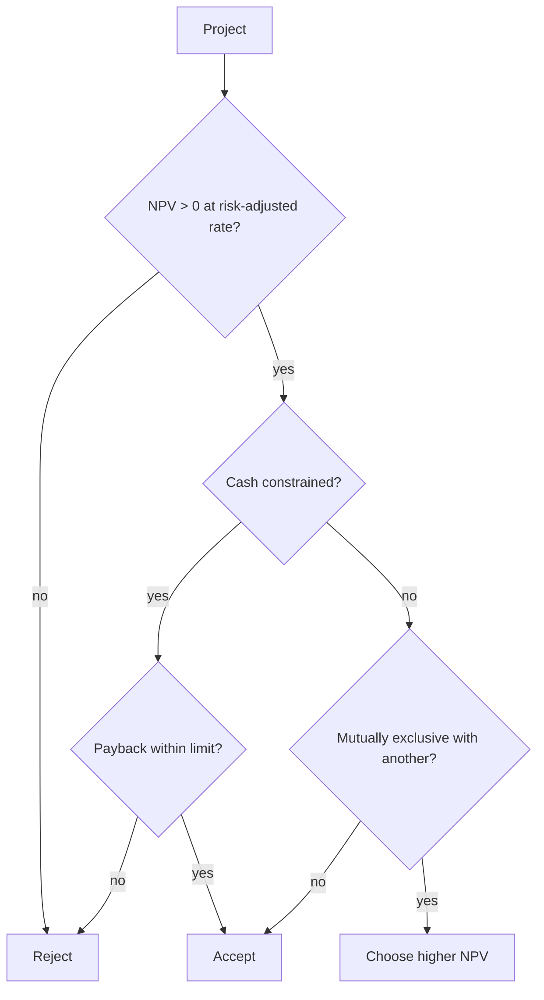

# Capital budgeting methods

## Summary

Capital budgeting is the process of deciding which long-term investments a company should make. The main methods are net present value, internal rate of return, payback period and simple return on investment. Each answers a different question: how much value, at what rate, how fast and how much profit per unit of cost. Theory favors NPV; practice uses several together. Surveys of finance directors find that NPV and IRR are used most often, with payback close behind.

*This note is educational. It is not investment, tax or accounting advice.*

## Prerequisites

- [Net present value (NPV)](net-present-value.md)
- [Internal rate of return (IRR)](internal-rate-of-return.md)
- [Payback period](payback-period.md)

## Core concepts

### Definition

*Capital budgeting* is the evaluation and selection of investments whose benefits extend over several years: new plants, equipment, products, acquisitions or software platforms. The methods compared here are:

- **NPV** (see [Net present value (NPV)](net-present-value.md)): value added in today's money.
- **IRR** (see [Internal rate of return (IRR)](internal-rate-of-return.md)): the break-even discount rate.
- **Payback period** (see [Payback period](payback-period.md)): time to recover the outlay.
- **ROI** (see [Return on investment (ROI)](../../business-and-management/business-metrics/return-on-investment.md)): profit relative to cost, without timing.

### Analogy

The methods are like four gauges on a car dashboard: speed, fuel, engine temperature and distance. Each is useful, none tells the whole story, and the one you look at most depends on the trip.

### Mechanism

| Method | Question | Uses time value of money | Uses all cash flows | Main weakness |
| --- | --- | --- | --- | --- |
| NPV | How much wealth? | Yes | Yes | Depends on discount rate and forecasts |
| IRR | At what rate? | Yes | Yes | Ignores scale; multiple solutions possible |
| Payback | How fast? | Only in discounted form | No | Ignores cash after payback |
| ROI | How much profit per unit of cost? | No | Usually | Ignores timing |

**How firms use them.** Graham and Harvey (2001) surveyed 392 chief financial officers in the United States and Canada: about three quarters always or almost always used NPV and IRR, and more than half used payback, more often in smaller firms and among older, less MBA-educated managers. A common practice is NPV as the main criterion, IRR for communication with investors, and payback as a liquidity constraint.

A decision flow combining the methods:

## Worked example

Two projects, cost of capital 10%:

| Project | Outlay | Cash flows | NPV | IRR | Payback |
| --- | --- | --- | --- | --- | --- |
| A | 100 | 60, 60 | 4.1 | 13.1% | 1.7 years |
| B | 100 | 30, 30, 30, 30, 30 | 13.7 | 15.2% | 3.3 years |

B has the higher NPV and IRR; A pays back faster. Without cash constraints, choose B. A firm that needs its 100 back within two years would choose A, accepting lower value for liquidity. The figures follow from the formulas in the linked notes (rounded).

## Trade offs and when to use it

Using several methods gives a fuller picture but invites choosing the one that supports a favored project. Agree on the primary criterion (usually NPV) and the role of the others before evaluating projects.

## Common mistakes

- **Letting the method that flatters a pet project decide.** Fix the decision rules before the analysis.
- **Using one discount rate for all projects.** Adjust for project risk.

## Practice

1. Which method answers "how fast?" and which "how much wealth?"
2. Which methods did most CFOs report using in the Graham and Harvey survey?

### Answers

1. Payback answers how fast; NPV answers how much wealth.
2. NPV and IRR (about three quarters each), with payback also common.

## Further reading

- Graham, J. R., Harvey, C. R. (2001). The theory and practice of corporate finance: Evidence from the field. Journal of Financial Economics, 60(2-3), 187-243. [DOI](https://doi.org/10.1016/S0304-405X(01)00044-7). Survey of capital budgeting practice.
- Brealey, R. A., Myers, S. C., Allen, F. et al. (2023). *Principles of Corporate Finance (14th ed.)*. McGraw Hill. Comparison of investment criteria.
