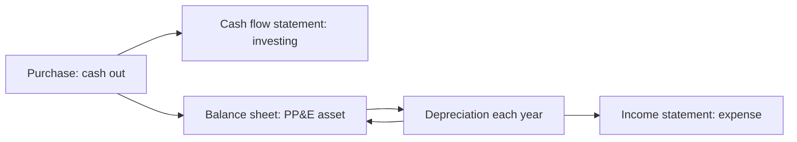

# Capital expenditure (CapEx)

## Summary

Capital expenditure (CapEx) is money spent to acquire, upgrade or extend the life of long-lived assets such as buildings, machines, vehicles, servers and, in some cases, software. Unlike operating expenses, the cost is recorded as an asset and spread over the asset's useful life through depreciation. CapEx builds capacity and competitive advantages, but it locks up cash and cannot be cancelled like a subscription. Because EBITDA ignores it, investors look at free cash flow to see whether a business actually generates cash.

*This note is educational. It is not investment, tax or accounting advice.*

## Prerequisites

- [Financial statements](financial-statements.md)

## Core concepts

### Definition

*Capital expenditure* is spending that creates a benefit lasting more than one accounting period and is therefore *capitalized*: recorded on the balance sheet as property, plant and equipment (PP&E, under IAS 16) or as an intangible asset (IAS 38), and depreciated or amortized over its useful life. CapEx appears in the investing section of the cash flow statement. If it is not reported directly, it can be estimated from two balance sheets:

```text
CapEx = PP&E (net) at end of period - PP&E (net) at start of period + depreciation for the period
```

### Analogy

CapEx is buying a delivery van instead of paying a courier per parcel. The van costs a lot upfront and then serves for years, losing value gradually. The analogy shows the trade-off: owning is cheaper per parcel if the van is used a lot, and a burden if business slows.

### Mechanism

**CapEx and OpEx.**

| Feature | CapEx | OpEx |
| --- | --- | --- |
| Timing of cost | Large upfront payment | Small recurring payments |
| Accounting | Capitalized as an asset | Expensed in the income statement |
| Tax effect | Deducted gradually through depreciation | Deducted in the current year |
| Examples | Buying a server or a building | Paying for cloud hosting, renting an office |

Tax rules differ from accounting: many countries, Poland among them, allow accelerated or one-off depreciation in some cases. Check the current rules.

**Maintenance and growth CapEx.** *Maintenance CapEx* keeps existing capacity running; *growth CapEx* adds capacity or new capabilities. If almost all CapEx is maintenance, the business is standing still.

**Three strategic uses.**

1. **Scaling capacity:** the machine that doubles output, or a proprietary platform.
2. **Efficiency and moats:** equipment that lowers unit costs so much that competitors cannot follow.
3. **Valuation:** EBITDA does not subtract CapEx, so a company can look very profitable while spending all its cash on equipment. Free cash flow subtracts it (see [Free cash flow (FCF)](free-cash-flow.md)).

**Capital intensity.** CapEx relative to revenue. High-CapEx businesses (airlines, factories, telecoms) are harder to scale and riskier; low-CapEx businesses (software, consulting) can grow with little extra investment and are often valued at higher multiples.

How a CapEx purchase flows through the statements over its life:



## Worked example

A bakery buys an oven for 120,000 with a useful life of 10 years and no residual value. Cash falls by 120,000 in year one (investing). The income statement shows depreciation of 12,000 per year for ten years. From the balance sheets: PP&E net was 300,000 at the start and 378,000 at the end of the year, depreciation for all assets was 42,000, so CapEx = 378,000 - 300,000 + 42,000 = 120,000.

## Trade offs and when to use it

CapEx creates lasting capacity and can lower unit costs, but it commits cash early, before the return is proven, and is hard to reverse. Leasing, renting and outsourcing shift costs to OpEx at the price of higher long-run cost and less control.

## Common mistakes

- **Over-investing.** Buying a large warehouse or high-end equipment before sales support it locks up cash in an idle asset.
- **Not separating maintenance from growth CapEx.** Track them separately to see whether the business is expanding or just standing still.
- **The legacy burden.** A building or custom factory cannot be cancelled like a subscription. Stage large commitments where possible.

## Practice

1. PP&E net rises from 500 to 560, depreciation is 70. What is CapEx?
2. Why can a company with strong EBITDA have weak free cash flow?

### Answers

1. 130.
2. Because EBITDA ignores CapEx, which may absorb most of the cash.

## Further reading

- IFRS Foundation. *IAS 16 Property, Plant and Equipment*. [Link](https://www.ifrs.org/issued-standards/list-of-standards/ias-16-property-plant-and-equipment/). Property, plant and equipment.
- IFRS Foundation. *IAS 38 Intangible Assets*. [Link](https://www.ifrs.org/issued-standards/list-of-standards/ias-38-intangible-assets/). Intangible assets.
- Koller, T., Goedhart, M., Wessels, D. (2020). *Valuation: Measuring and Managing the Value of Companies (7th ed.)*. Wiley. Capital intensity and value.
