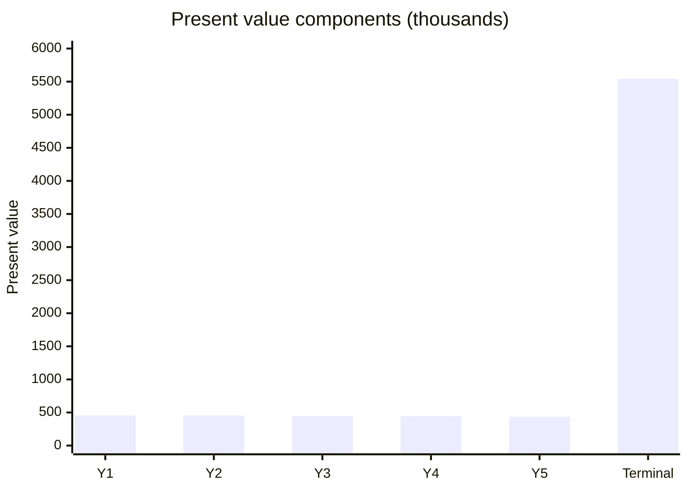

# Discounted cash flow (DCF)

## Summary

Discounted cash flow (DCF) valuation estimates what a business or project is worth today from the free cash flows it is expected to produce, discounted at a rate that reflects risk. It rests on the time value of money: future cash is worth less than cash today. A DCF needs three inputs: a forecast of free cash flow for 5 to 10 years, a discount rate (usually WACC) and a terminal value for the years beyond. It measures intrinsic value, independent of market mood, and it is highly sensitive to its assumptions.

*This note is educational. It is not investment, tax or accounting advice.*

## Prerequisites

- [Time value of money](time-value-of-money.md)
- [Free cash flow (FCF)](free-cash-flow.md)

## Core concepts

### Definition

A *DCF valuation* is:

```text
Value = sum over t = 1..n of  FCF_t / (1 + r) ^ t   +   TV / (1 + r) ^ n
```

where FCF_t is free cash flow in year t, r the discount rate (WACC for firm value), n the last forecast year and TV the *terminal value*. With the growing perpetuity method:

```text
TV = FCF_(n+1) / (r - g)
```

where g is a modest long-term growth rate, usually not above long-run nominal economic growth. The alternative is an *exit multiple* (for example a multiple of EBITDA in year n).

### Analogy

A DCF is like pricing an apple orchard by estimating each year's harvest, converting each future harvest into today's money, and adding a value for the trees after the forecast period. The more uncertain the harvests, the more the future is discounted.

### Mechanism

**Three pillars.**

1. **Forecast period (typically 5 to 10 years).** Project FCF year by year from assumptions about market share, pricing, margins and investment.
2. **Discount rate.** It reflects risk and the opportunity cost of capital. A risky startup might be discounted at 20% or more, a stable utility at around 8%. Higher rates make future cash worth less today (see [Weighted average cost of capital (WACC)](wacc.md)).
3. **Terminal value.** The business continues after year n. Terminal value often makes up a large share of the total; practitioners commonly cite 60% to 80% for mature companies, and more for fast-growing ones.

**Three strategic uses.**

- **Intrinsic value:** what the business is worth on its own cash generation, not compared with market multiples.
- **Mergers and acquisitions:** if a DCF puts a target at 10 million and the owner asks 15 million, the gap must be justified by synergies.
- **Capital budgeting:** a DCF of the extra cash flow from a new factory, minus its cost, is its NPV (see [Net present value (NPV)](net-present-value.md)).

The value build-up of the worked example: present values of five forecast years and of the terminal value.



The terminal value accounts for about 71% of the total.

## Worked example

```python
# Python 3.12. Five-year DCF with a growing perpetuity terminal value and a sensitivity table.
def dcf(fcfs, r, g):
    pv = [cf / (1 + r) ** t for t, cf in enumerate(fcfs, start=1)]
    tv = fcfs[-1] * (1 + g) / (r - g)
    pv_tv = tv / (1 + r) ** len(fcfs)
    return pv, pv_tv

fcfs = [500, 550, 600, 650, 700]
pv, pv_tv = dcf(fcfs, 0.10, 0.02)
print([round(x) for x in pv], round(pv_tv))
total = sum(pv) + pv_tv
print("value:", round(total), "terminal share: {:.0%}".format(pv_tv / total))

for r in (0.09, 0.10, 0.11):
    print(r, [round(sum(dcf(fcfs, r, g)[0]) + dcf(fcfs, r, g)[1]) for g in (0.01, 0.02, 0.03)])
```

Output:

```text
[455, 455, 451, 444, 435] 5542
value: 7780 terminal share: 71%
0.09 [8044, 8930, 10110]
0.1 [7116, 7780, 8634]
0.11 [6375, 6887, 7528]
```

A one-point change in the discount rate moves the value by roughly 10% to 15%, and a one-point change in g moves it by a similar amount, which is why a DCF is always shown with a sensitivity table.

## Trade offs and when to use it

A DCF forces explicit assumptions about growth, margins, investment and risk, and it values the business on its own merits. Its weakness is "garbage in, garbage out": small changes in growth or discount rates swing the value widely. Use it with market multiples and scenario analysis, not as a precise answer.

## Common mistakes

- **Over-optimistic growth.** Changing growth from 5% to 7% in a spreadsheet can swing a 10-year valuation by millions. Tie forecasts to market size and capacity.
- **Ignoring sensitivity to the discount rate.** Always show a table of values for different rates and growth assumptions.
- **The terminal value trap.** Because terminal value dominates, a perpetual growth rate that is too high produces large overvaluation. Keep g at or below long-run economic growth.
- **Discounting profit instead of free cash flow.** Discount FCF; profit ignores investment and working capital.

## Practice

1. What are the three pillars of a DCF?
2. FCF next year 100, discount rate 9%, growth 3% forever. What is the value?
3. Why is terminal value risky?

### Answers

1. The forecast period, the discount rate and the terminal value.
2. 100 / (0.09 - 0.03) ≈ 1,666.67.
3. It often makes up most of the value and is very sensitive to the assumed perpetual growth rate and discount rate.

## Further reading

- Koller, T., Goedhart, M., Wessels, D. (2020). *Valuation: Measuring and Managing the Value of Companies (7th ed.)*. Wiley. DCF valuation in practice.
- Damodaran, A. (2012). *Investment Valuation (3rd ed.)*. Wiley. Valuation methods.
- Gordon, M. J. (1959). Dividends, earnings, and stock prices. Review of Economics and Statistics, 41(2), 99-105. [DOI](https://doi.org/10.2307/1927792). Growing perpetuity.
