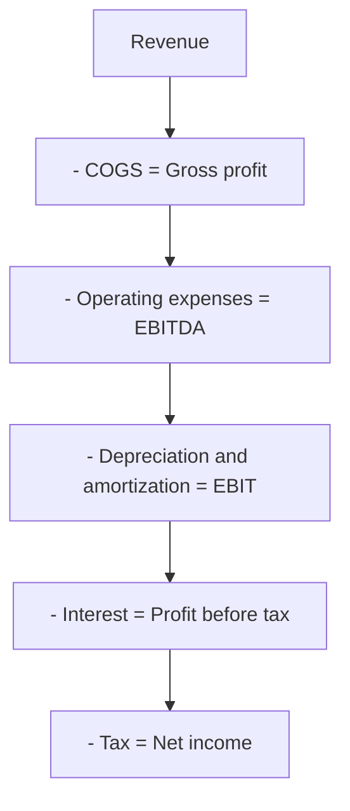

# EBITDA

## Summary

EBITDA stands for earnings before interest, taxes, depreciation and amortization. It measures the operating profitability of a business by removing the effects of financing (interest), tax environments (taxes) and accounting for long-lived assets (depreciation and amortization). It is widely used for valuation multiples, comparisons between companies and lending limits. It is not cash flow: it ignores capital expenditure, working capital and debt, so a company with strong EBITDA can still run out of money.

*This note is educational. It is not investment, tax or accounting advice.*

## Prerequisites

- [Financial statements](financial-statements.md)

## Core concepts

### Definition

*EBITDA* can be calculated two ways:

```text
Bottom-up:  EBITDA = net income + interest + taxes + depreciation + amortization
Top-down:   EBITDA = revenue - cost of goods sold - operating expenses (excluding depreciation and amortization)
            (equivalently, operating profit EBIT + depreciation + amortization)
```

It is a *non-GAAP* (non-IFRS) measure: accounting standards do not define it, so companies calculate it differently. Regulators such as the US SEC require public companies that present it to reconcile it to net income, and IFRS 18 (from 2027) requires disclosure of such management-defined measures.

### Analogy

EBITDA is like judging a taxi driver by fares minus fuel and wages, before car loan payments, taxes and the car's wear. It shows how well the driving business runs, but a driver with good EBITDA and a worn-out car that must be replaced every two years may not be making money at all.

### Mechanism

**Why each item is added back.**

| Component | Reason for adding back |
| --- | --- |
| Interest | Depends on how the business was funded (debt or equity), not on how well it is run. |
| Taxes | Rates differ by country and by past losses; they do not show operating efficiency. |
| Depreciation | A non-cash expense spreading the cost of physical assets (machines, laptops) over their life. |
| Amortization | The same for intangible assets (patents, licenses, acquired software, some customer lists). |

**Three uses.**

1. **Valuation multiple.** Many private businesses are bought and sold at a multiple of EBITDA (enterprise value / EBITDA). If the relevant multiple is 8x and EBITDA is 1 million, the business is worth about 8 million in enterprise value, and an extra 100,000 of EBITDA adds about 800,000. Multiples vary by industry, size, growth and interest rates; Damodaran publishes them by sector.
2. **Benchmarking.** Comparing companies with different tax regimes and debt structures on a like-for-like operating basis.
3. **Debt capacity.** Lenders look at *net debt / EBITDA* and *EBITDA / interest* to judge how much they can lend.

**EBITDA margin** = EBITDA / revenue. A high margin can indicate cost advantages or pricing power.

From revenue to net income, showing where EBITDA sits:



## Worked example

```python
# Python 3.12. EBITDA two ways, margin, and a multiple-based value.
revenue, cogs, opex_ex_da = 5_000, 2_000, 1_900
da, interest, tax = 300, 150, 120

ebitda_top = revenue - cogs - opex_ex_da
net_income = ebitda_top - da - interest - tax
ebitda_bottom = net_income + interest + tax + da
print(ebitda_top, ebitda_bottom, net_income)
print("margin: {:.0%}".format(ebitda_top / revenue))
print("value at 8x:", 8 * ebitda_top)
```

Output:

```text
1100 1100 530
margin: 22%
value at 8x: 8800
```

Both routes give 1,100 (thousands). At an 8x multiple, the enterprise value is about 8.8 million; equity value is that minus net debt.

## Trade offs and when to use it

EBITDA is quick, comparable across capital structures and close to operating cash generation for asset-light businesses. Its blind spots are serious for capital-intensive or indebted ones, and companies often present "adjusted EBITDA" that removes more and more costs. Warren Buffett and other investors have long criticized it for ignoring the real cost of replacing assets.

## Common mistakes

- **The CapEx blind spot.** High EBITDA with high capital needs (new machines every year) does not mean the company is rich. Look at free cash flow.
- **The debt mirage.** Adding back interest can make a heavily indebted company look healthy. Check debt ratios such as net debt / EBITDA.
- **Equating EBITDA with cash.** Unpaid invoices and inventory absorb cash; EBITDA ignores timing.
- **Trusting adjusted EBITDA blindly.** Read the reconciliation and question every add-back.

## Practice

1. Net income 200, interest 50, tax 40, depreciation 80, amortization 30. What is EBITDA?
2. Why can EBITDA overstate the health of an airline?
3. What do lenders use EBITDA for?

### Answers

1. 400.
2. It ignores the large, recurring cost of replacing aircraft (CapEx) and the airline's debt.
3. Ratios such as net debt / EBITDA and EBITDA / interest to judge debt capacity.

## Further reading

- Koller, T., Goedhart, M., Wessels, D. (2020). *Valuation: Measuring and Managing the Value of Companies (7th ed.)*. Wiley. Valuation and operating measures.
- Damodaran, A.. Damodaran Online: data on cost of capital, multiples and margins by industry. [Link](https://pages.stern.nyu.edu/~adamodar/New_Home_Page/datacurrent.html). Multiples and margins by industry.
- U.S. Securities and Exchange Commission. Non-GAAP Financial Measures: Compliance and Disclosure Interpretations. [Link](https://www.sec.gov/rules-regulations/staff-guidance/compliance-disclosure-interpretations/non-gaap-financial-measures). Rules for non-GAAP measures.
- IFRS Foundation (2024). *IFRS 18 Presentation and Disclosure in Financial Statements*. [Link](https://www.ifrs.org/issued-standards/list-of-standards/ifrs-18-presentation-and-disclosure-in-financial-statements/). Management-defined performance measures.
