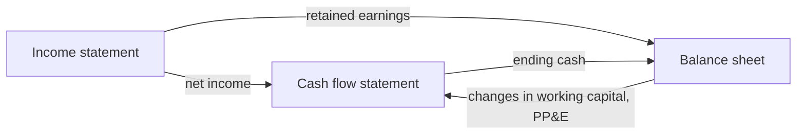

# Financial statements

## Summary

A company reports its finances in three linked statements. The income statement shows revenue, costs and profit over a period. The balance sheet shows what the company owns and owes at a moment. The cash flow statement shows how cash moved through operating, investing and financing activities. Profit and cash differ because of non-cash items such as depreciation, timing of payments and investment in assets, which is why all three are needed to judge a business.

*This note is educational. It is not investment, tax or accounting advice.*

## Prerequisites

No prior notes are needed.

## Core concepts

### Definition

*Financial statements* are the standard reports of a company's financial position and performance, prepared under accounting rules such as IFRS (International Financial Reporting Standards), US GAAP or national laws (in Poland, the Accounting Act).

- The **income statement** (profit and loss account) lists revenue and expenses over a period and ends with *net income*.
- The **balance sheet** (statement of financial position) lists *assets*, *liabilities* and *equity* at a date, and always balances: assets = liabilities + equity.
- The **cash flow statement** explains the change in cash over a period in three sections: operating, investing and financing activities (IAS 7).

### Analogy

The three statements are like three views of a household. The income statement is the monthly budget: salary in, bills out, what is left. The balance sheet is a snapshot of everything the household owns (flat, car, savings) and owes (mortgage, loans). The cash flow statement is the bank account history. A household can have a budget surplus and still run out of cash if a big payment comes before the salary, which is exactly the difference between profit and cash.

### Mechanism

**Income statement structure.**

```text
Revenue
- Cost of goods sold (COGS)
= Gross profit
- Operating expenses (sales, general and administrative, research and development)
= EBITDA (if depreciation and amortization are shown separately)
- Depreciation and amortization
= Operating profit (EBIT)
- Interest
= Profit before tax
- Income tax
= Net income
```

**How the statements connect.**

- Net income flows into equity on the balance sheet (retained earnings).
- The cash flow statement usually starts from net income, adds back non-cash expenses (depreciation, amortization), adjusts for changes in *working capital* (receivables, inventory, payables), and arrives at *cash flow from operations*. Investing activities (CapEx, acquisitions) and financing activities (loans, equity, dividends) follow.
- The ending cash on the cash flow statement equals the cash line on the balance sheet.

**From 2027.** IFRS 18 replaces the presentation rules of IAS 1 for annual periods beginning on or after 1 January 2027, with defined subtotals in the income statement (operating profit among them) and disclosure of management-defined performance measures.

The links between the three statements:



## Worked example

A small software company in one year:

| Line | Amount |
| --- | --- |
| Revenue | 1,000 |
| COGS (hosting, support) | 200 |
| Gross profit | 800 |
| Operating expenses | 550 |
| Depreciation and amortization | 50 |
| Operating profit (EBIT) | 200 |
| Interest | 20 |
| Tax (19%) | 34.2 |
| Net income | 145.8 |

Cash flow from operations: net income 145.8 + depreciation 50 - increase in receivables 90 = 105.8. The company also bought servers for 120 (investing). Despite a profit of 145.8, cash fell by 14.2 before any financing, because customers had not yet paid and servers were bought. All figures in thousands of euros, invented for the example.

## Trade offs and when to use it

Statements prepared under accounting rules are comparable and audited for larger companies, but they reflect accounting choices (depreciation methods, revenue recognition), lag reality and say little about intangible strengths. Investors combine them with operating metrics and cash measures.

## Common mistakes

- **Treating profit as cash.** Read the cash flow statement; receivables, inventory and investment absorb cash.
- **Reading one statement in isolation.** Follow net income and cash across all three.

## Practice

1. What equation does a balance sheet always satisfy?
2. Name the three sections of a cash flow statement.
3. Why can a profitable company run out of cash?

### Answers

1. Assets = liabilities + equity.
2. Operating, investing and financing activities.
3. Because customers pay late, inventory and investment absorb cash, and debt must be repaid, none of which reduce profit immediately.

## Further reading

- IFRS Foundation. *IAS 7 Statement of Cash Flows*. [Link](https://www.ifrs.org/issued-standards/list-of-standards/ias-7-statement-of-cash-flows/). Statement of cash flows.
- IFRS Foundation (2024). *IFRS 18 Presentation and Disclosure in Financial Statements*. [Link](https://www.ifrs.org/issued-standards/list-of-standards/ifrs-18-presentation-and-disclosure-in-financial-statements/). New presentation rules from 2027.
- Sejm RP (1994). *Ustawa z dnia 29 września 1994 r. o rachunkowości (Accounting Act)*. [Link](https://isap.sejm.gov.pl/isap.nsf/DocDetails.xsp?id=WDU19941210591). Polish accounting law.
- Brealey, R. A., Myers, S. C., Allen, F. et al. (2023). *Principles of Corporate Finance (14th ed.)*. McGraw Hill. Corporate finance textbook.
