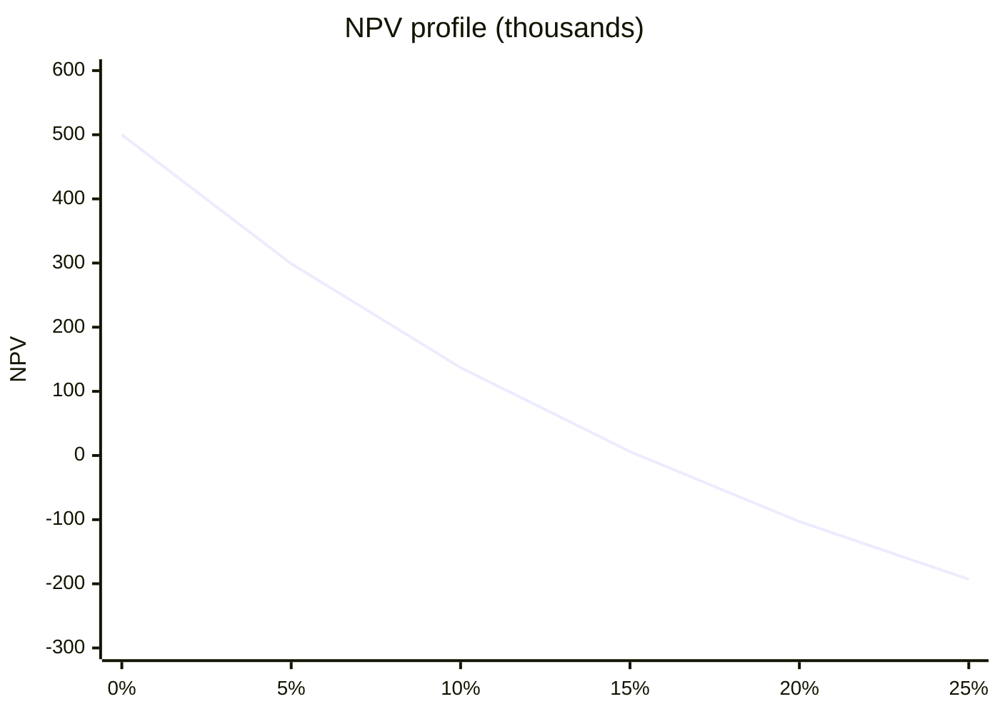

# Internal rate of return (IRR)

## Summary

The internal rate of return (IRR) is the discount rate at which an investment's net present value is zero: the annual return the project effectively pays on the money invested. A project is attractive if its IRR exceeds the cost of capital or a hurdle rate. IRR is popular because a percentage is easy to compare, but it ignores the size of projects, can produce several answers for unusual cash flows and implicitly assumes that interim cash can be reinvested at the same rate.

*This note is educational. It is not investment, tax or accounting advice.*

## Prerequisites

- [Net present value (NPV)](net-present-value.md)

## Core concepts

### Definition

IRR is the rate that solves:

```text
0 = sum over t = 0..n of  CF_t / (1 + IRR) ^ t
```

where CF_t is the cash flow at time t (negative for the initial investment). There is no closed-form solution for more than two periods, so it is found numerically, for example with the IRR function of a spreadsheet or a financial calculator.

### Analogy

IRR is like the interest rate a bank would have to pay on a savings account to match the investment's cash flows exactly. If the bank would pay more, keep the money in the bank.

### Mechanism

**Decision rule.**

| Comparison | Meaning | Action |
| --- | --- | --- |
| IRR above WACC (or hurdle rate) | The project earns more than the cost of money | Accept |
| IRR below WACC | It earns less than the cost of money | Reject |

**IRR and NPV.** IRR ranks efficiency; NPV measures value. They can conflict. A project with a 50% IRR that makes 10,000 is worse than a 15% IRR project that makes 1,000,000 in NPV, if only one can be chosen.

**Uses.**

- **Benchmarking with investors.** Venture capital and private equity funds often have target IRRs (for example 20% to 25%) and compare projects with stock market returns.
- **Margin of safety.** IRR 30% against WACC 10% leaves room for error; IRR 11% against WACC 10% leaves almost none.

**Traps.**

- **Reinvestment assumption.** IRR is often said to assume that interim cash is reinvested at the IRR itself; whether this is an assumption of the method or only of its interpretation is debated, but the practical point stands: if such returns are not available, the realized return is lower. The *modified IRR* (MIRR) uses an explicit reinvestment rate.
- **Scale.** IRR ignores project size.
- **Multiple IRRs.** If cash flows change sign more than once (for example a large outlay in year 3 to replace a machine), the equation can have two or more solutions, or none.

NPV as a function of the discount rate for the worked example. IRR is where the curve crosses zero.



## Worked example

```python
# Python 3.12. IRR by bisection, NPV profile and a two-IRR case.
def npv(rate, flows):
    return sum(cf / (1 + rate) ** t for t, cf in enumerate(flows))

def irr(flows, lo=-0.99, hi=1.0, tol=1e-7):
    for _ in range(200):
        mid = (lo + hi) / 2
        if npv(lo, flows) * npv(mid, flows) <= 0:
            hi = mid
        else:
            lo = mid
    return mid

project = [-1000, 300, 300, 300, 300, 300]
print("IRR: {:.2%}".format(irr(project)))
print([round(npv(r, project)) for r in (0, 0.05, 0.10, 0.15, 0.20, 0.25)])

odd = [-1000, 2300, -1320]              # cash flows change sign twice
print([abs(round(npv(r, odd), 2)) for r in (0.10, 0.20)])
```

Output:

```text
IRR: 15.24%
[500, 299, 137, 6, -103, -193]
[0.0, 0.0]
```

The project's IRR of about 15.2% exceeds a 10% cost of capital, so it is acceptable, consistent with its positive NPV. The second cash flow pattern has NPV zero at both 10% and 20%: two IRRs, so IRR cannot decide; use NPV.

## Trade offs and when to use it

IRR is intuitive and widely used by investors. Surveys of finance directors (Graham and Harvey, 2001) found that about three quarters always or almost always use IRR, a share similar to NPV. Use it alongside NPV, not instead of it, and switch to MIRR when reinvestment rates matter.

## Common mistakes

- **Choosing the highest IRR among mutually exclusive projects of different size.** Choose the highest NPV.
- **Using IRR when cash flows change sign several times.** Check for multiple IRRs and use NPV.
- **Comparing IRR with a rate of different risk.** Compare with the cost of capital for that project's risk.

## Practice

1. What is IRR in one sentence?
2. Project A: IRR 40%, NPV 20,000. Project B: IRR 18%, NPV 300,000. Only one can be done. Which?
3. What is MIRR for?

### Answers

1. The discount rate at which a project's NPV is zero.
2. B, because it adds more value.
3. To compute a return with an explicit reinvestment rate for interim cash flows.

## Further reading

- Brealey, R. A., Myers, S. C., Allen, F. et al. (2023). *Principles of Corporate Finance (14th ed.)*. McGraw Hill. IRR and its pitfalls.
- Graham, J. R., Harvey, C. R. (2001). The theory and practice of corporate finance: Evidence from the field. Journal of Financial Economics, 60(2-3), 187-243. [DOI](https://doi.org/10.1016/S0304-405X(01)00044-7). Survey of CFO practice.
