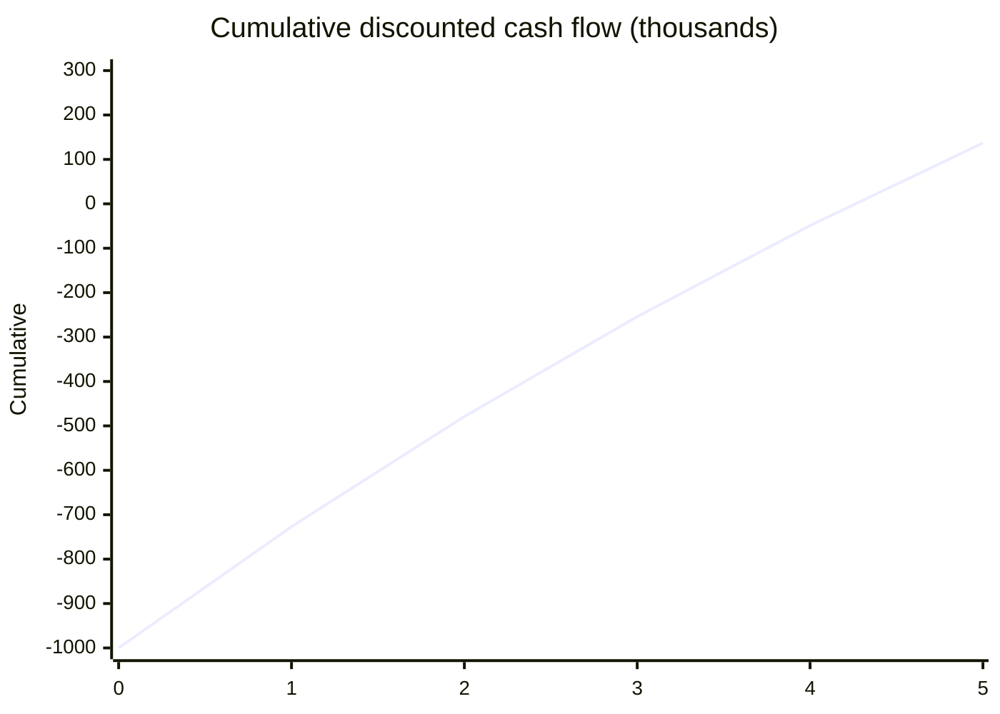

# Net present value (NPV)

## Summary

Net present value (NPV) is the difference between the present value of an investment's future cash inflows and the present value of its outflows, discounted at the required rate of return (often WACC). A positive NPV means the investment earns more than the cost of the capital it uses and adds that amount, in today's money, to the value of the firm. It gives a clear rule, accept if positive, and it is generally considered the most reliable capital budgeting method.

*This note is educational. It is not investment, tax or accounting advice.*

## Prerequisites

- [Time value of money](time-value-of-money.md)
- [Weighted average cost of capital (WACC)](wacc.md)

## Core concepts

### Definition

```text
NPV = sum over t = 1..n of  R_t / (1 + i) ^ t   -   I
```

- R_t: net cash flow in period t.
- i: discount rate (WACC or another required return reflecting the project's risk).
- n: number of periods.
- I: initial investment (outlay at time 0).

### Analogy

NPV is like asking, before buying a rental flat: if I add up all future rents and the sale price, each converted to today's money, how much more is that than what I pay today? A positive answer is wealth created; a negative one means a savings account at the same risk would have been better.

### Mechanism

**Decision rule.**

| NPV | Meaning | Action |
| --- | --- | --- |
| Above 0 | The project earns more than the cost of capital | Accept: it adds value |
| Equal to 0 | It earns exactly the cost of capital | Neutral |
| Below 0 | It earns less than the cost of capital | Reject: the money is better used elsewhere |

**NPV and IRR.** IRR gives a percentage, NPV an amount of money. NPV is generally preferred because value is created in money, not in percentages, and IRR can mislead when cash flows change sign more than once or when projects differ in size (see [Internal rate of return (IRR)](internal-rate-of-return.md)).

**Strategic uses.**

- **Mutually exclusive projects.** With 1 million to spend, project A may have a higher ROI (20%) and project B a lower one (15%), yet B may have a higher NPV because it is larger. Choose the higher NPV when only one can be done.
- **Accounting for risk.** Use a higher rate for risky projects (entering a new country) and a lower one for safe ones (expanding an existing product).

Cumulative discounted cash flow of the worked example. NPV is the end value.



## Worked example

```python
# Python 3.12. NPV of a project at 10%, cumulative discounted cash flow.
def npv(rate, outlay, flows):
    return -outlay + sum(cf / (1 + rate) ** t for t, cf in enumerate(flows, start=1))

flows = [300, 300, 300, 300, 300]
print(round(npv(0.10, 1000, flows), 1))

cum, run = [-1000], -1000
for t, cf in enumerate(flows, start=1):
    run += cf / 1.10 ** t
    cum.append(round(run))
print(cum)
print("at 16%:", round(npv(0.16, 1000, flows), 1))
```

Output:

```text
137.2
[-1000, -727, -479, -254, -49, 137]
at 16%: -17.7
```

At 10% the project adds about 137 thousand of value; at 16% it destroys value.

## Trade offs and when to use it

NPV uses all cash flows, accounts for time and risk and measures value created in money. It depends on forecasts and on the discount rate, and it does not show how much capital is tied up per unit of value, which matters when capital is rationed (then the profitability index, NPV divided by investment, helps).

## Common mistakes

- **Optimistic forecasts.** NPV is only as good as the cash flow forecast. Use scenarios and check against past projects.
- **Including sunk costs.** Money already spent is irrelevant; only future cash flows count.
- **Ignoring tax and inflation.** Use after-tax cash flows and keep nominal flows with nominal rates.

## Practice

1. An investment of 500 returns 200 a year for 3 years. Is it worth doing at 8%?
2. Why should sunk costs be excluded?

### Answers

1. NPV = 200 × 2.577 - 500 ≈ 15.4, positive, so yes.
2. They cannot be recovered whatever you decide, so they do not affect which choice is better.

## Further reading

- Brealey, R. A., Myers, S. C., Allen, F. et al. (2023). *Principles of Corporate Finance (14th ed.)*. McGraw Hill. NPV and the investment decision.
- Graham, J. R., Harvey, C. R. (2001). The theory and practice of corporate finance: Evidence from the field. Journal of Financial Economics, 60(2-3), 187-243. [DOI](https://doi.org/10.1016/S0304-405X(01)00044-7). How firms actually choose projects.
